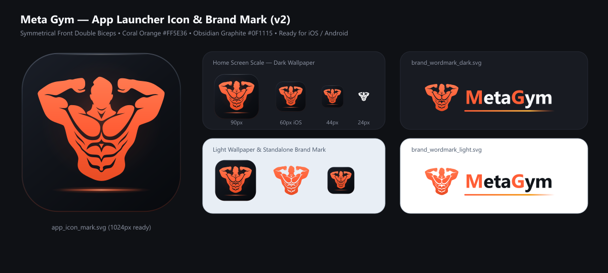

# Meta Gym — Bộ Biểu Tượng Ứng Dụng (App Launcher Icon Handoff cho Dev)

> **Phong cách:** Symmetrical Front Double Biceps • **Coral Orange** (`#FF7B52` → `#FF5E36` → `#E64A22`) trên nền **Obsidian Graphite** (`#191D26` → `#080A0E`) kèm quầng sáng ấm và tia ember mảnh phía dưới.
> **Nguồn vector gốc:** [`../svg/brand/app_icon_mark.svg`](../svg/brand/app_icon_mark.svg) & [`../svg/brand/brand_mark.svg`](../svg/brand/brand_mark.svg)



## 1. Danh sách tệp xuất chuẩn (`1024×1024 px`)

| Tệp | Kích thước | Mục đích sử dụng |
| :--- | :---: | :--- |
| [`meta_gym_app_icon_1024.png`](./meta_gym_app_icon_1024.png) | `1024×1024` | **iOS App Store & Android Legacy** (Full-bleed hình vuông, không bo góc cứng để hệ điều hành tự cắt squircle/circle). |
| [`meta_gym_app_icon_adaptive_fg_1024.png`](./meta_gym_app_icon_adaptive_fg_1024.png) | `1024×1024` | **Android Adaptive Icon — Foreground** (nền trong suốt, biểu tượng nằm gọn trong vùng an toàn `66%` trung tâm). |
| [`meta_gym_app_icon_monochrome_1024.png`](./meta_gym_app_icon_monochrome_1024.png) | `1024×1024` | **Android 13+ Themed Icon — Monochrome** (trắng thuần `#FFFFFF` trong vùng an toàn `66%`). |
| [`meta_gym_app_icon_squircle_1024.png`](./meta_gym_app_icon_squircle_1024.png) | `1024×1024` | **Web / Pitch Deck / Store Banner** (đã bo góc squircle chuẩn kèm viền specular mỏng). |
| [`../svg/brand/notification_small_monochrome.svg`](../svg/brand/notification_small_monochrome.svg) | `24×24` SVG | **Android Status Bar Notification Icon** (đơn sắc `#FFFFFF`, lược bớt nét mảnh để rõ nét ở `24dp`). |

## 2. Cấu hình mẫu cho Flutter Dev (`flutter_launcher_icons`)

Khi triển khai sang `mobile-app/`, copy 3 file PNG chính vào `mobile-app/assets/app_icon/` và dùng cấu hình:

```yaml
flutter_launcher_icons:
  android: true
  ios: true
  remove_alpha_ios: true
  image_path: "assets/app_icon/meta_gym_app_icon_1024.png"
  adaptive_icon_background: "#0F1115"
  adaptive_icon_foreground: "assets/app_icon/meta_gym_app_icon_adaptive_fg_1024.png"
  adaptive_icon_monochrome: "assets/app_icon/meta_gym_app_icon_monochrome_1024.png"
  web:
    generate: true
    image_path: "assets/app_icon/meta_gym_app_icon_1024.png"
    background_color: "#0F1115"
    theme_color: "#FF5E36"
```
