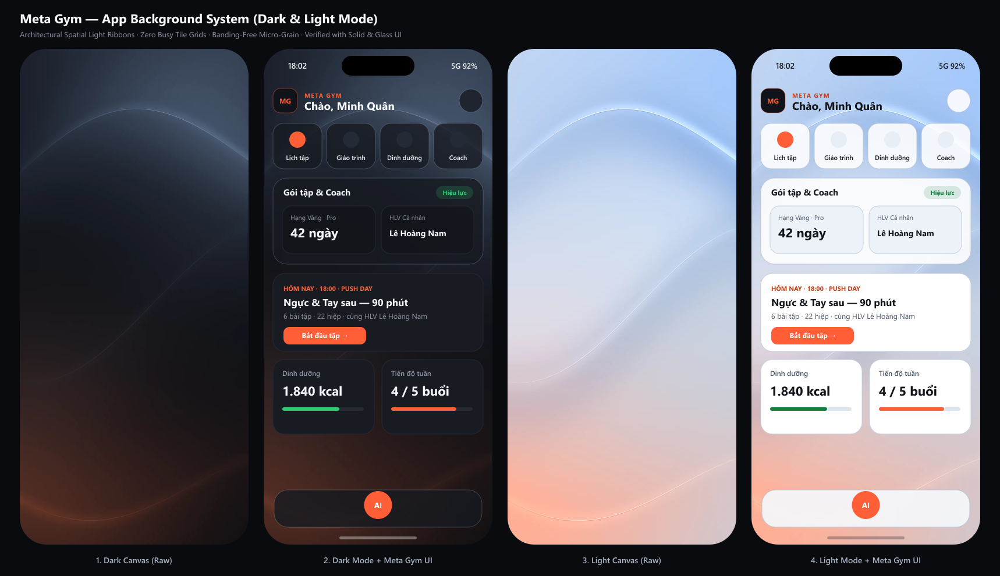

# Thư mục `images/backgrounds` — Hình nền Ứng dụng (Dark & Light) & Không gian Phòng Gym

## 0. Hình nền Ứng dụng Mobile chuẩn (Architectural Spatial Glass — Dark & Light Mode)

> **Phong cách:** Nền kiến trúc ánh sáng không gian (Spatial Light Ribbons) đồng bộ tuyệt đối giữa **Chế độ Tối** và **Chế độ Sáng**, bỏ hoàn toàn họa tiết ô lưới rối mắt cũ, có micro-grain chống banding trên màn OLED và siêu nhẹ cho 120fps.

| Tệp | Kích thước | Dung lượng | Mục đích & Tương phản |
| :--- | :---: | :---: | :--- |
| [`bg_app_dark.webp`](./bg_app_dark.webp) | `786×1704` (`2x`) | **11.0 KB** | **Dark Mode** — Deep Graphite `#0F1115` + dải sáng phản xạ lạnh `#A9C7E8` góc trên-phải & hơi ấm `#FF5E36` góc dưới-trái; vùng giữa giữ dịu để thẻ `#181B22` và kính blur 12px nổi khối rõ. |
| [`bg_app_light.webp`](./bg_app_light.webp) | `786×1704` (`2x`) | **15.4 KB** | **Light Mode** — Nền Titanium xanh da trời dịu phía trên-phải + dải phản xạ kính trắng sắc nét + ánh cam san hô hoàng hôn nhẹ góc dưới-trái; làm nổi khối rõ từng thẻ trắng `#FFFFFF` mà vẫn êm mắt. |
| [`../../svg/backgrounds/bg_luxury_dark.svg`](../../svg/backgrounds/bg_luxury_dark.svg) & [`bg_luxury_light.svg`](../../svg/backgrounds/bg_luxury_light.svg) | `393×852` SVG | `2.5 KB` | Bản vector siêu nhẹ dự phòng đồng bộ cùng ngôn ngữ đường cong ánh sáng. |

- **Gợi ý cho Flutter Dev:** Tải trước 2 ảnh `bg_app_dark.webp` & `bg_app_light.webp` bằng `precacheImage` ngay ở màn Splash, tự động đổi theo `Theme.of(context).brightness`, và dùng nền đặc `#0F1115` / `#E8EEF5` khi bật chế độ dự phòng hiệu năng / tắt ảnh nền (`DESIGN.md §12`).

---

## 1. Ảnh nền Không gian Phòng Gym (Desktop & Mobile)
- **Màn hình Đăng nhập / Đăng ký (`bg_exterior_*`):** `mobile-app/lib/features/auth/presentation/auth_glass_scaffold.dart`, `login_page.dart`, `register_page.dart` và trang đăng nhập `admin-web`.
- **Trang chủ Hội viên & Trung tâm Tập luyện (`bg_interior_*`):** `mobile-app/lib/features/member/presentation/member_dashboard_view.dart`, `member_training_hub_page.dart`, `meta_gym_glass_surface.dart`.
- **Trang chủ Huấn luyện viên (`bg_coach_home_*`):** `mobile-app/lib/features/coach/presentation/coach_home_page.dart`.

## 2. Mô tả thiết kế & Quy chuẩn kỹ thuật (`gym-space-bible.md`)
- **Bối cảnh:** 100% **Tầng trệt mặt đất (Ground-Floor Street-Level)** của studio flagship Meta Gym tại Việt Nam lúc chạng vạng (Blue-hour dusk).
  - **Trước phòng Gym (Zone 1):** Mặt tiền bê tông than chì, trần lam gỗ óc chó, bảng hiệu `MetaGym` (`M`, `G` cam `#FF5E36`), nhìn xuyên qua kính thấy quầy lễ tân đá đen nguyên khối và cổng QR check-in, phía trước là vỉa hè đá bazan và phố Việt Nam.
  - **Trong phòng Gym (Zone 2 & 3):** Khu tạ tự do (rack đen, bánh tạ viền cam mảnh, gương đèn hắt dọc ấm), cuối phòng là vách kính sọc mờ (Zone 5 Studio PT), bên phải là máy tập kháng lực cạnh cửa kính tầng trệt nhìn ra vỉa hè, cây xanh và phố ngang tầm mắt.
- **Bố cục UI-Safe Framing:** Chừa khoảng tối tự nhiên ở 25–30% đỉnh (trần/bầu trời tối) và 30% đáy (sàn cao su/vỉa hè đá đen) để chữ trắng `#F7F9FC` và các thẻ Glass đọc sắc nét.
- **Định dạng & Ngân sách dung lượng:** `.webp` (`quality: 82`), Desktop `1376×768` (`≤ 180 KB`), Mobile `768×1376` (`≤ 120 KB`).

## 3. Danh sách tệp trong thư mục
- `bg_exterior_desktop.webp` (`1376×768`, `125.9 KB`) — Trước phòng Gym (Desktop `16:9`).
- `bg_exterior_mobile.webp` (`768×1376`, `41.7 KB`) — Trước phòng Gym (Mobile `9:16`).
- `bg_interior_desktop.webp` (`1376×768`, `96.9 KB`) — Trong phòng Gym tầng trệt (Desktop `16:9`).
- `bg_interior_mobile.webp` (`768×1376`, `73.6 KB`) — Trong phòng Gym tầng trệt (Mobile `9:16`).
- `default.png`: Ảnh nền gốc đối chiếu.
