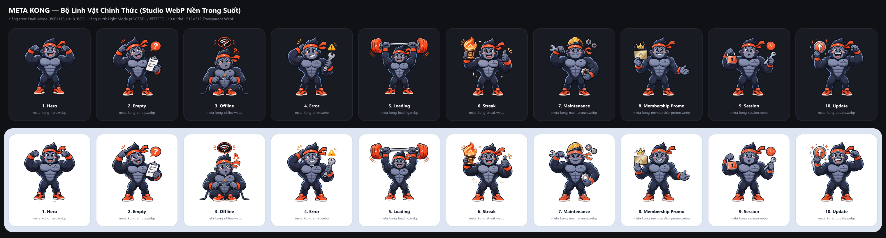

# META KONG — Bộ Linh Vật Chính Thức Meta Gym (Studio WebP Nền Trong Suốt)

> **Nhân vật:** **Meta Kong** — Chú khỉ đột thể hình thân thiện với dáng cơ bắp V-taper, logo `^ META GYM` trên ngực, băng trán & giày sneaker cam san hô `#FF5E36`, ánh sáng viền Cool Rim Light `#A9C7E8`.
> **Định dạng tối ưu cho Mobile (Flutter):** `512 × 512 px` **Transparent WebP** (`37–55 KB`/tệp), tách nền sạch sẵn — hiển thị sắc nét như nhau trên cả **Dark Mode (`#0F1115` / `#181B22`)** và **Light Mode (`#DCE5F1` / `#FFFFFF`)**, không cần render SVG nặng, load tức thì bằng `Image.asset(...)`.



## 1. Danh mục 10 tư thế chính thức

| STT | Tệp WebP | Kích thước | Ứng dụng trong App |
| :-: | :--- | :---: | :--- |
| 1 | [`meta_kong_hero.webp`](./meta_kong_hero.webp) | `512×512` (~40 KB) | **Hero / Brand Pose (Flex Double Biceps):** Banner chào mừng, Đăng nhập, Trợ lý AI Meta Gym. |
| 2 | [`meta_kong_empty.webp`](./meta_kong_empty.webp) | `512×512` (~46 KB) | **Empty State (Danh sách trống):** Chưa có lịch tập, nhật ký dinh dưỡng hay thông báo — cầm clipboard + bong bóng `?`. |
| 3 | [`meta_kong_offline.webp`](./meta_kong_offline.webp) | `512×512` (~48 KB) | **Offline State (Mất mạng):** Ngồi cầm 2 đầu phích cắm tách rời + huy hiệu mất Wi-Fi. |
| 4 | [`meta_kong_error.webp`](./meta_kong_error.webp) | `512×512` (~47 KB) | **Error State (Lỗi / Thử lại):** Cười gượng nhẹ + giọt mồ hôi + cầm cờ-lê + tam giác cảnh báo. |
| 5 | [`meta_kong_loading.webp`](./meta_kong_loading.webp) | `512×512` (~51 KB) | **Loading State (Đang tải dữ liệu):** Đẩy tạ đòn cam san hô qua đầu kèm vệt chuyển động. |
| 6 | [`meta_kong_streak.webp`](./meta_kong_streak.webp) | `512×512` (~54 KB) | **Streak / Achievement (Chúc mừng Thành tựu):** Nâng cúp lửa chuỗi ngày tập + giơ ngón cái cổ vũ. |
| 7 | [`meta_kong_maintenance.webp`](./meta_kong_maintenance.webp) | `512×512` (~55 KB) | **System Maintenance (Hệ thống đang bảo trì):** Đội mũ bảo hộ vàng + vác cờ-lê + bánh răng nâng cấp máy chủ. |
| 8 | [`meta_kong_update.webp`](./meta_kong_update.webp) | `512×512` (~51 KB) | **App Update (Có bản cập nhật mới):** Giơ cao huy hiệu mũi tên nâng cấp (`↑`) + nắm đấm hào hứng. |
| 9 | [`meta_kong_session.webp`](./meta_kong_session.webp) | `512×512` (~48 KB) | **Session Expired (Phiên đăng nhập hết hạn):** Cầm ổ khóa bảo mật + chìa khóa + đồng hồ hết phiên. |
| 10 | [`meta_kong_membership_promo.webp`](./meta_kong_membership_promo.webp) | `512×512` (~52 KB) | **Membership Promo (Mời gọi mua gói tập VIP):** Trao thẻ Vàng VIP + vương miện lấp lánh mời hội viên nâng hạng. |

## 2. Cách nhúng chuẩn trong Flutter

```dart
Image.asset(
  'assets/images/mascot/meta_kong_empty.webp',
  width: 148,
  height: 148,
  fit: BoxFit.contain,
)
```

- Không áp `ColorFilter` đảo màu khi chuyển Light/Dark Mode.
- Kích thước đề xuất: **`136–164 dp`** cho Modal / Empty State toàn màn hình, **`48–78 dp`** cho Banner / Danh sách trạng thái.

## 3. Công cụ tách nền tự động cho các tư thế Meta Kong mới

Thuật toán tách nền kín viền v3 (chống lẹm đồ vật tối màu, sạch bóng đế giày, sạch viền đen quanh tia sáng bay) đã được lưu cố định tại [`scripts/cutout_mascot.js`](./scripts/cutout_mascot.js).

```powershell
# Tách nền 1 ảnh mới sang WebP 512x512 trong suốt (kèm ảnh nền caro soi viền):
node design-system/meta-gym/assets/images/mascot/scripts/cutout_mascot.js "<anh-goc.jpg>" "design-system/meta-gym/assets/images/mascot/meta_kong_<ten>.webp" --audit

# Nếu ảnh có đồ vật đồng/kim loại tối (như cúp đồng) hoặc huy hiệu tối phía trên:
#   --no-holes                         (không đục lỗ kín bên trong nhân vật)
#   --protect-top-badge                (giữ nền tối bên trong huy hiệu tròn phía trên)
#   --seal-box=0.14,0.21,0.31,0.39     (khóa kín vùng đồ vật theo tọa độ tỉ lệ 0..1)

# Dựng lại bảng tổng quan Dark + Light Mode sau khi thêm tư thế mới:
node design-system/meta-gym/assets/images/mascot/scripts/cutout_mascot.js --sheet
```

