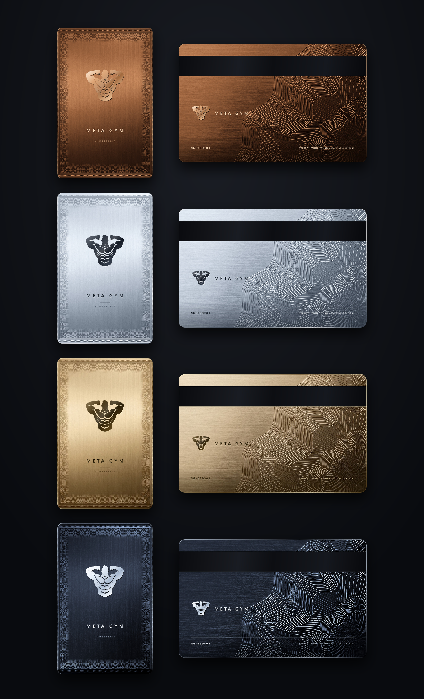

# Meta Gym — Ultra Luxury Permanent Membership Card Collection

> **Quy chuẩn thiết kế:** Quiet Luxury · Thẻ vật lý vĩnh viễn có thể tái kích hoạt/gia hạn nhiều năm · Chuẩn kích thước **CR80 / ISO ID-1** (`85.60 × 53.98 mm` — Dọc `900×1426 px` & Ngang `1426×900 px`).
> **Biểu tượng nhận diện:** Giữ nguyên 100% đường nét giải phẫu logo **Front Double Biceps** nguyên bản, hoàn thiện ép kim / khắc laser **kim loại đồng bộ theo từng hạng thẻ** (Đồng ánh đồng đỏ · Titanium xám đen khắc sâu · Vàng cổ điển khắc chìm · Bạch kim sáng trên Obsidian).
> **Tuyệt đối không in:** Chip EMV/ngân hàng, số thẻ tín dụng, CVV, tên hội viên, ngày hết hạn, giá gói, mã QR hay chữ hạng thẻ quá khổ.

## 1. Bộ sưu tập 4 Hạng Thẻ × 2 Mặt (8 Tệp Chuẩn — Đồng bộ ngôn ngữ Guilloché Haute Horlogerie)

| Hạng thẻ | Chất liệu kim loại & Hoàn thiện Logo | Hoa văn Guilloché & Clous de Paris đồng bộ | Mặt trước (Dọc CR80) | Mặt sau (Ngang CR80 + Dải từ) | Serial mẫu |
| :--- | :--- | :--- | :--- | :--- | :---: |
| **Hạng Đồng (Bronze)** | Antique Brushed Bronze · Logo ép kim đồng ánh hồng | Viền hạt Clous de Paris & sóng Guilloché đồng cổ ấm | [`card_bronze.jpg`](./card_bronze.jpg) | [`card_bronze_horizontal.jpg`](./card_bronze_horizontal.jpg) | `MG-000101` |
| **Hạng Bạc (Silver)** | Brushed Sterling Titanium · Logo khắc laser titanium xám đậm | Viền hạt Clous de Paris & sóng Guilloché bạc titanium mát | [`card_silver.jpg`](./card_silver.jpg) | [`card_silver_horizontal.jpg`](./card_silver_horizontal.jpg) | `MG-000201` |
| **Hạng Vàng (Gold)** | Satin Champagne Gold · Logo khắc sâu vàng cổ điển | Viền hạt Clous de Paris & sóng Guilloché vàng champagne *(chuẩn gốc)* | [`card_gold.jpg`](./card_gold.jpg) | [`card_gold_horizontal.jpg`](./card_gold_horizontal.jpg) | `MG-000301` |
| **Hạng Kim Cương (Diamond)** | Matte Obsidian Platinum · Logo khảm bạch kim sáng | Viền Clous de Paris & sóng Guilloché ánh bạch kim / xanh băng trên nền Obsidian đen nhám | [`card_diamond.jpg`](./card_diamond.jpg) | [`card_diamond_horizontal.jpg`](./card_diamond_horizontal.jpg) | `MG-000401` |

## 2. Quy tắc bố cục thống nhất toàn bộ sưu tập
- **Mặt trước (Dọc — Portrait):** Biểu tượng Meta Gym ép kim/khắc kim loại đồng bộ theo từng hạng thẻ là tâm điểm chính giữa, phía dưới là dòng chữ **`META GYM`** giãn chữ tinh tế + đường kẻ mảnh + nhãn phụ nhỏ **`MEMBERSHIP`**. Không in chữ `BRONZE / SILVER / GOLD / DIAMOND` lớn — nhận diện hạng thẻ hoàn toàn bằng màu kim loại, chất liệu và ánh phản chiếu.
- **Mặt sau (Ngang — Landscape):** Dải từ màu đen satin chức năng chạy ngang phần trên; bên dưới giữ nguyên bề mặt & hoa văn khắc tiếp nối từ mặt trước, kèm logo Meta Gym nhỏ + `META GYM`, số serial thẻ vĩnh viễn (`MG-000xxx`) góc trái dưới và dòng `VALID AT PARTICIPATING META GYM LOCATIONS` góc phải dưới.

## 3. Vị trí sử dụng trên App & Studio
- **Trang chủ Hội viên (`1.1`) & Chưa đăng ký (`1.2b`):** Bộ quạt thẻ dọc (`card_bronze.jpg`, `card_silver.jpg`, `card_gold.jpg`, `card_diamond.jpg`).
- **Gói tập đang hiệu lực (`1.2a`), Checkout (`1.2c`) & Modal kích hoạt:** Thẻ ngang CR80 (`card_*_horizontal.jpg`).
- **Bảng tổng hợp trình diễn (4 hàng × 2 cột):** [`membership_collection_presentation.png`](./membership_collection_presentation.png).
