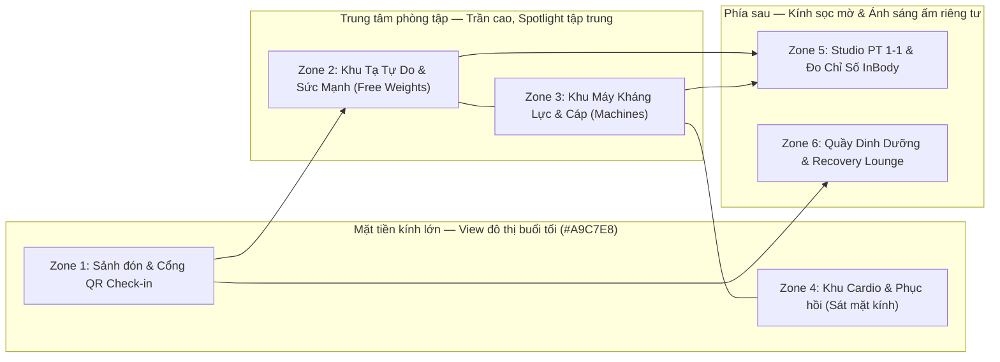

# Meta Gym — Hồ sơ Không gian & Bối cảnh Cửa hàng (Space & Visual Bible)

> **Mục đích:** Định nghĩa cố định không gian vật lý ảo, kiến trúc, ánh sáng, bố trí mặt bằng và nhân vật của **Meta Gym Flagship Studio**. Mọi hình ảnh được Agent (`image-generator`) hoặc PD tạo ra cho Mobile App & Admin Web **bắt buộc** tuân theo hồ sơ này để toàn bộ ứng dụng nhìn như được chụp trong **cùng một phòng tập thật, cùng một thời điểm ánh sáng và cùng một ống kính**.
>
> **Tham chiếu chuẩn:** [`../../DESIGN.md`](../../DESIGN.md) (**Futuristic Performance Glass**), [`MASTER.md`](./MASTER.md), [`mobile-assets-inventory.md`](./mobile-assets-inventory.md).

---

## 1. Tổng quan Kiến trúc & Vật liệu (Architectural DNA)

- **Mô hình không gian:** **Boutique Flagship Fitness Studio 1 tầng trệt mặt đất (Ground-Floor Street-Level)**, mặt bằng rộng, trần cao (`~4.5m`) tại khu đô thị hiện đại Việt Nam.
- **Tính nhất quán độ cao (Bắt buộc):** Vì mặt tiền phòng tập nằm ở **tầng trệt tiếp giáp vỉa hè**, nên ở **MỌI góc chụp bên trong nhìn qua cửa kính ra ngoài**, khung cảnh bên ngoài kính **bắt buộc phải ở tầm mặt đất (street-level)** — thấy vỉa hè đá bazan tối, bồn cây xanh/cọ cảnh sát mặt tiền, ánh đèn đường và bóng phố mờ ảo ngang tầm mắt. **Tuyệt đối không** tạo cảnh nhìn từ tầng cao hay đường chân trời chung cư trên cao (`no high-rise view, no elevated skyline`).
- **Thời điểm ánh sáng mặc định:** **Chạng vạng / Buổi tối (Blue-hour dusk / Evening)** — ánh xanh lạnh mờ từ thành phố ngoài mặt kính lớn (`#A9C7E8`) cân bằng với ánh đèn hắt kiến trúc ấm bên trong (`#FF5E36` / `#F5B041`).
- **Hệ vật liệu xuyên suốt (không thay đổi giữa các ảnh):**
  - **Tường chính:** Bê tông kiến trúc hoàn thiện mờ màu than chì đậm (`#181B22` – `#0F1115`), xen kẽ các mảng lam gỗ óc chó tối màu (dark walnut slats) tạo cảm giác sang trọng, ấm áp nhưng kỷ luật.
  - **Trần:** Trần kỹ thuật sơn đen mờ hoàn toàn, tích hợp rãnh đèn LED tuyến tính ẩn (recessed linear lighting) và đèn spotlight rọi điểm xuống từng khu thiết bị.
  - **Vách ngăn & Kính:** Kính cường lực khổ lớn full-height nhìn ra phố và vách kính sọc mờ (fluted frosted glass) khung thép đen mờ ngăn khu PT 1-1.
  - **Sàn:** Sàn cao su EPDM đen mờ chống sốc cho khu tập tạ/máy; sàn đá bazan tối màu nhám mờ cho sảnh đón, lối đi và quầy dinh dưỡng.
  - **Ánh sáng điểm nhấn (5–10% khung hình):** Chỉ dùng dải đèn hắt ấm tinh tế (`#FF5E36` / `#F5B041`) tại logo tường, khe chân gương và chi tiết nhận diện tối giản. **Tuyệt đối không** dùng đèn neon tím/xanh dương/hồng kiểu cyberpunk hay gaming.

---

## 2. Sơ đồ Bố trí Mặt bằng Cửa hàng (Floor Plan Concept)

Khi tạo ảnh ở bất kỳ phân khu nào, Agent cần tôn trọng **tính liên kết chiều sâu** giữa các khu theo sơ đồ mặt bằng sau:

- **Đứng ở Zone 1 (Sảnh)** nhìn vào trong thấy thấp thoáng **Zone 2 (Khu Tạ)** và bên cạnh là **Zone 6 (Nutrition Bar)**.
- **Đứng ở Zone 2 (Khu Tạ)** nhìn sang thấy **Zone 3 (Máy tập)** và vách kính sọc mờ của **Zone 5 (Studio PT 1-1)**.
- **Đứng ở Zone 4 (Cardio)** một bên là mặt kính lớn nhìn ra ánh đèn thành phố mờ ảo, một bên hướng về **Zone 3 (Máy tập)**.

---

## 3. Miêu tả Chi tiết 6 Phân khu & Mapping tới Asset App

### Zone 1 — Mặt tiền & Sảnh Check-in QR (`Reception & Smart Gate`)
- **Bối cảnh:** Quầy lễ tân đá đen nguyên khối thiết kế vát góc hiện đại; phía sau là vách bê tông than chì kết hợp lam gỗ sẫm gắn chữ nổi **MetaGym** phát sáng hắt chân chữ (chữ `M` và `G` ánh cam `#FF5E36`, các chữ còn lại trắng lạnh `#F7F9FC`). Kế bên là cổng kiểm soát kính thấp kèm trụ quét mã QR tối giản.
- **Áp dụng cho Asset:** `bg_auth`, `explore_gym_intro`, minh họa bối cảnh điểm danh QR.

### Zone 2 — Khu Tạ Tự Do & Sức Mạnh (`Free Weights & Power Zone`)
- **Bối cảnh:** Không gian rộng trung tâm với dãy power rack thép đen mờ thẳng hàng, giá tạ đơn bọc cao su đen sắp xếp gọn gàng, tạ đĩa đen khắc viền/số màu `#FF5E36` rất mảnh. Dọc tường là gương lớn sát trần có đường đèn hắt ấm dịu hai bên cạnh, sàn cao su đen mờ sạch sẽ.
- **Áp dụng cho Asset:** `bg_member_home`, `coach_cover_strength`, `membership_featured_cover`.

### Zone 3 — Khu Máy Kháng Lực & Cáp (`Selectorized Machines & Cable Zone`)
- **Bối cảnh:** Dãy máy tập khung thép đen mờ (matte charcoal/graphite), đệm da đen cao cấp không logo lòe loẹt, khoảng cách giữa các máy thoáng rộng. Mỗi máy được tách khối rõ nhờ đèn spotlight từ trần rọi xuống, nền phía sau tối và có độ mờ tự nhiên (shallow depth of field).
- **Áp dụng cho Asset:** `images/catalog/*` (ảnh thiết bị máy tập & thumbnail bài tập).

### Zone 4 — Khu Cardio & Phục Hồi (`Cardio & Recovery Zone`)
- **Bối cảnh:** Dãy máy chạy bộ và xe đạp công thái học đen mờ đặt dọc sát vách kính cường lực cao sát trần nhìn ra ánh đèn đô thị mờ ảo lúc chạng vạng. Liền kề là góc giãn cơ & phục hồi với thảm tập đen xám, con lăn foam roller gọn gàng, ánh sáng dịu nhẹ hơn khu tạ.
- **Áp dụng cho Asset:** `bg_training_hub`, `explore_beginner_guide`, bối cảnh ngày nghỉ/phục hồi.

### Zone 5 — Studio PT 1-1 & Đo Chỉ Số (`Private Coaching & Assessment Studio`)
- **Bối cảnh:** Không gian bán riêng tư được ngăn bằng vách kính sọc mờ (fluted glass) khung thép đen. Bên trong có khu vực huấn luyện 1-1 gọn gàng (tạ ấm, giàn kéo đa năng nhỏ), máy phân tích chỉ số cơ thể tối giản và khu vực trao đổi lộ trình với màn hình/tablet. Không khí tập trung, tin cậy, chuyên nghiệp.
- **Áp dụng cho Asset:** `bg_coach_home`, `coach_cover_1on1`, `coach_cover_transformation`, `coach_avatar_fallback`.

### Zone 6 — Quầy Dinh Dưỡng & Lounge (`Nutrition Bar & Recovery Lounge`)
- **Bối cảnh:** Quầy bar mặt đá bazan đen nhám, phía trên là cụm đèn thả tối giản ánh sáng ấm rọi trực tiếp xuống mặt quầy. Trình bày các phần ăn eat-clean (ức gà, cá hồi, rau xanh, ngũ cốc) trong bát/đĩa gốm đen mờ hoặc ly protein shake thủy tinh trong suốt, không bày biện rườm rà.
- **Áp dụng cho Asset:** `images/nutrition/*` (`food_placeholder` & ảnh món ăn mẫu).

---

## 4. Quy chuẩn Con người, Đồng phục & Đạo cụ

- **Nhân vật:** Người **Việt Nam / Đông Nam Á** hiện đại (23–35 tuổi), thể hình cân đối khỏe khoắn tự nhiên, biểu cảm tập trung tích cực. Không tạo dáng gồng cơ phô trương hay bóng dầu kiểu bodybuilding cũ.
- **Đồng phục HLV (Coach):**
  - Áo polo hoặc áo tập thể thao ôm vừa vặn màu **đen charcoal / xám graphite**, có điểm nhấn nhỏ màu `#FF5E36` (viền cổ mảnh hoặc ký hiệu nhỏ bên ngực trái).
  - Quần jogger/short thể thao đen mờ, giày tập tối màu.
  - Phong thái: chuyên nghiệp, đang quan sát kỹ thuật, chỉnh tư thế hoặc trao đổi cùng hội viên trên tablet.
- **Trang phục Hội viên (Member):**
  - Đồ tập tối giản tông trung tính (đen, xám tro, be sẫm, trắng ngà), không họa tiết rối mắt hoặc chữ in lớn.
- **Đạo cụ & Thiết bị:**
  - Mọi thiết bị tập luyện đều cùng ngôn ngữ **matte black / dark graphite**, đệm đen, chi tiết kim loại xước hoặc điểm nhấn cam `#FF5E36` cực tiết chế.

---

## 5. Quy chuẩn Ống kính, Bố cục & Prompt Consistency Lock cho Agent

### A. Bố cục thân thiện với UI (UI-Safe Framing)
- **Với ảnh nền (`bg_*`):** Chừa khoảng tối/ít chi tiết ở 30% trên và 35% dưới khung hình để chữ trắng `#F7F9FC` và các thẻ Glass đọc rõ sau khi phủ scrim `72–84%`.
- **Với ảnh Cover (`explore_*`, `coach_cover_*`, `membership_*`):** Chủ thể đặt lệch tâm nhẹ (quy tắc 1/3) để chừa khoảng trống tối cho tiêu đề hoặc pill trạng thái.
- **Với ảnh Thiết bị / Món ăn (`catalog/*`, `nutrition/*`):** Chủ thể ở chính giữa, tách nền gọn gàng nhờ spotlight từ trên xuống trên phông `#181B22` mờ nhẹ.

### B. Tiền tố Prompt Chuẩn (Master Prompt Prefix — bắt buộc ghép đầu mọi prompt tạo ảnh Meta Gym)
*(Giữ nguyên bản tiếng Anh để AI tạo ảnh hiểu chính xác nhất; bản dịch tiếng Việt ở ngay bên dưới để dễ đối chiếu.)*

> `Editorial architectural fitness photography inside Meta Gym flagship boutique studio in Vietnam, high-ceiling dark matte charcoal concrete walls, dark walnut wood slats, brushed dark steel and fluted frosted glass accents, deep graphite matte rubber floor, blue-hour evening city light subtly reflecting cool steel-blue (#A9C7E8) on large windows balanced with restrained warm amber-coral (#FF5E36) architectural indirect cove lighting, luxury modern minimalist performance atmosphere, shot on 35mm lens f/2.8, realistic textures, crisp natural shadows, clean composition with dark negative space for UI readability.`

- **Nghĩa tiếng Việt:** Ảnh chụp kiến trúc phòng tập phong cách tạp chí bên trong studio boutique flagship Meta Gym tại Việt Nam; trần cao, tường bê tông than chì mờ, lam gỗ óc chó sẫm, điểm nhấn thép tối xước và kính sọc mờ, sàn cao su đen than chì; ánh sáng thành phố lúc chạng vạng phản chiếu sắc xanh thép lạnh dịu (`#A9C7E8`) trên vách kính lớn, cân bằng với ánh đèn hắt kiến trúc ấm tông hổ phách–cam san hô (`#FF5E36`) tiết chế; không khí tập luyện hiệu suất cao tối giản và sang trọng; ống kính 35mm f/2.8, chất liệu chân thực, đổ bóng tự nhiên sắc nét, bố cục gọn gàng có khoảng tối trống để đặt chữ UI dễ đọc.

### C. Chặn lỗi hình ảnh (Negative Prompt — bắt buộc chặn)
> `no high-rise window view, no elevated floor skyline, no upper-story penthouse view, no cyberpunk, no purple or magenta or cyan neon lights, no rainbow RGB strips, no cluttered gym floor, no bright white hospital lighting, no cheap CGI plastic look, no exaggerated oily bodybuilding poses, no distorted hands or anatomy, no readable random text, no watermarks, no cluttered brand logos.`

- **Nghĩa tiếng Việt:** Không góc nhìn từ tầng cao hay đường chân trời trên cao (bắt buộc tầng trệt mặt đất), không cyberpunk, không đèn neon tím/hồng/xanh lơ, không dải LED RGB cầu vồng, không sàn tập bừa bộn, không ánh sáng trắng chói kiểu bệnh viện, không cảm giác đồ họa 3D giả nhựa, không tạo dáng gồng cơ bôi dầu quá đà, không lỗi bàn tay/giải phẫu, không chữ vô nghĩa, không watermark, không logo thương hiệu lộn xộn.

### D. Đoạn mô tả nhanh theo từng Phân khu (Zone Snippets — ghép sau Master Prompt Prefix)
- **Zone 1 (Sảnh & Check-in):**
  - *Prompt:* `minimalist monolithic black stone reception desk, subtle warm backlit MetaGym architectural wall behind, sleek glass QR check-in gate`
  - *Tiếng Việt:* Quầy lễ tân đá đen nguyên khối tối giản, phía sau là vách kiến trúc gắn chữ nổi MetaGym hắt sáng ấm tinh tế, kèm cổng kính quét QR check-in hiện đại.
- **Zone 2 (Tạ tự do):**
  - *Prompt:* `aligned matte-black power racks and dumbbell racks, black weight plates with subtle coral-orange ring accents, floor-to-ceiling mirrors with soft vertical warm edge lighting`
  - *Tiếng Việt:* Dãy khung gánh tạ và giá tạ đơn đen mờ xếp thẳng hàng, bánh tạ đen có viền vòng cam san hô mảnh tinh tế, gương cao sát trần hắt sáng dọc ấm dịu.
- **Zone 3 (Máy kháng lực):**
  - *Prompt:* `row of modern matte-charcoal selectorized strength machines with black leather padding, focused overhead gallery spotlights isolating each machine against a moody dark background`
  - *Tiếng Việt:* Hàng máy tập kháng lực hiện đại khung than chì mờ đệm da đen, đèn spotlight trần rọi tập trung tách nổi từng máy trên nền tối có chiều sâu.
- **Zone 4 (Cardio & Phục hồi):**
  - *Prompt:* `sleek dark treadmills and ergonomic bikes facing ground-floor street-level glass windows overlooking dark basalt sidewalk, lush tropical planter foliage, and soft-focus evening urban street bokeh at eye level, calm dark recovery stretching mat area nearby`
  - *Tiếng Việt:* Dãy máy chạy bộ và xe đạp công thái học tối màu đặt hướng ra vách kính tầng trệt nhìn ra vỉa hè đá bazan, bồn cây xanh nhiệt đới và ánh đèn phố buổi tối mờ ảo ngang tầm mắt, cạnh đó là khu thảm giãn cơ phục hồi yên tĩnh.
- **Zone 5 (Studio PT 1-1):**
  - *Prompt:* `semi-private personal training studio framed by fluted frosted glass panels, Vietnamese fitness coach in matte charcoal athletic polo with tiny coral-orange chest accent guiding a Vietnamese member in neutral sportswear on proper form`
  - *Tiếng Việt:* Phòng tập PT bán riêng tư ngăn bằng vách kính sọc mờ; HLV người Việt mặc áo polo thể thao màu than chì có điểm nhấn cam san hô nhỏ ở ngực đang hướng dẫn kỹ thuật cho hội viên người Việt mặc đồ tập trung tính.
- **Zone 6 (Quầy Dinh dưỡng):**
  - *Prompt:* `matte black basalt stone nutrition counter under warm minimalist pendant lights, healthy balanced meal bowl in matte dark ceramic dish and clean glass protein shake, editorial food lighting`
  - *Tiếng Việt:* Quầy dinh dưỡng đá bazan đen mờ dưới cụm đèn thả tối giản ánh sáng ấm, bát đồ ăn lành mạnh cân bằng trên đĩa gốm tối màu và ly protein shake thủy tinh trong suốt, ánh sáng chụp ẩm thực chuyên nghiệp.
