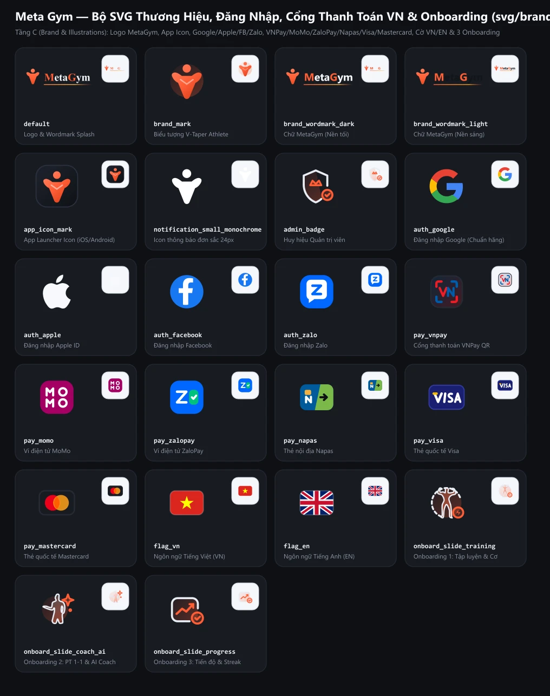

# Bản Review & Xem Trước: Thương Hiệu, Đăng Nhập, Cổng Thanh Toán VN, Cờ & Onboarding (`svg/brand/`) (22 SVG)

## 1. Đánh Giá Kiểm Duyệt Chất Lượng (Rubric 5 Tiêu Chí — Đạt `9.6/10`)
- **Style Fidelity (`2/2`):** Đồng bộ ngôn ngữ **MetaGym Soft-Line Duotone**, nét mở `2.2px` bo tròn, lớp ửng gradient mềm và huy hiệu điểm nhấn `#FF5E36`.
- **Object Construction (`2/2`):** Chi tiết định danh đặc trưng rõ ràng, nhận diện tức thì ở cả kích thước `2x` (`82px`) trên nền tối `#181B22` lẫn `1x` (`34px`) trên ô nền sáng `#F5F7FA`.
- **Knockout & Badge Harmony (`1.8/2`):** Huy hiệu hành động đặt đúng trọng tâm góc, không đè nét rối mắt.
- **Composition & Safe Margin (`1.8/2`):** Căn tâm chuẩn xác, lề thoáng `≥ 4px`.
- **Technical SVG Lint (`2/2`):** `0` thẻ cấm, `100%` ID gradient có tiền tố riêng, dung lượng siêu nhẹ.

## 2. Bảng Danh Mục Chi Tiết 22 Icon Trong `assets/svg/brand/`

| STT | `assetKey` | Têp SVG | Tầng | `viewBox` | Dung lượng | Ý nghĩa & Vị trí sử dụng |
| :-: | :--- | :--- | :-: | :-: | :-: | :--- |
| 1 | `admin_badge` | [`admin_badge.svg`](../assets/svg/brand/admin_badge.svg) | Tầng B/C | `48×48` | `1.05 KB` | Huy hiệu cổng Quản trị viên (Khiên bảo vệ + Vương miện & Bánh răng) |
| 2 | `app_icon_mark` | [`app_icon_mark.svg`](../assets/svg/brand/app_icon_mark.svg) | Tầng C | `512×512` | `10.30 KB` | Biểu tượng Front Double Biceps đóng khung squircle Obsidian xuất App Launcher Icon (iOS/Android) — kèm PNG `1024px` tại [`../assets/app-icon/`](../assets/app-icon/README.md) |
| 3 | `auth_apple` | [`auth_apple.svg`](../assets/svg/brand/auth_apple.svg) | Tầng C | `48×48` | `0.69 KB` | Đăng nhập thương hiệu Apple ID (Chuẩn hình học chính hãng) |
| 4 | `auth_facebook` | [`auth_facebook.svg`](../assets/svg/brand/auth_facebook.svg) | Tầng C | `48×48` | `0.41 KB` | Đăng nhập thương hiệu Facebook (Chuẩn hình học chính hãng) |
| 5 | `auth_google` | [`auth_google.svg`](../assets/svg/brand/auth_google.svg) | Tầng C | `48×48` | `0.75 KB` | Đăng nhập thương hiệu Google (Chuẩn hình học 4 màu chính hãng) |
| 6 | `auth_zalo` | [`auth_zalo.svg`](../assets/svg/brand/auth_zalo.svg) | Tầng C | `48×48` | `0.49 KB` | Đăng nhập thương hiệu Zalo (Chuẩn thị trường Việt Nam) |
| 7 | `brand_mark` | [`brand_mark.svg`](../assets/svg/brand/brand_mark.svg) | Tầng C | `512×512` | `7.64 KB` | Biểu tượng Front Double Biceps Athlete độc lập nền trong suốt (Header / Avatar / Adaptive Foreground) |
| 8 | `brand_wordmark_dark` | [`brand_wordmark_dark.svg`](../assets/svg/brand/brand_wordmark_dark.svg) | Tầng C | `240×80` | `6.20 KB` | Biểu tượng + Chữ MetaGym chuẩn trên nền tối #0F1115 / #181B22 |
| 9 | `brand_wordmark_light` | [`brand_wordmark_light.svg`](../assets/svg/brand/brand_wordmark_light.svg) | Tầng C | `240×80` | `6.20 KB` | Biểu tượng + Chữ MetaGym chuẩn trên nền sáng #F5F7FA / #FFFFFF |
| 10 | `default` | [`default.svg`](../assets/svg/brand/default.svg) | Tầng C | `240×80` | `6.20 KB` | Tổ hợp Logo Front Double Biceps Athlete + Wordmark MetaGym (Màn hình Splash) |
| 11 | `flag_en` | [`flag_en.svg`](../assets/svg/brand/flag_en.svg) | Tầng C | `48×48` | `0.76 KB` | Quốc kỳ Vương quốc Anh (Chọn ngôn ngữ Tiếng Anh) |
| 12 | `flag_vn` | [`flag_vn.svg`](../assets/svg/brand/flag_vn.svg) | Tầng C | `48×48` | `0.38 KB` | Quốc kỳ Việt Nam (Chọn ngôn ngữ Tiếng Việt / Quốc gia) |
| 13 | `notification_small_monochrome` | [`notification_small_monochrome.svg`](../assets/svg/brand/notification_small_monochrome.svg) | Tầng C | `24×24` | `4.34 KB` | Icon thông báo nhỏ đơn sắc (Monochrome `#FFFFFF`) trên thanh trạng thái |
| 14 | `onboard_slide_coach_ai` | [`onboard_slide_coach_ai.svg`](../assets/svg/brand/onboard_slide_coach_ai.svg) | Tầng C | `48×48` | `1.99 KB` | Minh họa Onboarding 2: HLV 1-1 & Trợ lý AI Coach (Pose #14) |
| 15 | `onboard_slide_progress` | [`onboard_slide_progress.svg`](../assets/svg/brand/onboard_slide_progress.svg) | Tầng C | `48×48` | `1.20 KB` | Minh họa Onboarding 3: Theo dõi tiến độ, dinh dưỡng & chuỗi kỷ luật |
| 16 | `onboard_slide_training` | [`onboard_slide_training.svg`](../assets/svg/brand/onboard_slide_training.svg) | Tầng C | `48×48` | `2.22 KB` | Minh họa Onboarding 1: Tập luyện thông minh & Giải phẫu cơ (Pose #18) |
| 17 | `pay_mastercard` | [`pay_mastercard.svg`](../assets/svg/brand/pay_mastercard.svg) | Tầng C | `48×48` | `0.52 KB` | Thẻ thanh toán quốc tế Mastercard (2 vòng tròn giao nhau) |
| 18 | `pay_momo` | [`pay_momo.svg`](../assets/svg/brand/pay_momo.svg) | Tầng C | `48×48` | `0.65 KB` | Ví điện tử MoMo (#A50064 chuẩn nhận diện) |
| 19 | `pay_napas` | [`pay_napas.svg`](../assets/svg/brand/pay_napas.svg) | Tầng C | `48×48` | `0.67 KB` | Cổng thẻ nội địa Napas (#005A9C & #8CC63F) |
| 20 | `pay_visa` | [`pay_visa.svg`](../assets/svg/brand/pay_visa.svg) | Tầng C | `48×48` | `0.85 KB` | Thẻ thanh toán quốc tế Visa (#1A1F71 & cánh vàng #F7B600) |
| 21 | `pay_vnpay` | [`pay_vnpay.svg`](../assets/svg/brand/pay_vnpay.svg) | Tầng C | `48×48` | `1.26 KB` | Cổng thanh toán VNPay QR (Khung quét QR đỏ #ED1C24 & xanh #005BAA) |
| 22 | `pay_zalopay` | [`pay_zalopay.svg`](../assets/svg/brand/pay_zalopay.svg) | Tầng C | `48×48` | `0.52 KB` | Ví điện tử ZaloPay (Xanh dương #0068FF & Xanh lục #00C27C) |
