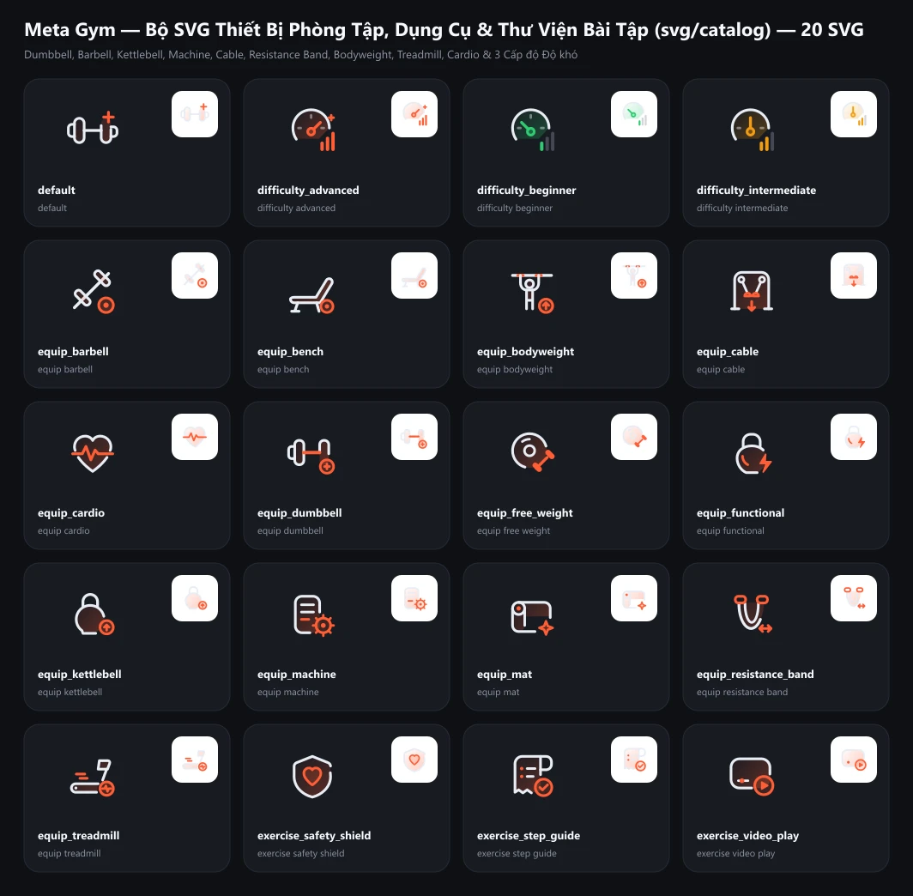

# Bản Review & Xem Trước: Thiết Bị Phòng Tập, Dụng Cụ & Thư Viện Bài Tập (`svg/catalog/`) (20 SVG)

## 1. Đánh Giá Kiểm Duyệt Chất Lượng (Rubric 5 Tiêu Chí — Đạt `9.6/10`)
- **Style Fidelity (`2/2`):** Đồng bộ ngôn ngữ **MetaGym Soft-Line Duotone**, nét mở `2.2px` bo tròn, lớp ửng gradient mềm và huy hiệu điểm nhấn `#FF5E36`.
- **Object Construction (`2/2`):** Chi tiết định danh đặc trưng rõ ràng, nhận diện tức thì ở cả kích thước `2x` (`82px`) trên nền tối `#181B22` lẫn `1x` (`34px`) trên ô nền sáng `#F5F7FA`.
- **Knockout & Badge Harmony (`1.8/2`):** Huy hiệu hành động đặt đúng trọng tâm góc, không đè nét rối mắt.
- **Composition & Safe Margin (`1.8/2`):** Căn tâm chuẩn xác, lề thoáng `≥ 4px`.
- **Technical SVG Lint (`2/2`):** `0` thẻ cấm, `100%` ID gradient có tiền tố riêng, dung lượng siêu nhẹ.

## 2. Bảng Danh Mục Chi Tiết 20 Icon Trong `assets/svg/catalog/`

| STT | `assetKey` | Têp SVG | Tầng | `viewBox` | Dung lượng | Ý nghĩa & Vị trí sử dụng |
| :-: | :--- | :--- | :-: | :-: | :-: | :--- |
| 1 | `default` | [`default.svg`](../assets/svg/catalog/default.svg) | Tầng B | `48×48` | `1.42 KB` | Biểu tượng mặc định danh mục thiết bị & bài tập |
| 2 | `difficulty_advanced` | [`difficulty_advanced.svg`](../assets/svg/catalog/difficulty_advanced.svg) | Tầng B | `48×48` | `2.02 KB` | Cấp độ Nâng cao (Tư thế Gymmer Arnold Pose #3 + Cột mức 3 đỉnh cao) |
| 3 | `difficulty_beginner` | [`difficulty_beginner.svg`](../assets/svg/catalog/difficulty_beginner.svg) | Tầng B | `48×48` | `1.86 KB` | Cấp độ Cơ bản / Người mới (Tư thế Gymmer thả lỏng Pose #13 + Cột mức 1) |
| 4 | `difficulty_intermediate` | [`difficulty_intermediate.svg`](../assets/svg/catalog/difficulty_intermediate.svg) | Tầng B | `48×48` | `1.85 KB` | Cấp độ Trung bình (Tư thế Gymmer gồng cơ tay Pose #2 + Cột mức 2) |
| 5 | `equip_barbell` | [`equip_barbell.svg`](../assets/svg/catalog/equip_barbell.svg) | Tầng B | `48×48` | `1.02 KB` | Dụng cụ: Thanh đòn tạ Olympic (Barbell + Bánh tạ đòn) |
| 6 | `equip_bench` | [`equip_bench.svg`](../assets/svg/catalog/equip_bench.svg) | Tầng B | `48×48` | `0.93 KB` | Dụng cụ: Ghế băng tập tạ điều chỉnh độ dốc (Adjustable Gym Bench) |
| 7 | `equip_bodyweight` | [`equip_bodyweight.svg`](../assets/svg/catalog/equip_bodyweight.svg) | Tầng B | `48×48` | `2.13 KB` | Dụng cụ: Tập bằng trọng lượng cơ thể / Xà đơn (Calisthenics Pose #5) |
| 8 | `equip_cable` | [`equip_cable.svg`](../assets/svg/catalog/equip_cable.svg) | Tầng B | `48×48` | `1.41 KB` | Dụng cụ: Giàn ròng rọc kéo cáp đa năng (Cable Crossover Pulley) |
| 9 | `equip_cardio` | [`equip_cardio.svg`](../assets/svg/catalog/equip_cardio.svg) | Tầng B | `48×48` | `1.53 KB` | Nhóm máy tập tim mạch tổng hợp (Cardio Equipment) |
| 10 | `equip_dumbbell` | [`equip_dumbbell.svg`](../assets/svg/catalog/equip_dumbbell.svg) | Tầng B | `48×48` | `1.24 KB` | Dụng cụ: Tạ đơn lục giác (Hex Dumbbell + Huy hiệu cộng tải) |
| 11 | `equip_free_weight` | [`equip_free_weight.svg`](../assets/svg/catalog/equip_free_weight.svg) | Tầng B | `48×48` | `1.25 KB` | Nhóm tạ rời tự do (Bánh tạ Olympic + Tạ đơn) |
| 12 | `equip_functional` | [`equip_functional.svg`](../assets/svg/catalog/equip_functional.svg) | Tầng B | `48×48` | `1.35 KB` | Nhóm dụng cụ tập chức năng thể lực (Functional Training) |
| 13 | `equip_kettlebell` | [`equip_kettlebell.svg`](../assets/svg/catalog/equip_kettlebell.svg) | Tầng B | `48×48` | `1.07 KB` | Dụng cụ: Tạ bình vôi / Tạ chuông (Cast Iron Kettlebell) |
| 14 | `equip_machine` | [`equip_machine.svg`](../assets/svg/catalog/equip_machine.svg) | Tầng B | `48×48` | `1.48 KB` | Dụng cụ: Máy tập cơ học có tạ khối (Selectorized Pin Stack Machine) |
| 15 | `equip_mat` | [`equip_mat.svg`](../assets/svg/catalog/equip_mat.svg) | Tầng B | `48×48` | `1.19 KB` | Dụng cụ: Thảm tập sàn / Yoga cuộn tròn (Rolled Exercise Mat) |
| 16 | `equip_resistance_band` | [`equip_resistance_band.svg`](../assets/svg/catalog/equip_resistance_band.svg) | Tầng B | `48×48` | `1.17 KB` | Dụng cụ: Dây kháng lực đàn hồi có tay cầm (Resistance Band) |
| 17 | `equip_treadmill` | [`equip_treadmill.svg`](../assets/svg/catalog/equip_treadmill.svg) | Tầng B | `48×48` | `1.52 KB` | Dụng cụ: Máy chạy bộ điện phòng gym (Treadmill + Nhịp tim) |
| 18 | `exercise_safety_shield` | [`exercise_safety_shield.svg`](../assets/svg/catalog/exercise_safety_shield.svg) | Tầng B | `48×48` | `1.21 KB` | Khiên lưu ý an toàn & phòng tránh chấn thương khi tập |
| 19 | `exercise_step_guide` | [`exercise_step_guide.svg`](../assets/svg/catalog/exercise_step_guide.svg) | Tầng B | `48×48` | `1.64 KB` | Sổ tay hướng dẫn từng bước thực hiện bài tập |
| 20 | `exercise_video_play` | [`exercise_video_play.svg`](../assets/svg/catalog/exercise_video_play.svg) | Tầng B | `48×48` | `1.21 KB` | Khung phát video hướng dẫn kỹ thuật động tác |
