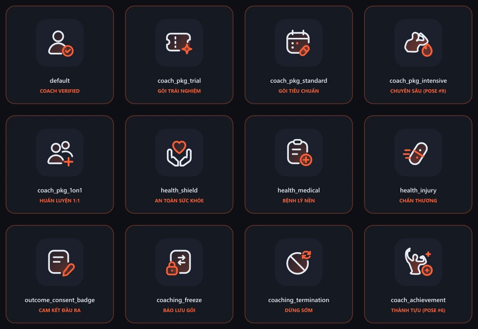

# Bản Review & Xem Trước: Gói Huấn Luyện Viên, Sức Khỏe & Cam Kết (`svg/coaching/`) (12 SVG)

## 1. Đánh Giá Kiểm Duyệt Chất Lượng (Rubric 5 Tiêu Chí — Đạt `9.6/10`)
- **Style Fidelity (`2/2`):** Đồng bộ ngôn ngữ **MetaGym Soft-Line Duotone**, nét mở `2.2px` bo tròn, lớp ửng gradient mềm và huy hiệu điểm nhấn `#FF5E36`.
- **Object Construction (`2/2`):** Chi tiết định danh đặc trưng rõ ràng, nhận diện tức thì ở cả kích thước `2x` (`82px`) trên nền tối `#181B22` lẫn `1x` (`34px`) trên ô nền sáng `#F5F7FA`.
- **Knockout & Badge Harmony (`1.8/2`):** Huy hiệu hành động đặt đúng trọng tâm góc, không đè nét rối mắt.
- **Composition & Safe Margin (`1.8/2`):** Căn tâm chuẩn xác, lề thoáng `≥ 4px`.
- **Technical SVG Lint (`2/2`):** `0` thẻ cấm, `100%` ID gradient có tiền tố riêng, dung lượng siêu nhẹ.

## 2. Bảng Danh Mục Chi Tiết 12 Icon Trong `assets/svg/coaching/`

| STT | `assetKey` | Têp SVG | Tầng | `viewBox` | Dung lượng | Ý nghĩa & Vị trí sử dụng |
| :-: | :--- | :--- | :-: | :-: | :-: | :--- |
| 1 | `coach_achievement` | [`coach_achievement.svg`](../assets/svg/coaching/coach_achievement.svg) | Tầng B | `48×48` | `1.91 KB` | Thành tựu & Chứng nhận huấn luyện viên (Tư thế chiến thắng Pose #6) |
| 2 | `coach_pkg_1on1` | [`coach_pkg_1on1.svg`](../assets/svg/coaching/coach_pkg_1on1.svg) | Tầng B | `48×48` | `1.32 KB` | Gói HLV kèm riêng 1-kèm-1 (Còi huấn luyện + Ngôi sao VIP) |
| 3 | `coach_pkg_intensive` | [`coach_pkg_intensive.svg`](../assets/svg/coaching/coach_pkg_intensive.svg) | Tầng B | `48×48` | `1.61 KB` | Gói HLV chuyên sâu cường độ cao (Tư thế Gymmer quỳ gồng cơ Pose #9 + Lửa) |
| 4 | `coach_pkg_standard` | [`coach_pkg_standard.svg`](../assets/svg/coaching/coach_pkg_standard.svg) | Tầng B | `48×48` | `1.57 KB` | Gói HLV tiêu chuẩn theo tháng (Lịch trình kỷ luật + Dấu tích) |
| 5 | `coach_pkg_trial` | [`coach_pkg_trial.svg`](../assets/svg/coaching/coach_pkg_trial.svg) | Tầng B | `48×48` | `1.44 KB` | Gói tập thử cùng HLV (Tấm vé khuyết bán nguyệt + Ngôi sao khởi đầu) |
| 6 | `coaching_freeze` | [`coaching_freeze.svg`](../assets/svg/coaching/coaching_freeze.svg) | Tầng B | `48×48` | `1.48 KB` | Bảo lưu / Tạm đóng băng gói huấn luyện viên |
| 7 | `coaching_termination` | [`coaching_termination.svg`](../assets/svg/coaching/coaching_termination.svg) | Tầng B | `48×48` | `1.52 KB` | Thanh lý / Kết thúc sớm hợp đồng huấn luyện |
| 8 | `default` | [`default.svg`](../assets/svg/coaching/default.svg) | Tầng B | `48×48` | `1.23 KB` | Biểu tượng mặc định phân hệ Huấn luyện viên |
| 9 | `health_injury` | [`health_injury.svg`](../assets/svg/coaching/health_injury.svg) | Tầng B | `48×48` | `1.22 KB` | Khai báo tiền sử chấn thương cơ xương khớp |
| 10 | `health_medical` | [`health_medical.svg`](../assets/svg/coaching/health_medical.svg) | Tầng B | `48×48` | `1.43 KB` | Hồ sơ bệnh án & Tờ khai y tế trước tập luyện |
| 11 | `health_shield` | [`health_shield.svg`](../assets/svg/coaching/health_shield.svg) | Tầng B | `48×48` | `1.42 KB` | Khiên bảo vệ & Sàng lọc sức khỏe hội viên |
| 12 | `outcome_consent_badge` | [`outcome_consent_badge.svg`](../assets/svg/coaching/outcome_consent_badge.svg) | Tầng B | `48×48` | `1.27 KB` | Bản cam kết lộ trình & mục tiêu đầu ra cùng HLV |
