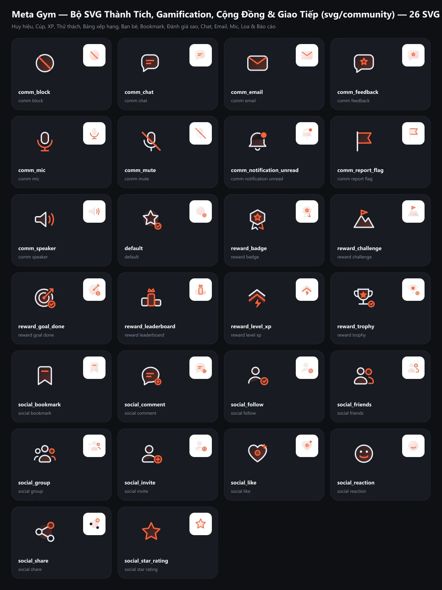

# Bản Review & Xem Trước: Thành Tích, Gamification, Cộng Đồng & Giao Tiếp (`svg/community/`) (26 SVG)

## 1. Đánh Giá Kiểm Duyệt Chất Lượng (Rubric 5 Tiêu Chí — Đạt `9.6/10`)
- **Style Fidelity (`2/2`):** Đồng bộ ngôn ngữ **MetaGym Soft-Line Duotone**, nét mở `2.2px` bo tròn, lớp ửng gradient mềm và huy hiệu điểm nhấn `#FF5E36`.
- **Object Construction (`2/2`):** Chi tiết định danh đặc trưng rõ ràng, nhận diện tức thì ở cả kích thước `2x` (`82px`) trên nền tối `#181B22` lẫn `1x` (`34px`) trên ô nền sáng `#F5F7FA`.
- **Knockout & Badge Harmony (`1.8/2`):** Huy hiệu hành động đặt đúng trọng tâm góc, không đè nét rối mắt.
- **Composition & Safe Margin (`1.8/2`):** Căn tâm chuẩn xác, lề thoáng `≥ 4px`.
- **Technical SVG Lint (`2/2`):** `0` thẻ cấm, `100%` ID gradient có tiền tố riêng, dung lượng siêu nhẹ.

## 2. Bảng Danh Mục Chi Tiết 26 Icon Trong `assets/svg/community/`

| STT | `assetKey` | Têp SVG | Tầng | `viewBox` | Dung lượng | Ý nghĩa & Vị trí sử dụng |
| :-: | :--- | :--- | :-: | :-: | :-: | :--- |
| 1 | `comm_block` | [`comm_block.svg`](../assets/svg/community/comm_block.svg) | Tầng A | `48×48` | `0.55 KB` | Giao tiếp: Chặn người dùng / Từ chối làm phiền (Block) |
| 2 | `comm_chat` | [`comm_chat.svg`](../assets/svg/community/comm_chat.svg) | Tầng A | `48×48` | `0.65 KB` | Giao tiếp: Khung trò chuyện trực tuyến (Chat) |
| 3 | `comm_email` | [`comm_email.svg`](../assets/svg/community/comm_email.svg) | Tầng A | `48×48` | `0.58 KB` | Giao tiếp: Hộp thư điện tử (Email) |
| 4 | `comm_feedback` | [`comm_feedback.svg`](../assets/svg/community/comm_feedback.svg) | Tầng A | `48×48` | `0.77 KB` | Giao tiếp: Gửi góp ý & Phản hồi trải nghiệm |
| 5 | `comm_mic` | [`comm_mic.svg`](../assets/svg/community/comm_mic.svg) | Tầng A | `48×48` | `0.61 KB` | Giao tiếp: Micro thu âm / Đàm thoại giọng nói |
| 6 | `comm_mute` | [`comm_mute.svg`](../assets/svg/community/comm_mute.svg) | Tầng A | `48×48` | `0.70 KB` | Giao tiếp: Tắt tiếng micro (Mute) |
| 7 | `comm_notification_unread` | [`comm_notification_unread.svg`](../assets/svg/community/comm_notification_unread.svg) | Tầng A | `48×48` | `0.74 KB` | Giao tiếp: Chuông thông báo có chấm đỏ tin mới chưa đọc |
| 8 | `comm_report_flag` | [`comm_report_flag.svg`](../assets/svg/community/comm_report_flag.svg) | Tầng A | `48×48` | `0.57 KB` | Giao tiếp: Cờ báo cáo nội dung vi phạm (Report / Flag) |
| 9 | `comm_speaker` | [`comm_speaker.svg`](../assets/svg/community/comm_speaker.svg) | Tầng A | `48×48` | `0.67 KB` | Giao tiếp: Loa ngoài / Âm lượng hướng dẫn giọng nói |
| 10 | `default` | [`default.svg`](../assets/svg/community/default.svg) | Tầng B | `48×48` | `0.79 KB` | Biểu tượng mặc định Thành tích & Cộng đồng |
| 11 | `reward_badge` | [`reward_badge.svg`](../assets/svg/community/reward_badge.svg) | Tầng B | `48×48` | `1.05 KB` | Gamification: Huy hiệu danh hiệu lục giác kèm dải ruy-băng |
| 12 | `reward_challenge` | [`reward_challenge.svg`](../assets/svg/community/reward_challenge.svg) | Tầng B | `48×48` | `0.85 KB` | Gamification: Thử thách chinh phục đỉnh cao (Đỉnh núi + Cờ cam) |
| 13 | `reward_goal_done` | [`reward_goal_done.svg`](../assets/svg/community/reward_goal_done.svg) | Tầng B | `48×48` | `1.21 KB` | Gamification: Hoàn thành mục tiêu (Bia hồng tâm + Mũi tên & Dấu tích) |
| 14 | `reward_leaderboard` | [`reward_leaderboard.svg`](../assets/svg/community/reward_leaderboard.svg) | Tầng B | `48×48` | `0.99 KB` | Gamification: Bảng xếp hạng hội viên (Bục vinh quang 1–2–3 + Vương miện) |
| 15 | `reward_level_xp` | [`reward_level_xp.svg`](../assets/svg/community/reward_level_xp.svg) | Tầng B | `48×48` | `0.91 KB` | Gamification: Cấp độ hội viên & Điểm kinh nghiệm XP |
| 16 | `reward_trophy` | [`reward_trophy.svg`](../assets/svg/community/reward_trophy.svg) | Tầng B | `48×48` | `1.39 KB` | Gamification: Cúp vô địch vinh danh thành tích xuất sắc |
| 17 | `social_bookmark` | [`social_bookmark.svg`](../assets/svg/community/social_bookmark.svg) | Tầng A | `48×48` | `0.62 KB` | Tương tác xã hội: Đánh dấu lưu bài viết / giáo trình (Bookmark) |
| 18 | `social_comment` | [`social_comment.svg`](../assets/svg/community/social_comment.svg) | Tầng A/B | `48×48` | `1.11 KB` | Tương tác xã hội: Bình luận & Thảo luận |
| 19 | `social_follow` | [`social_follow.svg`](../assets/svg/community/social_follow.svg) | Tầng A | `48×48` | `0.83 KB` | Tương tác xã hội: Đang theo dõi HLV / bạn tập (Follow) |
| 20 | `social_friends` | [`social_friends.svg`](../assets/svg/community/social_friends.svg) | Tầng B | `48×48` | `0.91 KB` | Cộng đồng: Bạn tập cùng (Gym Buddies) |
| 21 | `social_group` | [`social_group.svg`](../assets/svg/community/social_group.svg) | Tầng B | `48×48` | `1.09 KB` | Cộng đồng: Hội nhóm / Câu lạc bộ tập luyện |
| 22 | `social_invite` | [`social_invite.svg`](../assets/svg/community/social_invite.svg) | Tầng A/B | `48×48` | `1.02 KB` | Tương tác xã hội: Mời bạn bè tham gia tập luyện |
| 23 | `social_like` | [`social_like.svg`](../assets/svg/community/social_like.svg) | Tầng A/B | `48×48` | `0.85 KB` | Tương tác xã hội: Yêu thích / Thả tim cổ vũ |
| 24 | `social_reaction` | [`social_reaction.svg`](../assets/svg/community/social_reaction.svg) | Tầng A | `48×48` | `0.65 KB` | Tương tác xã hội: Biểu cảm nhanh (Emoji Reaction) |
| 25 | `social_share` | [`social_share.svg`](../assets/svg/community/social_share.svg) | Tầng A/B | `48×48` | `0.96 KB` | Tương tác xã hội: Chia sẻ thành tích / bài tập |
| 26 | `social_star_rating` | [`social_star_rating.svg`](../assets/svg/community/social_star_rating.svg) | Tầng A | `48×48` | `0.54 KB` | Tương tác xã hội: Đánh giá sao chất lượng HLV / buổi tập |
