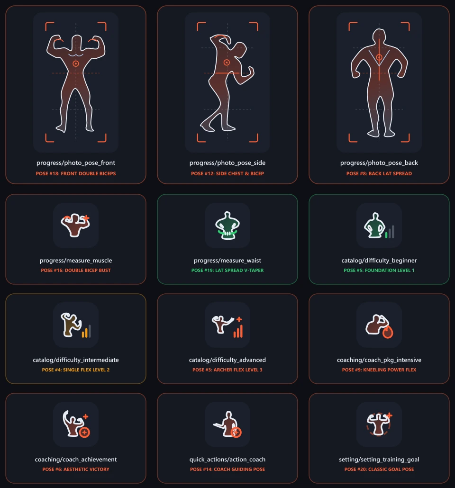

# Phân Tích 20 Tư Thế Gymmer & Cập Nhật 12 Biểu Tượng SVG Liên Quan

Từ bảng **20 tư thế Gymmer / Bodybuilding** (4 hàng × 5 cột), hệ thống sử dụng thuật toán **Moore-Neighbor Contour Tracing (bao gồm cả đường bao ngoài & khe hở âm giữa tay/eo)** kết hợp **Ramer–Douglas–Peucker + Catmull–Rom Cubic Spline** ở độ phân giải `3x` để trích xuất đường cong hình thể chuẩn xác của các tư thế và nâng cấp **12 biểu tượng SVG** trên **6 thư mục** (`progress`, `catalog`, `coaching`, `quick_actions`, `setting`, `states`).

---

## 1. Phân Tích Giải Phẫu & Tuyển Chọn Tư Thế Từ Bảng 20 Gymmer Poses

| Mã Tư Thế (Hàng × Cột) | Tên Tư Thế Thể Hình (Bodybuilding Pose) | Đặc Điểm Hình Thể Nổi Bật | File SVG Được Nâng Cấp |
| :--- | :--- | :--- | :--- |
| **Pose #18** *(Hàng 4, Cột 3)* | **Front Double Biceps** | Tư thế gồng 2 tay trước kinh điển, khoe trọn tay trước, ngực, vai và đùi trước | [progress/photo_pose_front.svg](../assets/svg/progress/photo_pose_front.svg) (`180×330`, `2.98 KB`) |
| **Pose #12** *(Hàng 3, Cột 2)* | **Side Chest & Triceps** | Tư thế nghiêng gồng ngực, vai bên, tay trước/sau và bước chân tạo khối đùi/bắp chuối | [progress/photo_pose_side.svg](../assets/svg/progress/photo_pose_side.svg) (`180×330`, `3.00 KB`) |
| **Pose #8** *(Hàng 2, Cột 3)* | **Back Lat Spread** | Tư thế mặt sau bành xô chữ V (V-Taper), khoe cầu vai, lưng xô, cơ mông và đùi sau | [progress/photo_pose_back.svg](../assets/svg/progress/photo_pose_back.svg) (`180×330`, `3.01 KB`) |
| **Pose #16** *(Hàng 4, Cột 1)* | **Power Double Bicep Bust** | Thân trên cuồn cuộn gồng đôi tay trước với đỉnh cơ Bicep Peak sắc nét | [progress/measure_muscle.svg](../assets/svg/progress/measure_muscle.svg) (`48×48`, `1.73 KB`) |
| **Pose #19** *(Hàng 4, Cột 4)* | **Front Lat Spread V-Taper** | Hai tay chống hông bành xô tạo thắt lưng chữ V chuẩn mực + thước dây xanh `#2ECC71` quấn eo | [progress/measure_waist.svg](../assets/svg/progress/measure_waist.svg) (`48×48`, `1.83 KB`) |
| **Pose #13** *(Hàng 3, Cột 3)* | **Athletic Foundation Stance** | Dáng đứng hai tay chống hông vững chãi + cột cường độ **Mức 1 (`#2ECC71`)** | [catalog/difficulty_beginner.svg](../assets/svg/catalog/difficulty_beginner.svg) (`48×48`, `1.68 KB`) |
| **Pose #2** *(Hàng 1, Cột 2)* | **3/4 Side Double Biceps Flex** | Dáng gồng cơ tay & lưng xô góc 3/4 + cột cường độ **Mức 2 (`#F39C12`)** | [catalog/difficulty_intermediate.svg](../assets/svg/catalog/difficulty_intermediate.svg) (`48×48`, `1.45 KB`) |
| **Pose #3** *(Hàng 1, Cột 3)* | **Victory Archer Flex** | Dáng bắn cung (Archer Pose) nâng cao độ khó + cột cường độ **Mức 3 (`#FF5E36`)** | [catalog/difficulty_advanced.svg](../assets/svg/catalog/difficulty_advanced.svg) (`48×48`, `1.54 KB`) |
| **Pose #9** *(Hàng 2, Cột 4)* | **Side-Bicep Power Flex** | Dáng gồng tay trước & vai cường độ cao + ngọn lửa cam san hô `#FF5E36` | [coaching/coach_pkg_intensive.svg](../assets/svg/coaching/coach_pkg_intensive.svg) (`48×48`, `1.48 KB`) |
| **Pose #6** *(Hàng 2, Cột 1)* | **Aesthetic Victory Pose** | Tư thế vươn tay chiến thắng (Classic Physique) + huy hiệu ngôi sao thành tựu | [coaching/coach_achievement.svg](../assets/svg/coaching/coach_achievement.svg) (`48×48`, `1.60 KB`) |
| **Pose #14** *(Hàng 3, Cột 4)* | **Coach Guiding Hand Pose** | Dáng HLV đứng thẳng, một tay chống hông, một tay mở ra chỉ dẫn bài tập | [quick_actions/action_coach.svg](../assets/svg/quick_actions/action_coach.svg) (`1.70 KB`) & [states/empty_coach.svg](../assets/svg/states/empty_coach.svg) (`1.73 KB`) |
| **Pose #20** *(Hàng 4, Cột 5)* | **Classic Symmetry Double Biceps** | Tư thế gồng 2 tay cân xứng đặt trong vòng tâm ngắm mục tiêu thể hình | [setting/setting_training_goal.svg](../assets/svg/setting/setting_training_goal.svg) (`48×48`, `1.67 KB`) |
