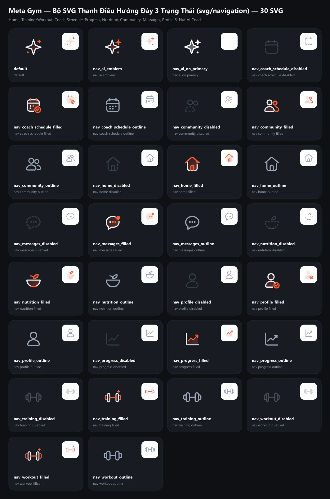

# Bản Review & Xem Trước: Thanh Điều Hướng Đáy 3 Trạng Thái (`outline`/`filled`/`disabled`) & AI Coach (`svg/navigation/`) (30 SVG)

## 1. Đánh Giá Kiểm Duyệt Chất Lượng (Rubric 5 Tiêu Chí — Đạt `9.6/10`)
- **Style Fidelity (`2/2`):** Đồng bộ ngôn ngữ **MetaGym Soft-Line Duotone**, nét mở `2.2px` bo tròn, lớp ửng gradient mềm và huy hiệu điểm nhấn `#FF5E36`.
- **Object Construction (`2/2`):** Chi tiết định danh đặc trưng rõ ràng, nhận diện tức thì ở cả kích thước `2x` (`82px`) trên nền tối `#181B22` lẫn `1x` (`34px`) trên ô nền sáng `#F5F7FA`.
- **Knockout & Badge Harmony (`1.8/2`):** Huy hiệu hành động đặt đúng trọng tâm góc, không đè nét rối mắt.
- **Composition & Safe Margin (`1.8/2`):** Căn tâm chuẩn xác, lề thoáng `≥ 4px`.
- **Technical SVG Lint (`2/2`):** `0` thẻ cấm, `100%` ID gradient có tiền tố riêng, dung lượng siêu nhẹ.

## 2. Bảng Danh Mục Chi Tiết 30 Icon Trong `assets/svg/navigation/`

| STT | `assetKey` | Têp SVG | Tầng | `viewBox` | Dung lượng | Ý nghĩa & Vị trí sử dụng |
| :-: | :--- | :--- | :-: | :-: | :-: | :--- |
| 1 | `default` | [`default.svg`](../assets/svg/navigation/default.svg) | Tầng A/B | `48×48` | `0.78 KB` | Biểu tượng điều hướng mặc định |
| 2 | `nav_ai_emblem` | [`nav_ai_emblem.svg`](../assets/svg/navigation/nav_ai_emblem.svg) | Tầng B | `48×48` | `0.96 KB` | Nút nổi trung tâm AI Coach (Phiên bản cam #FF5E36 trên nền tối) |
| 3 | `nav_ai_on_primary` | [`nav_ai_on_primary.svg`](../assets/svg/navigation/nav_ai_on_primary.svg) | Tầng B | `48×48` | `0.88 KB` | Nút nổi trung tâm AI Coach (Phiên bản trắng #FFFFFF trên nền cam) |
| 4 | `nav_coach_schedule_disabled` | [`nav_coach_schedule_disabled.svg`](../assets/svg/navigation/nav_coach_schedule_disabled.svg) | Tầng A/B | `48×48` | `0.69 KB` | Tab Lịch dạy HLV — Trạng thái vô hiệu hóa (Disabled) |
| 5 | `nav_coach_schedule_filled` | [`nav_coach_schedule_filled.svg`](../assets/svg/navigation/nav_coach_schedule_filled.svg) | Tầng A/B | `48×48` | `1.43 KB` | Tab Lịch dạy HLV — Trạng thái đang chọn (Filled Duotone) |
| 6 | `nav_coach_schedule_outline` | [`nav_coach_schedule_outline.svg`](../assets/svg/navigation/nav_coach_schedule_outline.svg) | Tầng A/B | `48×48` | `0.86 KB` | Tab Lịch dạy HLV — Trạng thái chưa chọn (Outline) |
| 7 | `nav_community_disabled` | [`nav_community_disabled.svg`](../assets/svg/navigation/nav_community_disabled.svg) | Tầng A/B | `48×48` | `0.52 KB` | Tab Cộng đồng — Trạng thái vô hiệu hóa (Disabled) |
| 8 | `nav_community_filled` | [`nav_community_filled.svg`](../assets/svg/navigation/nav_community_filled.svg) | Tầng A/B | `48×48` | `0.93 KB` | Tab Cộng đồng — Trạng thái đang chọn (Filled Duotone) |
| 9 | `nav_community_outline` | [`nav_community_outline.svg`](../assets/svg/navigation/nav_community_outline.svg) | Tầng A/B | `48×48` | `0.59 KB` | Tab Cộng đồng — Trạng thái chưa chọn (Outline) |
| 10 | `nav_home_disabled` | [`nav_home_disabled.svg`](../assets/svg/navigation/nav_home_disabled.svg) | Tầng A | `48×48` | `0.64 KB` | Tab Trang chủ — Trạng thái vô hiệu hóa (Disabled) |
| 11 | `nav_home_filled` | [`nav_home_filled.svg`](../assets/svg/navigation/nav_home_filled.svg) | Tầng A | `48×48` | `1.11 KB` | Tab Trang chủ — Trạng thái đang chọn (Filled Duotone) |
| 12 | `nav_home_outline` | [`nav_home_outline.svg`](../assets/svg/navigation/nav_home_outline.svg) | Tầng A | `48×48` | `0.59 KB` | Tab Trang chủ — Trạng thái chưa chọn (Outline) |
| 13 | `nav_messages_disabled` | [`nav_messages_disabled.svg`](../assets/svg/navigation/nav_messages_disabled.svg) | Tầng A | `48×48` | `0.59 KB` | Tab Tin nhắn — Trạng thái vô hiệu hóa (Disabled) |
| 14 | `nav_messages_filled` | [`nav_messages_filled.svg`](../assets/svg/navigation/nav_messages_filled.svg) | Tầng A | `48×48` | `1.10 KB` | Tab Tin nhắn — Trạng thái đang chọn (Filled Duotone) |
| 15 | `nav_messages_outline` | [`nav_messages_outline.svg`](../assets/svg/navigation/nav_messages_outline.svg) | Tầng A | `48×48` | `0.52 KB` | Tab Tin nhắn — Trạng thái chưa chọn (Outline) |
| 16 | `nav_nutrition_disabled` | [`nav_nutrition_disabled.svg`](../assets/svg/navigation/nav_nutrition_disabled.svg) | Tầng A/B | `48×48` | `0.54 KB` | Tab Dinh dưỡng — Trạng thái vô hiệu hóa (Disabled) |
| 17 | `nav_nutrition_filled` | [`nav_nutrition_filled.svg`](../assets/svg/navigation/nav_nutrition_filled.svg) | Tầng A/B | `48×48` | `0.89 KB` | Tab Dinh dưỡng — Trạng thái đang chọn (Filled Duotone) |
| 18 | `nav_nutrition_outline` | [`nav_nutrition_outline.svg`](../assets/svg/navigation/nav_nutrition_outline.svg) | Tầng A/B | `48×48` | `0.58 KB` | Tab Dinh dưỡng — Trạng thái chưa chọn (Outline) |
| 19 | `nav_profile_disabled` | [`nav_profile_disabled.svg`](../assets/svg/navigation/nav_profile_disabled.svg) | Tầng A | `48×48` | `0.46 KB` | Tab Hồ sơ cá nhân — Trạng thái vô hiệu hóa (Disabled) |
| 20 | `nav_profile_filled` | [`nav_profile_filled.svg`](../assets/svg/navigation/nav_profile_filled.svg) | Tầng A | `48×48` | `1.12 KB` | Tab Hồ sơ cá nhân — Trạng thái đang chọn (Filled Duotone) |
| 21 | `nav_profile_outline` | [`nav_profile_outline.svg`](../assets/svg/navigation/nav_profile_outline.svg) | Tầng A | `48×48` | `0.40 KB` | Tab Hồ sơ cá nhân — Trạng thái chưa chọn (Outline) |
| 22 | `nav_progress_disabled` | [`nav_progress_disabled.svg`](../assets/svg/navigation/nav_progress_disabled.svg) | Tầng A/B | `48×48` | `0.42 KB` | Tab Tiến độ — Trạng thái vô hiệu hóa (Disabled) |
| 23 | `nav_progress_filled` | [`nav_progress_filled.svg`](../assets/svg/navigation/nav_progress_filled.svg) | Tầng A/B | `48×48` | `0.87 KB` | Tab Tiến độ — Trạng thái đang chọn (Filled Duotone) |
| 24 | `nav_progress_outline` | [`nav_progress_outline.svg`](../assets/svg/navigation/nav_progress_outline.svg) | Tầng A/B | `48×48` | `0.46 KB` | Tab Tiến độ — Trạng thái chưa chọn (Outline) |
| 25 | `nav_training_disabled` | [`nav_training_disabled.svg`](../assets/svg/navigation/nav_training_disabled.svg) | Tầng A/B | `48×48` | `0.82 KB` | Tab Tập luyện (App hiện hành) — Trạng thái vô hiệu hóa (Disabled) |
| 26 | `nav_training_filled` | [`nav_training_filled.svg`](../assets/svg/navigation/nav_training_filled.svg) | Tầng A/B | `48×48` | `1.37 KB` | Tab Tập luyện (App hiện hành) — Trạng thái đang chọn (Filled Duotone) |
| 27 | `nav_training_outline` | [`nav_training_outline.svg`](../assets/svg/navigation/nav_training_outline.svg) | Tầng A/B | `48×48` | `0.69 KB` | Tab Tập luyện (App hiện hành) — Trạng thái chưa chọn (Outline) |
| 28 | `nav_workout_disabled` | [`nav_workout_disabled.svg`](../assets/svg/navigation/nav_workout_disabled.svg) | Tầng A/B | `48×48` | `0.82 KB` | Tab Tập luyện (Alias chuẩn nav_workout) — Trạng thái Disabled |
| 29 | `nav_workout_filled` | [`nav_workout_filled.svg`](../assets/svg/navigation/nav_workout_filled.svg) | Tầng A/B | `48×48` | `1.38 KB` | Tab Tập luyện (Alias chuẩn nav_workout) — Trạng thái Filled Duotone |
| 30 | `nav_workout_outline` | [`nav_workout_outline.svg`](../assets/svg/navigation/nav_workout_outline.svg) | Tầng A/B | `48×48` | `0.69 KB` | Tab Tập luyện (Alias chuẩn nav_workout) — Trạng thái Outline |
