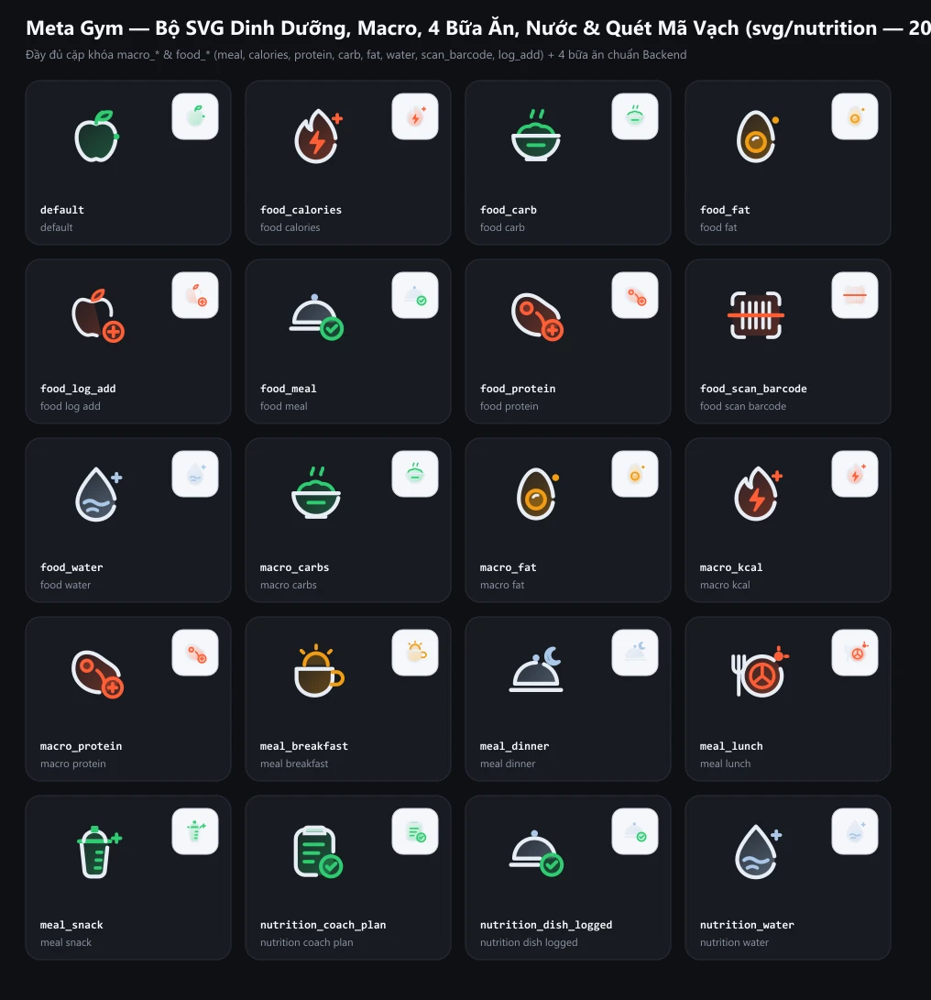

# Bản Review & Xem Trước: Chỉ Số Dinh Dưỡng Macro, 4 Bữa Ăn, Nước & Quét Mã Vạch (`svg/nutrition/`) (20 SVG)

## 1. Đánh Giá Kiểm Duyệt Chất Lượng (Rubric 5 Tiêu Chí — Đạt `9.6/10`)
- **Style Fidelity (`2/2`):** Đồng bộ ngôn ngữ **MetaGym Soft-Line Duotone**, nét mở `2.2px` bo tròn, lớp ửng gradient mềm và huy hiệu điểm nhấn `#FF5E36`.
- **Object Construction (`2/2`):** Chi tiết định danh đặc trưng rõ ràng, nhận diện tức thì ở cả kích thước `2x` (`82px`) trên nền tối `#181B22` lẫn `1x` (`34px`) trên ô nền sáng `#F5F7FA`.
- **Knockout & Badge Harmony (`1.8/2`):** Huy hiệu hành động đặt đúng trọng tâm góc, không đè nét rối mắt.
- **Composition & Safe Margin (`1.8/2`):** Căn tâm chuẩn xác, lề thoáng `≥ 4px`.
- **Technical SVG Lint (`2/2`):** `0` thẻ cấm, `100%` ID gradient có tiền tố riêng, dung lượng siêu nhẹ.

## 2. Bảng Danh Mục Chi Tiết 20 Icon Trong `assets/svg/nutrition/`

| STT | `assetKey` | Têp SVG | Tầng | `viewBox` | Dung lượng | Ý nghĩa & Vị trí sử dụng |
| :-: | :--- | :--- | :-: | :-: | :-: | :--- |
| 1 | `default` | [`default.svg`](../assets/svg/nutrition/default.svg) | Tầng B | `48×48` | `1.29 KB` | Biểu tượng mặc định phân hệ Dinh dưỡng |
| 2 | `food_calories` | [`food_calories.svg`](../assets/svg/nutrition/food_calories.svg) | Tầng B | `48×48` | `1.22 KB` | Khóa chuẩn food_calories: Năng lượng nạp vào (Kcal) |
| 3 | `food_carb` | [`food_carb.svg`](../assets/svg/nutrition/food_carb.svg) | Tầng B | `48×48` | `1.29 KB` | Khóa chuẩn food_carb: Nguồn tinh bột năng lượng |
| 4 | `food_fat` | [`food_fat.svg`](../assets/svg/nutrition/food_fat.svg) | Tầng B | `48×48` | `1.10 KB` | Khóa chuẩn food_fat: Nguồn chất béo tốt (Bơ / Omega) |
| 5 | `food_log_add` | [`food_log_add.svg`](../assets/svg/nutrition/food_log_add.svg) | Tầng B | `48×48` | `1.24 KB` | Khóa chuẩn food_log_add: Ghi chép thêm món ăn nhanh |
| 6 | `food_meal` | [`food_meal.svg`](../assets/svg/nutrition/food_meal.svg) | Tầng B | `48×48` | `1.14 KB` | Khóa chuẩn food_meal: Khẩu phần bữa ăn dinh dưỡng |
| 7 | `food_protein` | [`food_protein.svg`](../assets/svg/nutrition/food_protein.svg) | Tầng B | `48×48` | `1.33 KB` | Khóa chuẩn food_protein: Nguồn đạm thực phẩm |
| 8 | `food_scan_barcode` | [`food_scan_barcode.svg`](../assets/svg/nutrition/food_scan_barcode.svg) | Tầng B | `48×48` | `1.22 KB` | Khóa chuẩn food_scan_barcode: Quét mã vạch bao bì thực phẩm |
| 9 | `food_water` | [`food_water.svg`](../assets/svg/nutrition/food_water.svg) | Tầng B | `48×48` | `1.17 KB` | Khóa chuẩn food_water: Nước uống tinh khiết |
| 10 | `macro_carbs` | [`macro_carbs.svg`](../assets/svg/nutrition/macro_carbs.svg) | Tầng B | `48×48` | `1.29 KB` | Chỉ số Tinh bột hấp thu (Macro Carbs — Khớp Backend) |
| 11 | `macro_fat` | [`macro_fat.svg`](../assets/svg/nutrition/macro_fat.svg) | Tầng B | `48×48` | `1.10 KB` | Chỉ số Chất béo lành mạnh (Macro Fat — Khớp Backend) |
| 12 | `macro_kcal` | [`macro_kcal.svg`](../assets/svg/nutrition/macro_kcal.svg) | Tầng B | `48×48` | `1.22 KB` | Chỉ số Năng lượng Calo (Macro Kcal — Khớp Backend) |
| 13 | `macro_protein` | [`macro_protein.svg`](../assets/svg/nutrition/macro_protein.svg) | Tầng B | `48×48` | `1.33 KB` | Chỉ số Đạm phát triển cơ (Macro Protein — Khớp Backend) |
| 14 | `meal_breakfast` | [`meal_breakfast.svg`](../assets/svg/nutrition/meal_breakfast.svg) | Tầng B | `48×48` | `1.27 KB` | Bữa sáng (BREAKFAST — Tách cà phê & Mặt trời bình minh) |
| 15 | `meal_dinner` | [`meal_dinner.svg`](../assets/svg/nutrition/meal_dinner.svg) | Tầng B | `48×48` | `1.21 KB` | Bữa tối (DINNER — Lồng bàn ấm & Trăng khuyết phục hồi) |
| 16 | `meal_lunch` | [`meal_lunch.svg`](../assets/svg/nutrition/meal_lunch.svg) | Tầng B | `48×48` | `1.47 KB` | Bữa trưa (LUNCH — Đĩa khẩu phần cân bằng 3 nhóm chất) |
| 17 | `meal_snack` | [`meal_snack.svg`](../assets/svg/nutrition/meal_snack.svg) | Tầng B | `48×48` | `1.45 KB` | Bữa phụ trước/sau tập (SNACK — Bình lắc Whey Shaker) |
| 18 | `nutrition_coach_plan` | [`nutrition_coach_plan.svg`](../assets/svg/nutrition/nutrition_coach_plan.svg) | Tầng B | `48×48` | `1.29 KB` | Thực đơn dinh dưỡng do HLV thiết kế riêng |
| 19 | `nutrition_dish_logged` | [`nutrition_dish_logged.svg`](../assets/svg/nutrition/nutrition_dish_logged.svg) | Tầng B | `48×48` | `1.14 KB` | Món ăn đã ghi nhận vào nhật ký dinh dưỡng trong ngày |
| 20 | `nutrition_water` | [`nutrition_water.svg`](../assets/svg/nutrition/nutrition_water.svg) | Tầng B | `48×48` | `1.17 KB` | Theo dõi lượng nước uống bù khoáng (Hydration) |
