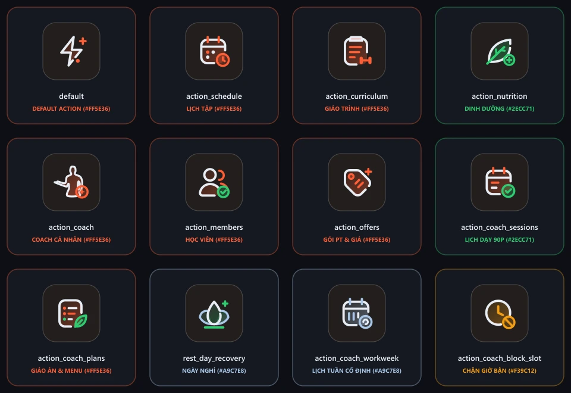

# Bản Review & Xem Trước: Thao Tác Nhanh Trang Chủ Member & Coach (`svg/quick_actions/`) (12 SVG)

## 1. Đánh Giá Kiểm Duyệt Chất Lượng (Rubric 5 Tiêu Chí — Đạt `9.6/10`)
- **Style Fidelity (`2/2`):** Đồng bộ ngôn ngữ **MetaGym Soft-Line Duotone**, nét mở `2.2px` bo tròn, lớp ửng gradient mềm và huy hiệu điểm nhấn `#FF5E36`.
- **Object Construction (`2/2`):** Chi tiết định danh đặc trưng rõ ràng, nhận diện tức thì ở cả kích thước `2x` (`82px`) trên nền tối `#181B22` lẫn `1x` (`34px`) trên ô nền sáng `#F5F7FA`.
- **Knockout & Badge Harmony (`1.8/2`):** Huy hiệu hành động đặt đúng trọng tâm góc, không đè nét rối mắt.
- **Composition & Safe Margin (`1.8/2`):** Căn tâm chuẩn xác, lề thoáng `≥ 4px`.
- **Technical SVG Lint (`2/2`):** `0` thẻ cấm, `100%` ID gradient có tiền tố riêng, dung lượng siêu nhẹ.

## 2. Bảng Danh Mục Chi Tiết 12 Icon Trong `assets/svg/quick_actions/`

| STT | `assetKey` | Têp SVG | Tầng | `viewBox` | Dung lượng | Ý nghĩa & Vị trí sử dụng |
| :-: | :--- | :--- | :-: | :-: | :-: | :--- |
| 1 | `action_coach` | [`action_coach.svg`](../assets/svg/quick_actions/action_coach.svg) | Tầng B | `48×48` | `1.70 KB` | Quick Action (Hội viên): Kết nối HLV cá nhân (Tư thế HLV chỉ dẫn Pose #14) |
| 2 | `action_coach_block_slot` | [`action_coach_block_slot.svg`](../assets/svg/quick_actions/action_coach_block_slot.svg) | Tầng B | `48×48` | `1.15 KB` | Khóa ca bận / Nghỉ phép trên lịch dạy HLV |
| 3 | `action_coach_plans` | [`action_coach_plans.svg`](../assets/svg/quick_actions/action_coach_plans.svg) | Tầng B | `48×48` | `1.52 KB` | Quick Action (HLV): Soạn giáo trình & Thực đơn cho học viên |
| 4 | `action_coach_sessions` | [`action_coach_sessions.svg`](../assets/svg/quick_actions/action_coach_sessions.svg) | Tầng B | `48×48` | `1.53 KB` | Quick Action (HLV): Lịch dạy 1-1 trong ngày |
| 5 | `action_coach_workweek` | [`action_coach_workweek.svg`](../assets/svg/quick_actions/action_coach_workweek.svg) | Tầng B | `48×48` | `1.67 KB` | Thiết lập khung giờ làm việc trong tuần của HLV |
| 6 | `action_curriculum` | [`action_curriculum.svg`](../assets/svg/quick_actions/action_curriculum.svg) | Tầng B | `48×48` | `1.34 KB` | Quick Action (Hội viên): Mở nhanh Giáo trình tập luyện |
| 7 | `action_members` | [`action_members.svg`](../assets/svg/quick_actions/action_members.svg) | Tầng B | `48×48` | `1.46 KB` | Quick Action (HLV): Quản lý danh sách Học viên đang phụ trách |
| 8 | `action_nutrition` | [`action_nutrition.svg`](../assets/svg/quick_actions/action_nutrition.svg) | Tầng B | `48×48` | `1.27 KB` | Quick Action (Hội viên): Ghi nhận Dinh dưỡng & Bữa ăn |
| 9 | `action_offers` | [`action_offers.svg`](../assets/svg/quick_actions/action_offers.svg) | Tầng B | `48×48` | `1.36 KB` | Quick Action (HLV): Đề nghị & Yêu cầu đăng ký gói tập mới |
| 10 | `action_schedule` | [`action_schedule.svg`](../assets/svg/quick_actions/action_schedule.svg) | Tầng B | `48×48` | `1.41 KB` | Quick Action (Hội viên): Xem nhanh Lịch tập tuần |
| 11 | `default` | [`default.svg`](../assets/svg/quick_actions/default.svg) | Tầng B | `48×48` | `0.86 KB` | Biểu tượng thao tác nhanh mặc định |
| 12 | `rest_day_recovery` | [`rest_day_recovery.svg`](../assets/svg/quick_actions/rest_day_recovery.svg) | Tầng B | `48×48` | `1.57 KB` | Trạng thái Ngày nghỉ phục hồi cơ bắp (Active Recovery) |
