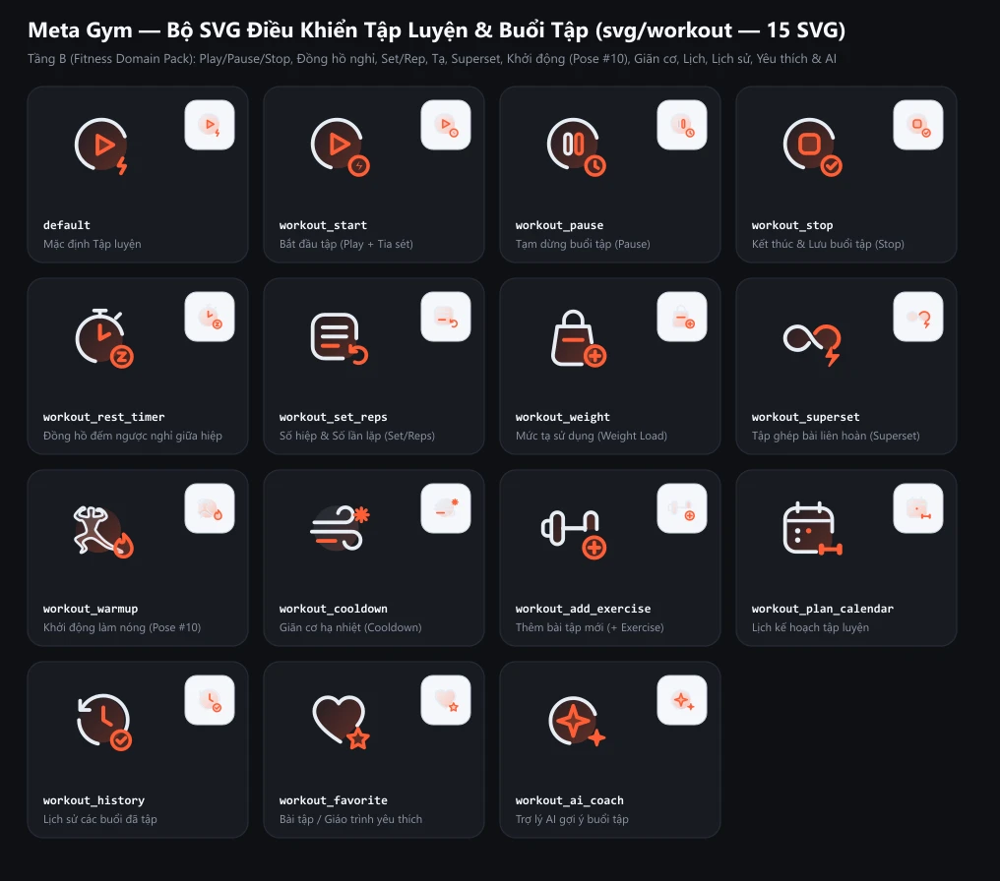

# Bản Review & Xem Trước: Điều Khiển Tập Luyện & Buổi Tập Trực Tiếp (`svg/workout/`) (15 SVG)

## 1. Đánh Giá Kiểm Duyệt Chất Lượng (Rubric 5 Tiêu Chí — Đạt `9.6/10`)
- **Style Fidelity (`2/2`):** Đồng bộ ngôn ngữ **MetaGym Soft-Line Duotone**, nét mở `2.2px` bo tròn, lớp ửng gradient mềm và huy hiệu điểm nhấn `#FF5E36`.
- **Object Construction (`2/2`):** Chi tiết định danh đặc trưng rõ ràng, nhận diện tức thì ở cả kích thước `2x` (`82px`) trên nền tối `#181B22` lẫn `1x` (`34px`) trên ô nền sáng `#F5F7FA`.
- **Knockout & Badge Harmony (`1.8/2`):** Huy hiệu hành động đặt đúng trọng tâm góc, không đè nét rối mắt.
- **Composition & Safe Margin (`1.8/2`):** Căn tâm chuẩn xác, lề thoáng `≥ 4px`.
- **Technical SVG Lint (`2/2`):** `0` thẻ cấm, `100%` ID gradient có tiền tố riêng, dung lượng siêu nhẹ.

## 2. Bảng Danh Mục Chi Tiết 15 Icon Trong `assets/svg/workout/`

| STT | `assetKey` | Têp SVG | Tầng | `viewBox` | Dung lượng | Ý nghĩa & Vị trí sử dụng |
| :-: | :--- | :--- | :-: | :-: | :-: | :--- |
| 1 | `default` | [`default.svg`](../assets/svg/workout/default.svg) | Tầng B | `48×48` | `0.81 KB` | Biểu tượng điều khiển tập luyện mặc định |
| 2 | `workout_add_exercise` | [`workout_add_exercise.svg`](../assets/svg/workout/workout_add_exercise.svg) | Tầng B | `48×48` | `1.19 KB` | Thêm bài tập mới vào lịch/buổi tập (Tạ đơn + Huy hiệu dấu cộng) |
| 3 | `workout_ai_coach` | [`workout_ai_coach.svg`](../assets/svg/workout/workout_ai_coach.svg) | Tầng B | `48×48` | `1.08 KB` | Trợ lý AI Coach gợi ý bài tập & mức tạ thông minh |
| 4 | `workout_cooldown` | [`workout_cooldown.svg`](../assets/svg/workout/workout_cooldown.svg) | Tầng B | `48×48` | `1.09 KB` | Giãn cơ hạ nhiệt cuối buổi (Làn gió điều hòa nhịp thở + Hoa tuyết) |
| 5 | `workout_favorite` | [`workout_favorite.svg`](../assets/svg/workout/workout_favorite.svg) | Tầng B | `48×48` | `1.12 KB` | Lưu bài tập / giáo trình yêu thích (Trái tim + Huy hiệu ngôi sao) |
| 6 | `workout_history` | [`workout_history.svg`](../assets/svg/workout/workout_history.svg) | Tầng B | `48×48` | `1.25 KB` | Lịch sử các buổi đã tập (Vòng tua ngược thời gian + Dấu tích hoàn thành) |
| 7 | `workout_pause` | [`workout_pause.svg`](../assets/svg/workout/workout_pause.svg) | Tầng B | `48×48` | `1.13 KB` | Tạm dừng buổi tập (2 thanh Pause + Huy hiệu đồng hồ chờ) |
| 8 | `workout_plan_calendar` | [`workout_plan_calendar.svg`](../assets/svg/workout/workout_plan_calendar.svg) | Tầng B | `48×48` | `1.27 KB` | Lịch kế hoạch tập luyện (Cuốn lịch + Huy hiệu tạ đơn ngày tập) |
| 9 | `workout_rest_timer` | [`workout_rest_timer.svg`](../assets/svg/workout/workout_rest_timer.svg) | Tầng B | `48×48` | `1.21 KB` | Đồng hồ đếm ngược thời gian nghỉ giữa hiệp (Stopwatch + Đồng hồ cát) |
| 10 | `workout_set_reps` | [`workout_set_reps.svg`](../assets/svg/workout/workout_set_reps.svg) | Tầng B | `48×48` | `1.21 KB` | Số hiệp & Số lần lặp (3 thanh hiệp tập + Vòng lặp xoay rep) |
| 11 | `workout_start` | [`workout_start.svg`](../assets/svg/workout/workout_start.svg) | Tầng B | `48×48` | `1.00 KB` | Bắt đầu buổi tập (Nút Play + Huy hiệu tia sét kích hoạt) |
| 12 | `workout_stop` | [`workout_stop.svg`](../assets/svg/workout/workout_stop.svg) | Tầng B | `48×48` | `1.04 KB` | Kết thúc & Lưu buổi tập (Nút Stop + Huy hiệu tích hoàn thành) |
| 13 | `workout_superset` | [`workout_superset.svg`](../assets/svg/workout/workout_superset.svg) | Tầng B | `48×48` | `1.15 KB` | Tập ghép bài liên hoàn Superset (Vòng vô cực + Tia sét năng lượng) |
| 14 | `workout_warmup` | [`workout_warmup.svg`](../assets/svg/workout/workout_warmup.svg) | Tầng B | `48×48` | `2.35 KB` | Khởi động làm nóng cơ thể (Tư thế Gymmer căng cơ Pose #10 + Ngọn lửa) |
| 15 | `workout_weight` | [`workout_weight.svg`](../assets/svg/workout/workout_weight.svg) | Tầng B | `48×48` | `1.19 KB` | Mức tạ sử dụng trong bài tập (Tạ khối + Huy hiệu cộng tải trọng) |
