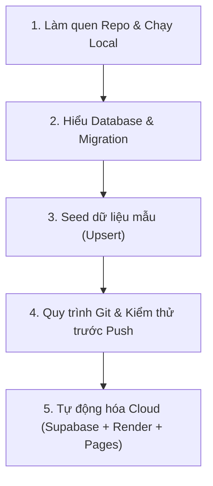

# Roadmap Onboarding & Quy trình Cloud cho Dev Fresher (MetaGym)

Tài liệu này giúp **Dev Fresher** chuyển từ thói quen làm việc ở **Local** sang làm việc nhóm và triển khai **Cloud Free** (`Supabase` + `Render` + `Cloudflare Pages`) trên dự án **MetaGym** một cách an toàn, không làm lỗi database hay nhánh chung.

---

## Tổng quan lộ trình



---

## Giai đoạn 1: Làm quen dự án & Chạy Local (Ngày 1–2)

**Mục tiêu:** Hiểu cấu trúc monorepo (`mobile-app/`, `admin-web/`, `backend/`, `database/`) và chạy được hệ thống trên máy.

1. Đọc [README.md](../../README.md) và [database/README.md](../../database/README.md).
2. Cài **Node.js `>= 22`**, chạy `npm install` trong `backend/` và `admin-web/`.
3. Tạo `backend/.env` từ `backend/.env.example`, điền `DATABASE_URL` và `JWT_SECRET` (>= 32 ký tự), chạy `npm run dev`.
4. Kiểm tra kết nối API & DB qua `GET http://localhost:3000/api/v1/health`.
5. Mở **Swagger UI** tại `http://localhost:3000/api-docs` (hoặc bản Cloud `https://metagym-api.onrender.com/api-docs`) để xem danh sách toàn bộ API.

---

## Giai đoạn 2: Hiểu Database & Quy tắc Migration (Ngày 3)

**Mục tiêu:** Hiểu sự khác biệt giữa Local và Cloud — **`git push` lên GitHub chỉ cập nhật code Node.js trên Render; Render KHÔNG tự chạy file SQL lên Supabase.**

1. Trước khi tạo file migration mới, luôn kiểm tra file mới nhất trong `database/migrations/` trên nhánh `main` để đặt số thứ tự tiếp theo (tránh trùng số).
2. Luôn tạo đủ cặp `XXXX_ten_tinh_nang.up.sql` và `XXXX_ten_tinh_nang.down.sql`.
3. **Tuyệt đối không** chạy lại toàn bộ từ `0001` lên database đã có dữ liệu. Chỉ chạy **file `.up.sql` mới** qua **Supabase SQL Editor** (copy-paste) hoặc `psql`.
4. Nếu migration có tạo bảng/sequence/function mới, chạy ngay lệnh khóa quyền public trong **Supabase SQL Editor**:
   ```sql
   REVOKE ALL ON ALL TABLES IN SCHEMA public FROM anon, authenticated;
   REVOKE ALL ON ALL SEQUENCES IN SCHEMA public FROM anon, authenticated;
   REVOKE EXECUTE ON ALL FUNCTIONS IN SCHEMA public FROM PUBLIC, anon, authenticated;
   ```
5. Luôn cập nhật database trên Supabase **trước khi** đẩy code Backend mới lên `main`.

---

## Giai đoạn 3: Đổ dữ liệu mẫu — Seed Data (Ngày 4)

**Mục tiêu:** Biết cách đổ dữ liệu test nhanh mà không gây trùng lặp hoặc lỗi khóa ngoại.

1. Tham khảo mẫu [0002_demo.sql](../../database/seeds/0002_demo.sql).
2. Tuân thủ **3 nguyên tắc vàng** khi seed:
   - **Đúng thứ tự khóa ngoại (Foreign Key Order):** Bảng cha trước → bảng con sau (`users` → `coach_profiles`/`member_profiles` → `membership_plans` → `member_memberships` → `coach_relationships`).
   - **Idempotent (`UPSERT`):** Dùng UUID cố định + `ON CONFLICT (...) DO UPDATE` hoặc `DO NOTHING` để chạy lặp lại nhiều lần không lỗi.
   - **Không tạo `ADMIN` thứ 2:** Schema chỉ cho phép duy nhất **1 tài khoản `ADMIN`**.
3. Chỉ dùng tài khoản demo ở môi trường dev/test; không dùng mật khẩu demo trên production thật.

---

## Giai đoạn 4: Quy trình Code, Test & Git (Hằng ngày)

**Mục tiêu:** Không đẩy code lỗi cú pháp, lộ secret hoặc gây xung đột cho nhánh chung `main`.

1. Code trên nhánh riêng (`feat/...` hoặc nhánh cá nhân), **không code trực tiếp trên `main`**.
2. Không bao giờ commit `.env`, `DATABASE_URL`, `JWT_SECRET`, `SUPABASE_SECRET_KEY` lên GitHub.
3. Trước khi commit / tạo Pull Request, bắt buộc chạy:
   - Backend: `cd backend && npm run check && npm test`
   - Admin Web: `cd admin-web && npm run build && npm test`

---

## Giai đoạn 5: Triển khai & Tự động hóa trên Cloud

**Mục tiêu:** Nắm toàn bộ luồng vận hành giữa GitHub, Supabase, Render và Cloudflare Pages.

1. Đọc kỹ 2 tài liệu:
   - [free-cloud-deployment-plan.md](./free-cloud-deployment-plan.md) (kế hoạch tổng thể, tự động hóa GitHub Actions + `schema_migrations` + Render Deploy Hook).
   - [meta-gym-cloud-step-by-step.md](./meta-gym-cloud-step-by-step.md) (hướng dẫn thực hành chi tiết và các lỗi thực tế như SSL `?uselibpqcompat=true&sslmode=require`, cache Cloudflare Pages).
2. Biết các endpoint vận hành trên Render:
   - Health check (kiểm tra cả API + DB): `/api/v1/health`
   - Keep-alive cho Cron (nhẹ, không query DB): `/ping`
   - Tài liệu test API trực quan: `/api-docs`

---

## Giai đoạn 6: Xem & Review App nhanh trên Web (Không cần cài APK lên máy)

Để team, tester hoặc giảng viên xem và bấm thử toàn bộ UI của `mobile-app/` ngay trên trình duyệt mà không cần cài Android Studio hay file `.apk`:

### Cách A: Dev tự review nhanh trên Chrome ở Local
```powershell
cd mobile-app
flutter pub get
flutter run -d chrome --dart-define=APP_ENV=local
```
- Nhấn `F12` trên Chrome → bật chế độ thiết bị di động (`390×844`) để xem đúng tỷ lệ màn hình điện thoại.
- **Lưu ý CORS:** Vì Chrome chạy `http://localhost:...` nên không gọi thẳng vào Render (`NODE_ENV=production` chỉ cho phép `https://`). Hãy bật backend local (`cd backend && npm run dev`, trỏ `DATABASE_URL` trong `.env` tới Supabase Cloud) để test dữ liệu thật trên Cloud mà không bị lỗi CORS.

### Cách B: Deploy bản Flutter Web lên Cloudflare Pages (Tạo link Review cho mọi người)
1. **Build bản Web trỏ về Backend Render:**
   ```powershell
   cd mobile-app
   flutter build web --release `
     --dart-define=APP_ENV=production `
     --dart-define=API_BASE_URL=https://metagym-api.onrender.com/api/v1
   ```
2. **Đẩy thư mục `mobile-app/build/web` lên Cloudflare Pages** (Direct Upload trên Cloudflare Dashboard hoặc tự động hóa qua GitHub Actions dùng `subosito/flutter-action@v2` để máy tính không cần cài Flutter).
3. **Cập nhật CORS trên Render (Bắt buộc):**
   - Thêm URL vừa tạo vào `CORS_ALLOWED_ORIGINS` trên Render, ngăn cách bằng dấu phẩy với URL Admin Web:
     ```text
     https://metagym-admin.pages.dev,https://metagym-app.pages.dev
     ```
4. **Lưu ý khi review trên Web:** Toàn bộ UI, điều hướng, biểu đồ, danh sách, đăng nhập, tập luyện, dinh dưỡng đều bấm thử được ngay; chỉ các tính năng cần camera trực tiếp (quét QR `mobile_scanner`) hoặc gọi thoại/video (`livekit_client`) bị giới hạn tùy quyền trình duyệt.

### Tổng hợp các Link Public trên Cloud để cả team / giảng viên vào xem trực tiếp
*(Lưu ý: `mobile-app/` hỗ trợ `android/` và `web/`, chưa có `windows/`, nên bản Web trên Cloudflare Pages là cách nhanh nhất để máy mới bất kỳ mở xem mà không cần cài Flutter hay Backend).*

| Thành phần | Link Public | Mục đích |
|---|---|---|
| **Backend API** | `https://metagym-api.onrender.com` | REST API chính kết nối Supabase |
| **Swagger UI** | `https://metagym-api.onrender.com/api-docs` | Xem & test API trực tuyến |
| **Cron Keep-Alive** | `https://metagym-api.onrender.com/ping` | Endpoint nhẹ giữ Render không ngủ |
| **WebAdmin** | `https://metagym-admin.pages.dev` | Trang quản trị Admin |
| **App Member/Coach (Web)** | `https://<ten-app>.pages.dev` | Link public từ `mobile-app/build/web` để xem UI & dùng thử online |

---

## Bảng tra cứu nhanh các Keyword kỹ thuật

| Keyword | Ý nghĩa / Vai trò trong MetaGym |
|---|---|
| **`Migration` (`.up.sql` / `.down.sql`)** | File SQL thay đổi cấu trúc bảng/cột (`.up.sql` để nâng cấp, `.down.sql` để hoàn tác). |
| **`schema_migrations`** | Bảng lưu lịch sử tên các file migration đã chạy, giúp script tự động biết file nào mới để chạy, file nào cũ thì bỏ qua. |
| **`GitHub Actions`** | Hệ thống chạy tự động miễn phí trên GitHub khi bạn `git push` (dùng workflow `.github/workflows/deploy-db-and-backend.yml`). |
| **`GitHub Secrets`** | Nơi lưu biến bí mật trên GitHub (`SUPABASE_DB_URL`, `RENDER_DEPLOY_HOOK_URL`) để workflow dùng mà không lộ lên code. |
| **`Render Deploy Hook`** | URL do Render cấp để GitHub Actions gọi `POST` kích hoạt deploy Backend **sau khi** DB migration đã chạy xong. |
| **`Session Pooler`** | Chuỗi kết nối PostgreSQL qua IPv4 của Supabase (cổng `5432`), giúp Render và GitHub Actions kết nối ổn định. |
| **`REVOKE ALL` (`anon`, `authenticated`)** | Lệnh khóa quyền truy cập trực tiếp từ khóa public của Supabase vào các bảng mới tạo. |
| **`Seed Data`** | Dữ liệu mẫu/danh mục khởi tạo ban đầu (bài tập, thiết bị, thực phẩm, gói tập, tài khoản test). |
| **`Idempotent` / `UPSERT` (`ON CONFLICT`)** | Viết lệnh SQL/Seed sao cho chạy lặp lại nhiều lần vẫn an toàn, không báo lỗi trùng khóa hoặc tạo dữ liệu rác. |
| **`Foreign Key Order`** | Thứ tự đổ dữ liệu: bảng cha trước (`users`, `membership_plans`), bảng con sau (`member_memberships`, `training_plans`). |
