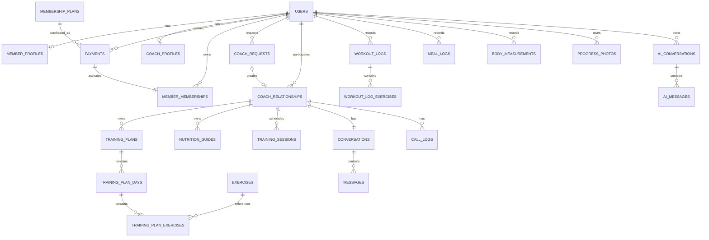

# Meta Gym — Đặc tả database MVP

> Cập nhật: 21/10/2026  
> Trạng thái: Bản đặc tả chờ duyệt, chưa khởi tạo PostgreSQL.  
> Phạm vi: Một phòng gym, một Admin, Member và Coach dùng chung hệ thống.

## 1. Mục tiêu

Tài liệu này xác định đầy đủ các đối tượng dữ liệu cần cho MVP Meta Gym, gồm:

- Tên bảng và trách nhiệm của bảng.
- Trường dữ liệu, kiểu PostgreSQL và tính bắt buộc.
- Khóa chính, khóa ngoại, giá trị trạng thái.
- Unique constraint, check constraint và index quan trọng.
- Quy tắc lưu lịch sử và quyền riêng tư.

Tài liệu này là nguồn chuẩn cho bước tạo migration sau khi được duyệt.

## 2. Quy ước kỹ thuật

- PostgreSQL là hệ quản trị cơ sở dữ liệu.
- Khóa chính của bảng nghiệp vụ dùng `uuid`, sinh ở backend.
- Thời điểm dùng `timestamptz`, lưu theo UTC. Múi giờ nghiệp vụ duy nhất là `Asia/Ho_Chi_Minh`; backend chuyển thời điểm sang múi giờ này trước khi xác định ngày nghiệp vụ, không tin ngày giờ từ thiết bị.
- Ngày không kèm giờ dùng `date`. Ngày hiệu lực membership tính theo lịch Việt Nam và bao gồm cả ngày bắt đầu lẫn ngày kết thúc.
- Tiền chỉ dùng VND và lưu bằng `bigint` theo số đồng, không dùng `float` và không lưu phần thập phân. Vì hệ thống chỉ có một tiền tệ nên không thêm cột `currency` vào từng bảng.
- Email dùng extension `citext` hoặc unique index trên `lower(email)`.
- Trạng thái dùng `varchar` kèm `CHECK`; không dùng PostgreSQL enum để dễ thay đổi migration.
- Mọi bảng thay đổi được đều có `created_at` và `updated_at`, trừ bảng chỉ ghi lịch sử. PostgreSQL tự đặt hai cột khi `INSERT` và cập nhật `updated_at` bằng một trigger dùng chung khi dữ liệu thực sự thay đổi; Flutter và Admin web không được gửi các giá trị hệ thống này.
- Không xóa vật lý tài khoản, thanh toán, gói đã mua, quan hệ, giáo trình đã công bố, nhật ký, tin nhắn, cuộc gọi và dữ liệu AI.
- Trường nhạy cảm chỉ được bảo vệ bằng phân quyền backend; URL ảnh riêng tư phải là URL ký có thời hạn, không phải URL công khai vĩnh viễn.

Quy ước cột:

- `PK`: khóa chính.
- `FK`: khóa ngoại.
- `NN`: bắt buộc, không được `NULL`.
- Các cột không ghi `NN` được phép `NULL`.

## 3. Tổng quan các nhóm bảng

| Nhóm | Bảng |
| --- | --- |
| Tài khoản | `users`, `member_profiles`, `coach_profiles`, `password_reset_codes` |
| Gói tập và thanh toán | `membership_plans`, `payments`, `member_memberships` |
| Quan hệ Coach–Member | `coach_requests`, `coach_relationships`, `coach_termination_requests`, `coach_transfer_history` |
| Nội dung phòng gym | `gym_profile`, `equipment`, `exercises` |
| Giáo trình và lịch tập | `training_plans`, `training_plan_days`, `training_plan_exercises`, `nutrition_guides`, `training_sessions` |
| Tệp và hình ảnh | `media_assets` |
| Theo dõi tiến độ | `workout_logs`, `workout_log_exercises`, `meal_logs`, `body_measurements`, `progress_photos`, `progress_comments` |
| Nhắn tin | `conversations`, `conversation_participants`, `messages` |
| Cuộc gọi | `call_logs` |
| AI | `ai_conversations`, `ai_messages` |
| Kiểm toán | `admin_audit_logs` |

Tổng cộng: **33 bảng nghiệp vụ**. Dashboard không có bảng riêng vì được tổng hợp từ các bảng hiện có.

## 4. Identity & Access

### 4.1. `users`

Lưu tài khoản đăng nhập và thông tin chung của cả Member, Coach và Admin.

| Cột | Kiểu | Ràng buộc | Ý nghĩa |
| --- | --- | --- | --- |
| `id` | `uuid` | PK | Mã người dùng |
| `email` | `citext` | NN, UNIQUE | Email đăng nhập |
| `password_hash` | `varchar(255)` | NN | Mật khẩu đã băm; không bao giờ lưu mật khẩu gốc |
| `role` | `varchar(20)` | NN, CHECK | `MEMBER`, `COACH`, `ADMIN` |
| `full_name` | `varchar(120)` | NN | Họ tên hiển thị |
| `phone` | `varchar(20)` | | Số điện thoại |
| `avatar_media_id` | `uuid` | FK → `media_assets.id` | Ảnh đại diện |
| `status` | `varchar(20)` | NN, CHECK | `ACTIVE`, `DISABLED` |
| `session_version` | `integer` | NN, mặc định `0`, CHECK `>= 0` | Phiên bản xác thực để vô hiệu JWT cũ |
| `disabled_at` | `timestamptz` | | Thời điểm Admin khóa tài khoản |
| `disabled_reason` | `text` | | Lý do khóa tài khoản |
| `last_login_at` | `timestamptz` | | Lần đăng nhập thành công gần nhất |
| `created_at` | `timestamptz` | NN | Thời điểm tạo |
| `updated_at` | `timestamptz` | NN | Thời điểm cập nhật |

Ràng buộc và index:

- Unique email không phân biệt chữ hoa/thường.
- Chỉ có một dòng `role = 'ADMIN'` bằng partial unique index.
- Index `(role, status)` và index tìm kiếm `full_name`.
- `ACTIVE` bắt buộc không có `disabled_at`/`disabled_reason`; `DISABLED` bắt buộc có cả hai trường này.
- Không cho đổi vai trò sau khi tài khoản đã phát sinh dữ liệu.
- JWT chứa `session_version`. Mọi API xác thực phải kiểm tra `status = 'ACTIVE'` và phiên bản trong JWT bằng giá trị hiện tại trong database.
- Khi khóa tài khoản hoặc đặt lại mật khẩu thành công, backend khóa dòng `users`, tăng `session_version` và làm cho toàn bộ JWT cũ mất hiệu lực. Mở khóa không khôi phục JWT cũ; người dùng phải đăng nhập lại.
- Tài khoản Member bị khóa không tự động kết thúc quan hệ Coach và vẫn chiếm suất khi quan hệ là `ACTIVE` hoặc `PAUSED`.

### 4.2. `member_profiles`

Thông tin bổ sung do Member tự khai báo. Thông tin này không phải chẩn đoán y tế.

| Cột | Kiểu | Ràng buộc | Ý nghĩa |
| --- | --- | --- | --- |
| `user_id` | `uuid` | PK, FK → `users.id` | Đồng thời là mã Member |
| `date_of_birth` | `date` | | Ngày sinh |
| `gender` | `varchar(30)` | CHECK | `MALE`, `FEMALE`, `OTHER`, `PREFER_NOT_TO_SAY` |
| `height_cm` | `numeric(5,2)` | CHECK | Chiều cao, lớn hơn 0 và không quá 300 cm |
| `fitness_goal` | `text` | | Mục tiêu tập luyện |
| `experience_level` | `varchar(20)` | CHECK | `BEGINNER`, `INTERMEDIATE`, `ADVANCED` |
| `activity_level` | `varchar(20)` | CHECK | `LOW`, `MODERATE`, `HIGH` |
| `health_notes` | `text` | | Thông tin sức khỏe Member tự khai báo |
| `injury_notes` | `text` | | Chấn thương hoặc hạn chế vận động tự khai báo |
| `dietary_preferences` | `text` | | Sở thích, dị ứng hoặc hạn chế ăn uống tự khai báo |
| `created_at` | `timestamptz` | NN | Thời điểm tạo |
| `updated_at` | `timestamptz` | NN | Thời điểm cập nhật |

Quyền riêng tư: Member, chính Member đó và Coach đang phụ trách mới được đọc; Admin chỉ xem thông tin tài khoản cơ bản, không xem ghi chú sức khỏe chi tiết.

### 4.3. `coach_profiles`

| Cột | Kiểu | Ràng buộc | Ý nghĩa |
| --- | --- | --- | --- |
| `user_id` | `uuid` | PK, FK → `users.id` | Đồng thời là mã Coach |
| `biography` | `text` | | Giới thiệu Coach |
| `specialties` | `text[]` | NN, mặc định `{}` | Chuyên môn |
| `qualifications` | `text` | | Bằng cấp/chứng chỉ dạng mô tả |
| `experience_years` | `smallint` | NN, CHECK `>= 0` | Số năm kinh nghiệm |
| `availability_note` | `text` | | Ghi chú thời gian có thể hướng dẫn |
| `member_limit` | `smallint` | NN, CHECK `> 0` | Số Member tối đa |
| `created_at` | `timestamptz` | NN | Thời điểm tạo |
| `updated_at` | `timestamptz` | NN | Thời điểm cập nhật |

Số suất đang dùng được đếm từ quan hệ `ACTIVE` và `PAUSED`, không lưu thành cột để tránh sai lệch.

### 4.4. `password_reset_codes`

| Cột | Kiểu | Ràng buộc | Ý nghĩa |
| --- | --- | --- | --- |
| `id` | `uuid` | PK | Mã yêu cầu |
| `user_id` | `uuid` | NN, FK → `users.id` | Người yêu cầu |
| `code_hash` | `varchar(255)` | NN | Mã xác nhận đã băm |
| `attempt_count` | `smallint` | NN, mặc định `0` | Số lần nhập sai |
| `expires_at` | `timestamptz` | NN | Hạn sử dụng |
| `used_at` | `timestamptz` | | Thời điểm đã dùng |
| `invalidated_at` | `timestamptz` | | Thời điểm bị thay thế hoặc vô hiệu hóa |
| `created_at` | `timestamptz` | NN | Thời điểm tạo |

Ràng buộc và index:

- CHECK `attempt_count BETWEEN 0 AND 5` và `expires_at > created_at`.
- CHECK `num_nonnulls(used_at, invalidated_at) <= 1`.
- Index `(user_id, created_at DESC)`.
- Mỗi lần tạo mã mới phải làm mất hiệu lực các mã cũ chưa dùng. Mã chỉ hợp lệ khi `used_at IS NULL`, `invalidated_at IS NULL`, chưa hết hạn và `attempt_count < 5`.

Quy tắc đặt lại mật khẩu:

- Dùng mã một lần gửi qua email, thời hạn 15 phút; không đổi sang security question hoặc cho Admin đọc mật khẩu cũ.
- API yêu cầu mã luôn trả thông báo trung tính dù email có tồn tại hay không.
- Giới hạn tối đa 3 lần yêu cầu trong 15 phút theo tài khoản và IP; giới hạn này do service/rate limiter thực thi.
- API kiểm tra mã không đánh dấu `used_at`. API đặt mật khẩu phải gửi lại `request_id` và mã, khóa dòng mã cùng dòng `users`, kiểm tra lại toàn bộ điều kiện rồi cập nhật mật khẩu, đặt `used_at` và tăng `session_version` trong cùng transaction.

## 5. Membership & Payment

### 5.1. `membership_plans`

| Cột | Kiểu | Ràng buộc | Ý nghĩa |
| --- | --- | --- | --- |
| `id` | `uuid` | PK | Mã gói |
| `name` | `varchar(100)` | NN | Tên gói |
| `description` | `text` | | Nội dung giới thiệu |
| `price` | `bigint` | NN, CHECK `>= 0` | Giá bán tính theo số đồng VND |
| `duration_days` | `integer` | NN, CHECK `> 0` | Số ngày sử dụng |
| `status` | `varchar(20)` | NN, CHECK | `ACTIVE`, `INACTIVE` |
| `created_by` | `uuid` | NN, FK → `users.id` | Admin tạo |
| `created_at` | `timestamptz` | NN | Thời điểm tạo |
| `updated_at` | `timestamptz` | NN | Thời điểm cập nhật |

Không sửa giá hoặc thời hạn của các gói Member đã mua; giao dịch và membership lưu snapshot cần thiết.

### 5.2. `payments`

| Cột | Kiểu | Ràng buộc | Ý nghĩa |
| --- | --- | --- | --- |
| `id` | `uuid` | PK | Mã giao dịch |
| `member_id` | `uuid` | NN, FK → `users.id` | Member mua gói |
| `plan_id` | `uuid` | NN, FK → `membership_plans.id` | Gói được mua |
| `plan_name_snapshot` | `varchar(100)` | NN | Tên gói tại lúc mua |
| `duration_days_snapshot` | `integer` | NN, CHECK `> 0` | Thời hạn tại lúc mua |
| `amount` | `bigint` | NN, CHECK `>= 0` | Số tiền tại lúc mua, tính theo số đồng VND |
| `method` | `varchar(20)` | NN, CHECK | `MOCK_QR`, `FRONT_DESK` |
| `status` | `varchar(20)` | NN, CHECK | `PENDING`, `SUCCESS`, `FAILED`, `CANCELLED` |
| `transaction_code` | `varchar(50)` | NN, UNIQUE | Mã giao dịch hiển thị |
| `idempotency_key` | `varchar(100)` | NN | Khóa chống tạo giao dịch trùng |
| `request_hash` | `varchar(64)` | NN | SHA-256 của nội dung tạo giao dịch để phát hiện dùng lại key với nội dung khác |
| `created_by` | `uuid` | NN, FK → `users.id` | Member hoặc Admin tạo giao dịch |
| `decided_by` | `uuid` | FK → `users.id` | Admin thực hiện quyết định thủ công; để trống khi hệ thống xác nhận `MOCK_QR` thành công |
| `confirmed_at` | `timestamptz` | | Thời điểm thành công |
| `decided_at` | `timestamptz` | | Thời điểm chuyển khỏi `PENDING` |
| `failure_reason` | `text` | | Lý do thất bại/hủy |
| `created_at` | `timestamptz` | NN | Thời điểm tạo |
| `updated_at` | `timestamptz` | NN | Thời điểm cập nhật |

Ràng buộc và index:

- UNIQUE `(created_by, idempotency_key)`.
- UNIQUE `(id, member_id, plan_id)` để membership tham chiếu đúng giao dịch, Member và gói.
- Cùng idempotency key nhưng `request_hash` khác phải trả lỗi, không dùng lại kết quả cũ.
- Index `(member_id, created_at DESC)` và `(status, created_at DESC)`.
- Sau khi `SUCCESS`, số tiền, gói, người mua và phương thức không được sửa.
- Với `MOCK_QR`, Member sở hữu giao dịch mô phỏng thanh toán thành công. Backend tự chuyển `PENDING → SUCCESS`; không cần Admin duyệt. Xác nhận lặp cho cùng giao dịch đã `SUCCESS` phải trả lại kết quả hiện có và không tạo thêm membership.
- Với `FRONT_DESK`, Admin tạo và xác nhận giao dịch tại quầy. Các thao tác Admin đánh dấu `FAILED` hoặc `CANCELLED` phải lưu `decided_by` và được audit.
- Các trạng thái kết thúc không chuyển lại `PENDING`; trường hợp sự cố phải được xử lý bằng thao tác quản trị có audit, không sửa mất lịch sử.
- `SUCCESS` bắt buộc có `confirmed_at`, `decided_at` và không có `failure_reason`. `decided_by` để trống khi `MOCK_QR` được hệ thống xác nhận, và bắt buộc có giá trị khi `FRONT_DESK` thành công hoặc khi Admin quyết định thủ công. `FAILED`/`CANCELLED` bắt buộc có `decided_at` và `failure_reason`; nếu do Admin xử lý thì bắt buộc có `decided_by`.
- Xác nhận `MOCK_QR` phải kiểm tra giao dịch thuộc Member đang đăng nhập, dùng conditional update từ `PENDING`, rồi tạo membership và tính chuỗi ngày nối tiếp trong cùng transaction. Gói có hiệu lực từ hôm nay được kích hoạt ngay; gói mua thêm được xếp `SCHEDULED`.

### 5.3. `member_memberships`

| Cột | Kiểu | Ràng buộc | Ý nghĩa |
| --- | --- | --- | --- |
| `id` | `uuid` | PK | Mã lần đăng ký gói |
| `member_id` | `uuid` | NN, FK → `users.id` | Member sở hữu |
| `plan_id` | `uuid` | NN, FK → `membership_plans.id` | Gói tham chiếu |
| `source_payment_id` | `uuid` | NN, UNIQUE, FK → `payments.id` | Giao dịch tạo ra gói này |
| `start_date` | `date` | NN | Ngày bắt đầu, tính cả ngày này |
| `end_date` | `date` | NN | Ngày kết thúc, tính cả ngày này |
| `status` | `varchar(20)` | NN, CHECK | `SCHEDULED`, `ACTIVE`, `EXPIRED`, `CANCELLED` |
| `activated_at` | `timestamptz` | | Thời điểm kích hoạt |
| `expired_at` | `timestamptz` | | Thời điểm chuyển hết hạn |
| `created_at` | `timestamptz` | NN | Thời điểm tạo |
| `updated_at` | `timestamptz` | NN | Thời điểm cập nhật |

Ràng buộc:

- `end_date >= start_date`.
- `(source_payment_id, member_id, plan_id)` tham chiếu `(id, member_id, plan_id)` của `payments`; payment nguồn bắt buộc ở trạng thái `SUCCESS` khi service tạo membership.
- Một Member chỉ có tối đa một gói `ACTIVE` bằng partial unique index.
- Gói mua tiếp được xếp `SCHEDULED` với ngày bắt đầu sau ngày kết thúc gói trước.
- Dùng `btree_gist` và exclusion constraint trên `member_id` cùng `daterange(start_date, end_date, '[]')` để mọi membership không phải `CANCELLED` của cùng Member không chồng ngày hiệu lực.
- Index `(member_id, status, start_date)` để tìm gói hiện tại và hàng đợi.
- Membership còn hiệu lực khi ngày hiện tại tại `Asia/Ho_Chi_Minh` nằm trong đoạn `[start_date, end_date]`. Gói nối tiếp bắt đầu vào ngày sau `end_date` của gói trước.
- `SCHEDULED` không có `activated_at`/`expired_at`; `ACTIVE` có `activated_at` và chưa có `expired_at`; `EXPIRED` có cả `activated_at` và `expired_at`.
- Ngày bắt đầu membership mới là ngày lớn hơn giữa ngày hiện tại tại `Asia/Ho_Chi_Minh` và ngày sau `end_date` lớn nhất của chuỗi membership chưa `CANCELLED`.

## 6. Coaching Relationship

### 6.1. `coach_requests`

| Cột | Kiểu | Ràng buộc | Ý nghĩa |
| --- | --- | --- | --- |
| `id` | `uuid` | PK | Mã yêu cầu |
| `member_id` | `uuid` | NN, FK → `users.id` | Member gửi yêu cầu |
| `coach_id` | `uuid` | NN, FK → `users.id` | Coach được chọn |
| `message` | `text` | | Lời nhắn của Member |
| `status` | `varchar(20)` | NN, CHECK | `PENDING`, `ACCEPTED`, `REJECTED`, `CANCELLED` |
| `rejection_reason` | `text` | | Lý do từ chối |
| `requested_at` | `timestamptz` | NN | Thời điểm gửi |
| `decided_at` | `timestamptz` | | Thời điểm xử lý |
| `created_at` | `timestamptz` | NN | Thời điểm tạo |
| `updated_at` | `timestamptz` | NN | Thời điểm cập nhật |

Partial unique index bảo đảm một Member chỉ có một yêu cầu `PENDING`.

UNIQUE `(id, member_id, coach_id)` để quan hệ được tạo từ yêu cầu không thể đổi Member hoặc Coach. `PENDING` không có `decided_at`; các trạng thái kết thúc phải có `decided_at`; `REJECTED` bắt buộc có `rejection_reason`.

Yêu cầu đã `ACCEPTED`, `REJECTED` hoặc `CANCELLED` là lịch sử và không được dùng lại. Nếu Member chọn hoặc chuyển Coach lần nữa thì phải tạo yêu cầu/quan hệ mới.

### 6.2. `coach_relationships`

| Cột | Kiểu | Ràng buộc | Ý nghĩa |
| --- | --- | --- | --- |
| `id` | `uuid` | PK | Mã quan hệ |
| `member_id` | `uuid` | NN, FK → `users.id` | Member |
| `coach_id` | `uuid` | NN, FK → `users.id` | Coach phụ trách |
| `source_request_id` | `uuid` | FK → `coach_requests.id` | Yêu cầu tạo quan hệ; có thể trống nếu Admin chuyển Coach |
| `status` | `varchar(20)` | NN, CHECK | `ACTIVE`, `PAUSED`, `ENDED` |
| `started_at` | `timestamptz` | NN | Thời điểm bắt đầu |
| `paused_at` | `timestamptz` | | Thời điểm tạm ngưng |
| `pause_reason` | `varchar(30)` | CHECK | Hiện tại chỉ dùng `MEMBERSHIP_EXPIRED` |
| `ended_at` | `timestamptz` | | Thời điểm kết thúc |
| `ended_by` | `uuid` | FK → `users.id` | Người thực hiện kết thúc |
| `end_reason` | `text` | | Lý do kết thúc |
| `created_at` | `timestamptz` | NN | Thời điểm tạo |
| `updated_at` | `timestamptz` | NN | Thời điểm cập nhật |

Ràng buộc và index:

- Partial unique index trên `member_id` khi trạng thái là `ACTIVE` hoặc `PAUSED`.
- UNIQUE `(id, member_id)` và UNIQUE `(id, coach_id)` để các bảng phụ thuộc có thể ràng buộc đúng chủ thể mà không lặp dữ liệu không cần thiết.
- UNIQUE `(id, member_id, coach_id)` để các bảng nghiệp vụ có thể dùng composite FK xác nhận đúng ba thành phần của quan hệ.
- UNIQUE `source_request_id` khi cột này có giá trị để một yêu cầu không tạo được hai quan hệ.
- Khi `source_request_id` có giá trị, `(source_request_id, member_id, coach_id)` phải tham chiếu `(id, member_id, coach_id)` của `coach_requests`; trường hợp Admin chuyển Coach được phép để `source_request_id` trống.
- Index `(coach_id, status)` để đếm suất; cả `ACTIVE` và `PAUSED` đều chiếm suất.
- Chỉ quan hệ `ACTIVE` được tạo tin nhắn và cuộc gọi mới.
- `ENDED` bắt buộc có `ended_at`; quan hệ đã `ENDED` không được kích hoạt lại. Gia hạn gói chỉ tự kích hoạt quan hệ đang `PAUSED` vì `MEMBERSHIP_EXPIRED`.
- `ACTIVE` không có thông tin pause/end hiện hành. `PAUSED` bắt buộc có `paused_at` và `pause_reason`, đồng thời chưa có thông tin kết thúc. `ENDED` bắt buộc có `ended_at`, `ended_by`, `end_reason`.
- Khi nhận hoặc chuyển Coach, transaction phải khóa dòng Member và Coach trước khi đếm lại các quan hệ `ACTIVE`/`PAUSED`, không chỉ dựa vào số suất đã hiển thị cho client.
- Coach có quan hệ `ACTIVE` được đọc/ghi dữ liệu chuyên môn. Quan hệ `PAUSED` chỉ được đọc lịch sử. Sau `ENDED`, Coach cũ chỉ được đọc chat cũ và giáo trình/hướng dẫn/buổi tập do chính quan hệ đó tạo; không được đọc hồ sơ sức khỏe, nhật ký, số đo hoặc ảnh tiến trình của Member.

### 6.3. `coach_termination_requests`

| Cột | Kiểu | Ràng buộc | Ý nghĩa |
| --- | --- | --- | --- |
| `id` | `uuid` | PK | Mã yêu cầu |
| `relationship_id` | `uuid` | NN, FK → `coach_relationships.id` | Quan hệ cần kết thúc |
| `coach_id` | `uuid` | NN, FK → `users.id` | Coach gửi yêu cầu |
| `reason` | `text` | NN | Lý do xin ngừng phụ trách |
| `status` | `varchar(20)` | NN, CHECK | `PENDING`, `APPROVED`, `REJECTED`, `CANCELLED` |
| `admin_note` | `text` | | Ghi chú của Admin |
| `decided_by` | `uuid` | FK → `users.id` | Admin xử lý |
| `decided_at` | `timestamptz` | | Thời điểm xử lý |
| `created_at` | `timestamptz` | NN | Thời điểm tạo |
| `updated_at` | `timestamptz` | NN | Thời điểm cập nhật |

Partial unique index bảo đảm mỗi quan hệ chỉ có một yêu cầu `PENDING`.

`(relationship_id, coach_id)` phải tham chiếu `(id, coach_id)` của `coach_relationships`. `PENDING` chưa có `decided_by`/`decided_at`; `APPROVED` hoặc `REJECTED` bắt buộc có cả hai trường. Coach tạo yêu cầu được phép hủy yêu cầu của chính mình khi còn `PENDING`.

### 6.4. `coach_transfer_history`

| Cột | Kiểu | Ràng buộc | Ý nghĩa |
| --- | --- | --- | --- |
| `id` | `uuid` | PK | Mã lịch sử chuyển |
| `member_id` | `uuid` | NN, FK → `users.id` | Member được chuyển |
| `old_relationship_id` | `uuid` | NN, FK → `coach_relationships.id` | Quan hệ cũ |
| `new_relationship_id` | `uuid` | NN, FK → `coach_relationships.id` | Quan hệ mới |
| `old_coach_id` | `uuid` | NN, FK → `users.id` | Coach cũ |
| `new_coach_id` | `uuid` | NN, FK → `users.id` | Coach mới |
| `reason` | `text` | NN | Sự cố và lý do chuyển |
| `admin_id` | `uuid` | NN, FK → `users.id` | Admin thực hiện |
| `created_at` | `timestamptz` | NN | Thời điểm chuyển |

Chuyển Coach phải kết thúc quan hệ cũ, tạo quan hệ mới và ghi lịch sử trong cùng một transaction.

Ràng buộc:

- `(old_relationship_id, member_id, old_coach_id)` và `(new_relationship_id, member_id, new_coach_id)` tham chiếu composite key tương ứng của `coach_relationships`.
- `old_relationship_id <> new_relationship_id` và `old_coach_id <> new_coach_id`.

## 7. Gym Content

### 7.1. `gym_profile`

Hệ thống chỉ có đúng một dòng với `id = 1`.

| Cột | Kiểu | Ràng buộc | Ý nghĩa |
| --- | --- | --- | --- |
| `id` | `smallint` | PK, CHECK `id = 1` | Khóa cố định |
| `name` | `varchar(150)` | NN | Tên phòng gym |
| `address` | `text` | NN | Địa chỉ |
| `phone` | `varchar(20)` | | Số liên hệ |
| `email` | `citext` | | Email liên hệ |
| `description` | `text` | | Giới thiệu |
| `opening_hours` | `jsonb` | NN | Giờ mở cửa theo từng ngày |
| `rules` | `text` | | Nội quy |
| `cover_media_id` | `uuid` | FK → `media_assets.id` | Ảnh đại diện phòng gym |
| `updated_by` | `uuid` | FK → `users.id` | Admin cập nhật gần nhất |
| `created_at` | `timestamptz` | NN | Thời điểm tạo |
| `updated_at` | `timestamptz` | NN | Thời điểm cập nhật |

### 7.2. `equipment`

| Cột | Kiểu | Ràng buộc | Ý nghĩa |
| --- | --- | --- | --- |
| `id` | `uuid` | PK | Mã thiết bị |
| `name` | `varchar(120)` | NN | Tên thiết bị |
| `category` | `varchar(80)` | NN | Nhóm thiết bị |
| `target_muscles` | `text[]` | NN, mặc định `{}` | Nhóm cơ tác động |
| `image_media_id` | `uuid` | FK → `media_assets.id` | Hình ảnh |
| `description` | `text` | | Mô tả |
| `usage_steps` | `jsonb` | NN | Mảng các bước có số thứ tự và nội dung |
| `safety_notes` | `text` | | Cảnh báo an toàn |
| `video_url` | `text` | | Video hướng dẫn bên ngoài |
| `status` | `varchar(20)` | NN, CHECK | `ACTIVE`, `HIDDEN` |
| `created_by` | `uuid` | NN, FK → `users.id` | Admin tạo |
| `created_at` | `timestamptz` | NN | Thời điểm tạo |
| `updated_at` | `timestamptz` | NN | Thời điểm cập nhật |

Index: `(status, category)` và chỉ mục tìm kiếm tên.

### 7.3. `exercises`

| Cột | Kiểu | Ràng buộc | Ý nghĩa |
| --- | --- | --- | --- |
| `id` | `uuid` | PK | Mã bài tập |
| `equipment_id` | `uuid` | FK → `equipment.id` | Thiết bị liên quan, có thể trống |
| `name` | `varchar(120)` | NN | Tên bài tập |
| `description` | `text` | | Mô tả |
| `target_muscles` | `text[]` | NN, mặc định `{}` | Nhóm cơ |
| `instructions` | `text` | NN | Hướng dẫn thực hiện |
| `safety_notes` | `text` | | Cảnh báo |
| `difficulty` | `varchar(20)` | CHECK | `BEGINNER`, `INTERMEDIATE`, `ADVANCED` |
| `video_url` | `text` | | Video hướng dẫn |
| `status` | `varchar(20)` | NN, CHECK | `ACTIVE`, `HIDDEN` |
| `created_by` | `uuid` | NN, FK → `users.id` | Admin tạo |
| `created_at` | `timestamptz` | NN | Thời điểm tạo |
| `updated_at` | `timestamptz` | NN | Thời điểm cập nhật |

## 8. Training & Nutrition

### 8.1. `training_plans`

| Cột | Kiểu | Ràng buộc | Ý nghĩa |
| --- | --- | --- | --- |
| `id` | `uuid` | PK | Mã giáo trình |
| `relationship_id` | `uuid` | NN, FK → `coach_relationships.id` | Quan hệ tạo giáo trình |
| `member_id` | `uuid` | NN, FK → `users.id` | Member nhận giáo trình |
| `coach_id` | `uuid` | NN, FK → `users.id` | Coach tạo |
| `title` | `varchar(150)` | NN | Tên giáo trình |
| `goal` | `text` | | Mục tiêu |
| `start_date` | `date` | | Ngày bắt đầu dự kiến |
| `end_date` | `date` | | Ngày kết thúc dự kiến |
| `version` | `integer` | NN, CHECK `> 0` | Phiên bản theo Member |
| `status` | `varchar(20)` | NN, CHECK | `DRAFT`, `ACTIVE`, `ARCHIVED` |
| `published_at` | `timestamptz` | | Thời điểm công bố |
| `archived_at` | `timestamptz` | | Thời điểm lưu trữ |
| `created_at` | `timestamptz` | NN | Thời điểm tạo |
| `updated_at` | `timestamptz` | NN | Thời điểm cập nhật |

Ràng buộc:

- `end_date` phải lớn hơn hoặc bằng `start_date` khi có cả hai.
- UNIQUE `(member_id, version)`.
- UNIQUE `(id, member_id)` để nhật ký tập tham chiếu đúng giáo trình của Member.
- Một Member chỉ có tối đa một giáo trình `ACTIVE`.
- Member chỉ đọc được `ACTIVE` và `ARCHIVED`, không đọc bản `DRAFT`.
- `(relationship_id, member_id, coach_id)` phải tham chiếu composite key tương ứng của `coach_relationships`.
- Chỉ bản `DRAFT` được sửa nội dung. Khi công bố, bản `ACTIVE` cũ chuyển `ARCHIVED`, bản mới chuyển `ACTIVE`; `ACTIVE` và `ARCHIVED` là bất biến, mọi thay đổi tiếp theo phải tạo phiên bản mới.
- `DRAFT` không có `published_at`/`archived_at`; `ACTIVE` có `published_at` và chưa có `archived_at`; `ARCHIVED` có cả hai timestamp.
- Mọi thao tác thêm, sửa hoặc xóa `training_plan_days` và `training_plan_exercises` phải khóa giáo trình cha và chỉ cho phép khi cha còn `DRAFT`.

### 8.2. `training_plan_days`

| Cột | Kiểu | Ràng buộc | Ý nghĩa |
| --- | --- | --- | --- |
| `id` | `uuid` | PK | Mã ngày tập |
| `plan_id` | `uuid` | NN, FK → `training_plans.id` | Giáo trình cha |
| `day_number` | `smallint` | NN, CHECK `> 0` | Thứ tự ngày/buổi |
| `title` | `varchar(120)` | NN | Tên ngày tập |
| `notes` | `text` | | Ghi chú |
| `created_at` | `timestamptz` | NN | Thời điểm tạo |
| `updated_at` | `timestamptz` | NN | Thời điểm cập nhật |

UNIQUE `(plan_id, day_number)`. Thêm, sửa hoặc xóa dòng chỉ được thực hiện khi giáo trình cha còn `DRAFT`.

### 8.3. `training_plan_exercises`

| Cột | Kiểu | Ràng buộc | Ý nghĩa |
| --- | --- | --- | --- |
| `id` | `uuid` | PK | Mã cấu hình bài tập |
| `plan_day_id` | `uuid` | NN, FK → `training_plan_days.id` | Ngày tập |
| `exercise_id` | `uuid` | NN, FK → `exercises.id` | Bài tập |
| `exercise_name_snapshot` | `varchar(120)` | | Tên bài tập được chụp khi công bố giáo trình |
| `instructions_snapshot` | `text` | | Hướng dẫn được chụp khi công bố |
| `safety_notes_snapshot` | `text` | | Cảnh báo an toàn được chụp khi công bố |
| `display_order` | `smallint` | NN, CHECK `> 0` | Thứ tự hiển thị |
| `sets` | `smallint` | CHECK `> 0` | Số hiệp |
| `reps` | `varchar(50)` | | Số lần, cho phép dạng `8-12` |
| `duration_seconds` | `integer` | CHECK `> 0` | Thời lượng nếu là bài theo thời gian |
| `rest_seconds` | `integer` | CHECK `>= 0` | Thời gian nghỉ |
| `weight_guidance` | `varchar(100)` | | Gợi ý mức tạ; không ép thành số cố định |
| `notes` | `text` | | Lưu ý kỹ thuật |
| `created_at` | `timestamptz` | NN | Thời điểm tạo |
| `updated_at` | `timestamptz` | NN | Thời điểm cập nhật |

UNIQUE `(plan_day_id, display_order)`. Phải có ít nhất một trong `reps` hoặc `duration_seconds`. Khi giáo trình được công bố, ba cột snapshot là bắt buộc; thay đổi danh mục `exercises` về sau không làm thay đổi nội dung phiên bản đã công bố.

### 8.4. `nutrition_guides`

| Cột | Kiểu | Ràng buộc | Ý nghĩa |
| --- | --- | --- | --- |
| `id` | `uuid` | PK | Mã hướng dẫn |
| `relationship_id` | `uuid` | NN, FK → `coach_relationships.id` | Quan hệ tạo hướng dẫn |
| `member_id` | `uuid` | NN, FK → `users.id` | Member nhận |
| `coach_id` | `uuid` | NN, FK → `users.id` | Coach tạo |
| `title` | `varchar(150)` | NN | Tiêu đề |
| `content` | `text` | NN | Nội dung hướng dẫn dạng văn bản |
| `version` | `integer` | NN, CHECK `> 0` | Phiên bản theo Member |
| `status` | `varchar(20)` | NN, CHECK | `DRAFT`, `ACTIVE`, `ARCHIVED` |
| `published_at` | `timestamptz` | | Thời điểm công bố |
| `archived_at` | `timestamptz` | | Thời điểm lưu trữ |
| `created_at` | `timestamptz` | NN | Thời điểm tạo |
| `updated_at` | `timestamptz` | NN | Thời điểm cập nhật |

UNIQUE `(member_id, version)` và chỉ một dòng `ACTIVE` cho mỗi Member. `(relationship_id, member_id, coach_id)` phải tham chiếu composite key của `coach_relationships`. Chỉ `DRAFT` được sửa nội dung; `ACTIVE` và `ARCHIVED` là bất biến, sửa đổi phải tạo phiên bản mới.

`DRAFT` không có `published_at`/`archived_at`; `ACTIVE` có `published_at` và chưa có `archived_at`; `ARCHIVED` có cả hai timestamp.

### 8.5. `training_sessions`

| Cột | Kiểu | Ràng buộc | Ý nghĩa |
| --- | --- | --- | --- |
| `id` | `uuid` | PK | Mã buổi tập |
| `relationship_id` | `uuid` | NN, FK → `coach_relationships.id` | Quan hệ liên quan |
| `member_id` | `uuid` | NN, FK → `users.id` | Member của quan hệ; dùng bảo vệ ownership nhật ký tập |
| `title` | `varchar(150)` | NN | Tên buổi tập |
| `scheduled_start_at` | `timestamptz` | NN | Giờ bắt đầu dự kiến |
| `scheduled_end_at` | `timestamptz` | | Giờ kết thúc dự kiến |
| `status` | `varchar(20)` | NN, CHECK | `SCHEDULED`, `COMPLETED`, `MEMBER_ABSENT`, `CANCELLED` |
| `notes` | `text` | | Ghi chú của Coach |
| `cancellation_reason` | `text` | | Lý do hủy |
| `cancelled_at` | `timestamptz` | | Thời điểm hủy |
| `completed_at` | `timestamptz` | | Thời điểm hoàn thành |
| `absent_at` | `timestamptz` | | Thời điểm Coach xác nhận Member vắng |
| `created_at` | `timestamptz` | NN | Thời điểm tạo |
| `updated_at` | `timestamptz` | NN | Thời điểm cập nhật |

`scheduled_end_at` phải sau `scheduled_start_at`. `(relationship_id, member_id)` phải tham chiếu `(id, member_id)` của `coach_relationships`; UNIQUE `(id, member_id)` phục vụ FK ownership của nhật ký tập. Index `(relationship_id, scheduled_start_at)`.

Chuyển trạng thái hợp lệ: `SCHEDULED → COMPLETED`, `SCHEDULED → MEMBER_ABSENT` hoặc `SCHEDULED → CANCELLED`. Trạng thái kết thúc không được khôi phục về `SCHEDULED`; quan hệ chuyển `PAUSED` hoặc `ENDED` phải hủy các buổi tương lai còn `SCHEDULED`. `COMPLETED` bắt buộc có `completed_at`; `MEMBER_ABSENT` bắt buộc có `absent_at`; `CANCELLED` bắt buộc có `cancelled_at` và `cancellation_reason`. Các timestamp kết quả khác phải trống.

## 9. Tệp và hình ảnh

### 9.1. `media_assets`

Lưu metadata của tệp; nội dung tệp nằm ở dịch vụ lưu trữ, không lưu binary trong PostgreSQL.

| Cột | Kiểu | Ràng buộc | Ý nghĩa |
| --- | --- | --- | --- |
| `id` | `uuid` | PK | Mã tệp |
| `owner_id` | `uuid` | NN, FK → `users.id` | Người tải lên |
| `purpose` | `varchar(30)` | NN, CHECK | `AVATAR`, `MESSAGE`, `PROGRESS_PHOTO`, `MEAL_PHOTO`, `EQUIPMENT`, `GYM` |
| `access_scope` | `varchar(20)` | NN, CHECK | `PUBLIC`, `PRIVATE` |
| `storage_key` | `text` | NN, UNIQUE | Khóa trong dịch vụ lưu trữ |
| `original_name` | `varchar(255)` | NN | Tên tệp ban đầu |
| `mime_type` | `varchar(100)` | | Loại ảnh đã được backend xác minh |
| `size_bytes` | `bigint` | CHECK `> 0` | Kích thước tệp đã được backend xác minh |
| `width` | `integer` | CHECK `> 0` | Chiều rộng ảnh |
| `height` | `integer` | CHECK `> 0` | Chiều cao ảnh |
| `status` | `varchar(20)` | NN, CHECK | `UPLOADING`, `READY`, `FAILED`, `DELETED` |
| `expires_at` | `timestamptz` | NN | Hạn hoàn tất upload; mặc định 30 phút sau khi tạo |
| `ready_at` | `timestamptz` | | Thời điểm backend xác minh file thành công |
| `failed_at` | `timestamptz` | | Thời điểm upload/xác minh thất bại |
| `failure_reason` | `text` | | Lý do thất bại đã lọc, không chứa dữ liệu bí mật |
| `created_at` | `timestamptz` | NN | Thời điểm tải lên |
| `deleted_at` | `timestamptz` | | Thời điểm xóa mềm |

Ảnh tin nhắn và tiến trình bắt buộc `PRIVATE`; ảnh phòng gym, thiết bị và avatar có thể `PUBLIC`.

Ràng buộc và vòng đời:

- Chuyển trạng thái hợp lệ: `UPLOADING → READY`, `UPLOADING → FAILED`, `UPLOADING/FAILED/READY → DELETED`. Không khôi phục bản ghi `DELETED`.
- UNIQUE `(id, owner_id)` để consumer riêng tư tham chiếu đúng chủ tệp.
- `READY` bắt buộc có `mime_type`, `size_bytes`, `ready_at`, kích thước ảnh hợp lệ và file thực sự tồn tại trong storage. Chỉ media `READY` đúng owner, purpose và access scope mới được gắn vào đối tượng nghiệp vụ.
- `FAILED` bắt buộc có `failed_at` và `failure_reason`; `DELETED` bắt buộc có `deleted_at`.
- Job cleanup idempotent chạy hằng ngày: xử lý `UPLOADING` quá `expires_at`, `FAILED`, file vật lý của bản ghi `DELETED`, và file storage mồ côi quá 24 giờ. Nếu xóa vật lý thất bại thì giữ `storage_key` để lần chạy sau thử lại.

## 10. Progress Tracking

### 10.1. `workout_logs`

| Cột | Kiểu | Ràng buộc | Ý nghĩa |
| --- | --- | --- | --- |
| `id` | `uuid` | PK | Mã nhật ký tập |
| `member_id` | `uuid` | NN, FK → `users.id` | Chủ nhật ký |
| `training_session_id` | `uuid` | FK → `training_sessions.id` | Buổi tập liên quan |
| `training_plan_id` | `uuid` | FK → `training_plans.id` | Giáo trình tham chiếu |
| `performed_at` | `timestamptz` | NN | Thời điểm tập |
| `duration_minutes` | `smallint` | CHECK `> 0` | Tổng thời lượng |
| `completion_level` | `smallint` | CHECK `0..100` | Phần trăm hoàn thành |
| `notes` | `text` | | Cảm nhận và ghi chú |
| `created_at` | `timestamptz` | NN | Thời điểm tạo |
| `updated_at` | `timestamptz` | NN | Thời điểm cập nhật |

Ràng buộc và index:

- `(training_session_id, member_id)` tham chiếu `(id, member_id)` của `training_sessions` khi có session.
- `(training_plan_id, member_id)` tham chiếu `(id, member_id)` của `training_plans` khi có giáo trình.
- UNIQUE `(id, member_id)` để nhận xét Coach tham chiếu đúng Member.
- Index `(member_id, performed_at DESC)`.

### 10.2. `workout_log_exercises`

| Cột | Kiểu | Ràng buộc | Ý nghĩa |
| --- | --- | --- | --- |
| `id` | `uuid` | PK | Mã chi tiết |
| `workout_log_id` | `uuid` | NN, FK → `workout_logs.id` | Nhật ký cha |
| `exercise_id` | `uuid` | FK → `exercises.id` | Bài tập tham chiếu |
| `exercise_name_snapshot` | `varchar(120)` | NN | Tên bài tập tại thời điểm ghi |
| `display_order` | `smallint` | NN, CHECK `> 0` | Thứ tự |
| `sets_completed` | `smallint` | CHECK `>= 0` | Số hiệp hoàn thành |
| `reps_summary` | `varchar(100)` | | Ví dụ `12, 10, 8` |
| `weight_kg` | `numeric(6,2)` | CHECK `>= 0` | Mức tạ |
| `duration_seconds` | `integer` | CHECK `> 0` | Thời lượng bài |
| `notes` | `text` | | Ghi chú |
| `created_at` | `timestamptz` | NN | Thời điểm tạo |

UNIQUE `(workout_log_id, display_order)`.

### 10.3. `meal_logs`

| Cột | Kiểu | Ràng buộc | Ý nghĩa |
| --- | --- | --- | --- |
| `id` | `uuid` | PK | Mã bữa ăn |
| `member_id` | `uuid` | NN, FK → `users.id` | Chủ nhật ký |
| `eaten_at` | `timestamptz` | NN | Thời điểm ăn |
| `meal_type` | `varchar(20)` | CHECK | `BREAKFAST`, `LUNCH`, `DINNER`, `SNACK`, `OTHER` |
| `meal_name` | `varchar(150)` | NN | Tên/mô tả ngắn |
| `description` | `text` | | Chi tiết món ăn |
| `estimated_calories` | `integer` | CHECK `>= 0` | Member tự ước lượng, không bắt buộc |
| `image_media_id` | `uuid` | FK → `media_assets.id` | Ảnh bữa ăn |
| `notes` | `text` | | Ghi chú |
| `created_at` | `timestamptz` | NN | Thời điểm tạo |
| `updated_at` | `timestamptz` | NN | Thời điểm cập nhật |

UNIQUE `(id, member_id)`. `(image_media_id, member_id)` tham chiếu `(id, owner_id)` của `media_assets` khi có ảnh. Index `(member_id, eaten_at DESC)`.

### 10.4. `body_measurements`

| Cột | Kiểu | Ràng buộc | Ý nghĩa |
| --- | --- | --- | --- |
| `id` | `uuid` | PK | Mã lần đo |
| `member_id` | `uuid` | NN, FK → `users.id` | Chủ dữ liệu |
| `measured_at` | `timestamptz` | NN | Thời điểm đo |
| `weight_kg` | `numeric(5,2)` | NN, CHECK `> 0` | Cân nặng |
| `body_fat_percent` | `numeric(5,2)` | CHECK `0..100` | Tỷ lệ mỡ nếu có |
| `chest_cm` | `numeric(5,2)` | CHECK `> 0` | Vòng ngực |
| `waist_cm` | `numeric(5,2)` | CHECK `> 0` | Vòng eo |
| `hips_cm` | `numeric(5,2)` | CHECK `> 0` | Vòng hông |
| `arm_cm` | `numeric(5,2)` | CHECK `> 0` | Vòng tay |
| `thigh_cm` | `numeric(5,2)` | CHECK `> 0` | Vòng đùi |
| `notes` | `text` | | Ghi chú |
| `created_at` | `timestamptz` | NN | Thời điểm tạo |
| `updated_at` | `timestamptz` | NN | Thời điểm cập nhật |

UNIQUE `(id, member_id)`. Index `(member_id, measured_at DESC)`. Ngoài cân nặng, các số đo khác đều không bắt buộc.

### 10.5. `progress_photos`

| Cột | Kiểu | Ràng buộc | Ý nghĩa |
| --- | --- | --- | --- |
| `id` | `uuid` | PK | Mã ảnh tiến trình |
| `member_id` | `uuid` | NN, FK → `users.id` | Chủ ảnh |
| `media_id` | `uuid` | NN, UNIQUE, FK → `media_assets.id` | Tệp ảnh riêng tư |
| `taken_at` | `timestamptz` | NN | Thời điểm chụp |
| `pose` | `varchar(20)` | CHECK | `FRONT`, `SIDE`, `BACK`, `OTHER` |
| `notes` | `text` | | Ghi chú |
| `created_at` | `timestamptz` | NN | Thời điểm tạo |
| `updated_at` | `timestamptz` | NN | Thời điểm cập nhật |

UNIQUE `(id, member_id)`. `(media_id, member_id)` tham chiếu `(id, owner_id)` của `media_assets`. Index `(member_id, taken_at DESC)`.

### 10.6. `progress_comments`

| Cột | Kiểu | Ràng buộc | Ý nghĩa |
| --- | --- | --- | --- |
| `id` | `uuid` | PK | Mã nhận xét |
| `member_id` | `uuid` | NN, FK → `users.id` | Member nhận nhận xét |
| `coach_id` | `uuid` | NN, FK → `users.id` | Coach viết |
| `relationship_id` | `uuid` | NN, FK → `coach_relationships.id` | Quan hệ tại lúc nhận xét |
| `workout_log_id` | `uuid` | FK → `workout_logs.id` | Nhật ký tập được nhận xét |
| `meal_log_id` | `uuid` | FK → `meal_logs.id` | Nhật ký ăn được nhận xét |
| `measurement_id` | `uuid` | FK → `body_measurements.id` | Lần đo được nhận xét |
| `progress_photo_id` | `uuid` | FK → `progress_photos.id` | Ảnh được nhận xét |
| `content` | `text` | NN | Nội dung nhận xét |
| `created_at` | `timestamptz` | NN | Thời điểm gửi |

Tối đa một trong bốn cột đối tượng đích được có giá trị; nếu tất cả trống thì đây là nhận xét tiến độ chung.

`(relationship_id, member_id, coach_id)` phải tham chiếu composite key của `coach_relationships`. Coach chỉ được tạo nhận xét khi quan hệ đó đang `ACTIVE`. Member được sửa hoặc xóa bản ghi tiến độ của mình cho đến khi có nhận xét Coach đầu tiên trỏ tới bản ghi; sau đó bản ghi trở thành bất biến. Thao tác sửa bản ghi và tạo nhận xét phải khóa cùng dòng tiến độ để tránh race condition. Nhận xét không bị xóa vật lý và việc ẩn/xóa nhận xét về sau không làm bản ghi tiến độ mở khóa trở lại.

Bốn FK đích phải ghép cùng `member_id`: `(workout_log_id, member_id)`, `(meal_log_id, member_id)`, `(measurement_id, member_id)`, `(progress_photo_id, member_id)` tham chiếu cặp `(id, member_id)` của bảng tương ứng. CHECK dùng `num_nonnulls(...) <= 1`. Tạo nhận xét và sửa/xóa cả bản ghi gốc lẫn chi tiết `workout_log_exercises` phải khóa cùng bản ghi gốc.

## 11. Messaging

### 11.1. `conversations`

| Cột | Kiểu | Ràng buộc | Ý nghĩa |
| --- | --- | --- | --- |
| `id` | `uuid` | PK | Mã cuộc trò chuyện |
| `relationship_id` | `uuid` | NN, UNIQUE, FK → `coach_relationships.id` | Mỗi quan hệ có một cuộc trò chuyện |
| `last_message_at` | `timestamptz` | | Dùng sắp xếp danh sách |
| `created_at` | `timestamptz` | NN | Thời điểm tạo |
| `updated_at` | `timestamptz` | NN | Thời điểm cập nhật |

### 11.2. `conversation_participants`

| Cột | Kiểu | Ràng buộc | Ý nghĩa |
| --- | --- | --- | --- |
| `conversation_id` | `uuid` | PK phần 1, FK → `conversations.id` | Cuộc trò chuyện |
| `user_id` | `uuid` | PK phần 2, FK → `users.id` | Member hoặc Coach |
| `last_read_message_id` | `uuid` | FK → `messages.id` | Tin cuối cùng đã đọc |
| `last_read_at` | `timestamptz` | | Thời điểm đọc |
| `joined_at` | `timestamptz` | NN | Thời điểm tham gia |

Mỗi conversation có đúng hai người, khớp với Member và Coach của quan hệ. Quy tắc này được kiểm tra bằng transaction/service.

`(last_read_message_id, conversation_id)` phải tham chiếu `(id, conversation_id)` của `messages`; cursor chỉ được tiến về trước theo `(sent_at, id)`. FK này được thêm sau khi tạo `messages` để xử lý vòng phụ thuộc.

### 11.3. `messages`

| Cột | Kiểu | Ràng buộc | Ý nghĩa |
| --- | --- | --- | --- |
| `id` | `uuid` | PK | Mã tin nhắn |
| `conversation_id` | `uuid` | NN, FK → `conversations.id` | Cuộc trò chuyện |
| `sender_id` | `uuid` | NN, FK → `users.id` | Người gửi |
| `client_message_id` | `uuid` | NN | ID sinh ở ứng dụng để chống gửi trùng |
| `message_type` | `varchar(20)` | NN, CHECK | `TEXT`, `IMAGE` |
| `content` | `text` | | Nội dung văn bản hoặc chú thích ảnh |
| `media_id` | `uuid` | FK → `media_assets.id` | Ảnh đính kèm |
| `sent_at` | `timestamptz` | NN | Thời điểm gửi theo server |

Ràng buộc:

- UNIQUE `(sender_id, client_message_id)`.
- UNIQUE `(id, conversation_id)` và FK `(conversation_id, sender_id)` → `conversation_participants(conversation_id, user_id)`.
- Với tin `IMAGE`, `(media_id, sender_id)` tham chiếu `(id, owner_id)` của `media_assets`.
- `TEXT` bắt buộc có `content`; `IMAGE` bắt buộc có `media_id`.
- Index `(conversation_id, sent_at DESC, id)` để phân trang ổn định.
- Không hỗ trợ sửa, thu hồi hoặc xóa tin nhắn trong MVP.

## 12. Voice & Video Call

### 12.1. `call_logs`

| Cột | Kiểu | Ràng buộc | Ý nghĩa |
| --- | --- | --- | --- |
| `id` | `uuid` | PK | Mã cuộc gọi nội bộ |
| `relationship_id` | `uuid` | NN, FK → `coach_relationships.id` | Quan hệ liên quan |
| `provider_call_id` | `varchar(150)` | UNIQUE | Mã phiên từ SDK bên thứ ba |
| `caller_id` | `uuid` | NN, FK → `users.id` | Người gọi |
| `receiver_id` | `uuid` | NN, FK → `users.id` | Người nhận |
| `call_type` | `varchar(20)` | NN, CHECK | `VOICE`, `VIDEO` |
| `status` | `varchar(20)` | NN, CHECK | `CREATED`, `RINGING`, `ANSWERED`, `REJECTED`, `MISSED`, `ENDED`, `FAILED` |
| `initiated_at` | `timestamptz` | NN | Thời điểm bắt đầu gọi |
| `answered_at` | `timestamptz` | | Thời điểm bắt máy |
| `ended_at` | `timestamptz` | | Thời điểm kết thúc |
| `duration_seconds` | `integer` | NN, mặc định `0`, CHECK `>= 0` | Thời lượng |
| `failure_reason` | `text` | | Nguyên nhân lỗi |
| `created_at` | `timestamptz` | NN | Thời điểm tạo bản ghi |
| `updated_at` | `timestamptz` | NN | Thời điểm cập nhật |

Index `(caller_id, initiated_at DESC)`, `(receiver_id, initiated_at DESC)`. Không có cột ghi âm hoặc ghi hình.

CHECK `caller_id <> receiver_id`. Backend lấy caller từ JWT và phải kiểm tra tập `{caller_id, receiver_id}` đúng bằng Member và Coach của `relationship_id`; constraint động này được bảo vệ ở service trong transaction.

Chuyển trạng thái hợp lệ: `CREATED → RINGING`, `CREATED/RINGING → FAILED`, `RINGING → ANSWERED/REJECTED/MISSED/ENDED`, `ANSWERED → ENDED`. Cập nhật trạng thái dùng conditional update trên trạng thái hiện tại để xử lý race giữa bắt máy, từ chối và hủy. Chỉ quan hệ `ACTIVE` với hai tài khoản `ACTIVE` được bắt đầu/tiếp tục cuộc gọi; khi quan hệ chuyển `PAUSED`/`ENDED` hoặc một tài khoản bị khóa, cuộc gọi chưa kết thúc phải chuyển trạng thái kết thúc phù hợp.

## 13. AI Advisor

### 13.1. `ai_conversations`

| Cột | Kiểu | Ràng buộc | Ý nghĩa |
| --- | --- | --- | --- |
| `id` | `uuid` | PK | Mã cuộc trò chuyện AI |
| `user_id` | `uuid` | NN, FK → `users.id` | Chủ sở hữu Member/Coach |
| `title` | `varchar(150)` | NN | Tiêu đề |
| `created_at` | `timestamptz` | NN | Thời điểm tạo |
| `updated_at` | `timestamptz` | NN | Thời điểm cập nhật gần nhất |
| `deleted_at` | `timestamptz` | | Xóa mềm |

Index `(user_id, updated_at DESC)` với điều kiện `deleted_at IS NULL`.

### 13.2. `ai_messages`

| Cột | Kiểu | Ràng buộc | Ý nghĩa |
| --- | --- | --- | --- |
| `id` | `uuid` | PK | Mã tin AI |
| `conversation_id` | `uuid` | NN, FK → `ai_conversations.id` | Cuộc trò chuyện |
| `role` | `varchar(20)` | NN, CHECK | `USER`, `ASSISTANT` |
| `content` | `text` | NN | Câu hỏi hoặc câu trả lời |
| `client_request_id` | `uuid` | | Khóa idempotency do Flutter tạo cho tin `USER` |
| `request_hash` | `varchar(64)` | | SHA-256 nội dung câu hỏi đã chuẩn hóa |
| `reply_to_message_id` | `uuid` | UNIQUE, FK → `ai_messages.id` | Tin `USER` mà câu trả lời `ASSISTANT` phản hồi |
| `status` | `varchar(20)` | NN, CHECK | `PROCESSING`, `COMPLETED`, `FAILED` |
| `provider` | `varchar(50)` | | Nhà cung cấp AI |
| `model_name` | `varchar(100)` | | Model đã sử dụng |
| `provider_request_id` | `varchar(150)` | | Mã truy vết từ nhà cung cấp |
| `input_tokens` | `integer` | CHECK `>= 0` | Token đầu vào nếu nhà cung cấp trả về |
| `output_tokens` | `integer` | CHECK `>= 0` | Token đầu ra nếu nhà cung cấp trả về |
| `safety_category` | `varchar(50)` | | Phân loại an toàn nếu có |
| `completed_at` | `timestamptz` | | Thời điểm xử lý thành công |
| `failed_at` | `timestamptz` | | Thời điểm xử lý thất bại |
| `created_at` | `timestamptz` | NN | Thời điểm tạo |

Ràng buộc và xử lý:

- Index `(conversation_id, created_at, id)` và partial UNIQUE `(conversation_id, client_request_id)` cho các dòng `role = 'USER'`.
- UNIQUE `(id, conversation_id)` và composite self-FK `(reply_to_message_id, conversation_id)` để phản hồi không thể trỏ sang conversation khác.
- Tin `USER` bắt buộc có `client_request_id`, `request_hash`; tin `ASSISTANT` bắt buộc có `reply_to_message_id`, không có hai câu trả lời cho cùng một câu hỏi.
- Tin `USER` không có `reply_to_message_id`. Tin `ASSISTANT` không có `client_request_id`/`request_hash` và chỉ ở trạng thái `COMPLETED`; service phải xác nhận đích phản hồi có role `USER`.
- `PROCESSING` chưa có `completed_at`/`failed_at`; `COMPLETED` chỉ có `completed_at`; `FAILED` chỉ có `failed_at`.
- Tin `USER` được tạo ở `PROCESSING`. Khi thành công, transaction cập nhật nó thành `COMPLETED`, đặt `completed_at` và tạo tin `ASSISTANT COMPLETED`. Khi lỗi, cập nhật tin `USER` thành `FAILED`, đặt `failed_at` và không lưu câu trả lời dang dở.
- Retry cùng ID và cùng hash: trả kết quả đã lưu, trạng thái đang xử lý hoặc lỗi đã lưu; không gọi provider lần nữa. Cùng ID nhưng khác hash trả lỗi xung đột. Retry một yêu cầu `FAILED` phải dùng ID mới.
- Chỉ request tạo được dòng `USER PROCESSING` mới gọi provider; không giữ transaction database mở trong thời gian chờ AI. `PROCESSING` quá 2 phút được chuyển `FAILED` bởi tác vụ kiểm tra timeout, không tự gọi lại provider.
- Idempotency ngăn backend chủ động gọi lặp nhưng không cam kết exactly-once tại nhà cung cấp khi backend mất kết nối sau khi provider đã xử lý.

## 14. Admin Audit

### 14.1. `admin_audit_logs`

Ghi lại thao tác quản trị quan trọng, không lưu nội dung riêng tư.

| Cột | Kiểu | Ràng buộc | Ý nghĩa |
| --- | --- | --- | --- |
| `id` | `uuid` | PK | Mã log |
| `admin_id` | `uuid` | NN, FK → `users.id` | Admin thực hiện |
| `action` | `varchar(80)` | NN | Ví dụ `USER_DISABLED`, `COACH_TRANSFERRED` |
| `entity_type` | `varchar(50)` | NN | Loại đối tượng |
| `entity_id` | `text` | NN | Khóa đối tượng dạng chuỗi, hỗ trợ cả UUID và `gym_profile.id = 1` |
| `summary` | `text` | NN | Mô tả ngắn, không chứa mật khẩu/nội dung riêng tư |
| `metadata` | `jsonb` | NN, mặc định `{}` | Dữ liệu bổ sung đã lọc |
| `created_at` | `timestamptz` | NN | Thời điểm thao tác |

Index `(admin_id, created_at DESC)` và `(entity_type, entity_id, created_at DESC)`. Bảng này chỉ thêm mới, không sửa hoặc xóa qua API.

Các thao tác bắt buộc audit gồm xác nhận/từ chối/điều chỉnh payment do sự cố, khóa/mở tài khoản, thay đổi thông tin quan trọng của tài khoản khác, thay đổi gói/giá và cấu hình gym. Không audit thao tác đọc thông thường và tuyệt đối không lưu mật khẩu, JWT, mã reset, nội dung chat/AI hoặc URL media riêng tư. `metadata` lưu dữ liệu nghiệp vụ đã lọc theo cấu trúc `{ "before": ..., "after": ... }`. Thao tác nghiệp vụ quan trọng và audit phải nằm trong cùng transaction; ghi audit thất bại thì rollback thao tác.

## 15. Quan hệ chính giữa các đối tượng

## 16. Transaction bắt buộc

Các thao tác sau phải chạy trong một database transaction:

1. Member xác nhận `MOCK_QR` thành công hoặc Admin ghi nhận `FRONT_DESK` → chuyển payment thành `SUCCESS` → tạo membership → tính chuỗi ngày nối tiếp → kích hoạt quyền theo gói nếu membership có hiệu lực trong ngày hiện tại.
2. Coach chấp nhận yêu cầu → khóa dòng Coach/quan hệ → kiểm tra giới hạn → tạo quan hệ → tạo conversation → cập nhật request.
3. Gói hết hạn → chuyển membership → tạm ngưng quan hệ đang hoạt động.
4. Gia hạn thành công → kích hoạt gói phù hợp → khôi phục quan hệ đang `PAUSED`.
5. Admin duyệt yêu cầu kết thúc → kết thúc quan hệ → cập nhật termination request.
6. Admin chuyển Coach → kiểm tra suất Coach mới → kết thúc quan hệ cũ → tạo quan hệ và conversation mới → ghi transfer history.
7. Công bố giáo trình/hướng dẫn mới → lưu trữ bản `ACTIVE` cũ → kích hoạt phiên bản mới.

### 16.1. Thứ tự tạo migration và xử lý FK vòng

Migration nền tảng phải tạo schema theo thứ tự:

1. Extension cần thiết: `citext`, `btree_gist`.
2. Hàm trigger dùng chung cho `updated_at` và các type/thành phần nền tảng khác.
3. Bảng độc lập, sau đó các bảng phụ thuộc theo nhóm nghiệp vụ.
4. FK thông thường có thể khai báo ngay khi cả hai bảng đã tồn tại.
5. FK gây vòng được thêm sau bằng `ALTER TABLE`.
6. UNIQUE, CHECK, exclusion constraint, partial index và index truy vấn.
7. Chạy kiểm tra toàn vẹn rồi mới chạy baseline seed.

Vòng FK giữa `users.avatar_media_id` và `media_assets.owner_id` được xử lý như sau: tạo `users` với cột `avatar_media_id` nhưng chưa gắn FK; tạo `media_assets` cùng FK `owner_id → users.id`; sau đó thêm composite FK `(avatar_media_id, id) → media_assets(id, owner_id)`.

Vòng FK giữa `conversation_participants.last_read_message_id` và `messages.sender_id` được xử lý bằng cách tạo participants chưa có FK read cursor, tạo `messages` với FK sender tới participant, rồi `ALTER TABLE` thêm FK `(last_read_message_id, conversation_id) → messages(id, conversation_id)`. Composite self-FK của `ai_messages` được thêm sau khi bảng và composite UNIQUE đích đã tồn tại. Không bỏ FK, không đổi cột bắt buộc thành nullable và không dùng `ON DELETE CASCADE` cho dữ liệu phải giữ lịch sử chỉ để làm migration dễ hơn.

### 16.2. Index truy vấn và timestamp

- Không tạo index trùng với PK, UNIQUE, exclusion constraint hoặc partial unique index đã có.
- Index phải dùng mốc nghiệp vụ thật của từng bảng: `performed_at`, `eaten_at`, `measured_at`, `taken_at`, `scheduled_start_at`, `initiated_at`; không thay bằng `created_at` một cách máy móc.
- Các truy vấn chính phải được kiểm tra bằng `EXPLAIN` sau khi có dữ liệu demo: lịch sử/trạng thái payment, tìm membership hiện tại/hàng đợi, đếm suất Coach, phân trang chat, lịch tập, tiến độ, lịch sử cuộc gọi, AI và cleanup media.
- `created_at`/`updated_at` chỉ là metadata kỹ thuật. Các mốc nghiệp vụ như `confirmed_at`, `decided_at`, `completed_at`, `cancelled_at`, `ended_at`, `ready_at` phải dùng cột riêng.

## 17. Quy tắc xóa và lưu lịch sử

| Dữ liệu | Cách xử lý |
| --- | --- |
| User | Đổi `status`, không xóa |
| Gói tập | Đổi `status = INACTIVE`, không xóa |
| Payment/membership | Không xóa |
| Yêu cầu và quan hệ Coach | Không xóa; chuyển trạng thái |
| Giáo trình đã công bố | Chuyển `ARCHIVED` |
| Giáo trình nháp chưa công bố | Có thể xóa trước khi triển khai API xóa; MVP hiện chưa cần API xóa |
| Nhật ký và số đo | Không xóa vật lý nếu đã có nhận xét |
| Tin nhắn/cuộc gọi | Không xóa |
| Hội thoại AI | Xóa mềm bằng `deleted_at` |
| Media | Đánh dấu `DELETED`; tác vụ nền xóa tệp khi không còn tham chiếu |
| Audit log | Chỉ thêm mới |

## 18. Dữ liệu khởi tạo sau khi duyệt

Baseline seed bắt buộc, chạy lặp an toàn và luôn được áp dụng khi dựng database:

- Một tài khoản Admin chính; mật khẩu lấy từ biến môi trường khi chạy seed.
- Một dòng `gym_profile` rỗng cơ bản với `id = 1`.

Demo seed là lệnh riêng, chỉ chạy khi được chỉ định trong môi trường development/test. Demo có thể tạo gói tập, Coach, Member, thiết bị, bài tập, relationship, giáo trình, lịch, tiến độ, chat và AI mẫu nhưng phải tuân thủ toàn bộ constraint; không gọi payment/AI thật và không tự chạy trong production. Cả hai loại seed dùng khóa nhận diện ổn định để chạy lại không tạo dữ liệu trùng và không xóa dữ liệu người dùng đã có.

## 19. Tiêu chí duyệt đặc tả

- Tất cả màn hình và API đã chốt đều có nơi lưu dữ liệu phù hợp.
- Một Member không thể có hai gói `ACTIVE`, hai yêu cầu Coach `PENDING` hoặc hai quan hệ chưa kết thúc.
- Quan hệ `PAUSED` vẫn được tính vào giới hạn Coach.
- Dữ liệu thanh toán và lịch sử chuyên môn không bị thay đổi theo dữ liệu danh mục về sau.
- Member, Coach và Admin không thể đọc dữ liệu ngoài phạm vi được phép.
- Tin nhắn gửi lại không bị tạo trùng.
- Giao dịch gửi lại không bị tạo trùng.
- Mọi thao tác nhiều bước quan trọng có transaction rõ ràng.
- Không có bảng riêng cho dữ liệu chỉ có thể tính toán như số suất còn lại hoặc số liệu dashboard.

## 20. Các điểm cần duyệt

1. Thông tin tự khai báo trong `member_profiles` có giữ đủ các trường sức khỏe, chấn thương và ăn uống như trên không.
2. `nutrition_guides` dùng nội dung văn bản tự do cho MVP, chưa tách thành thực đơn từng ngày/từng món.
3. Một quan hệ mới sau khi chuyển Coach tạo một conversation mới; lịch sử Coach cũ giữ nguyên và chỉ đọc.
4. Ảnh riêng tư nằm ở dịch vụ lưu trữ tệp và được truy cập bằng URL ký có thời hạn.
5. Chưa lưu refresh token vì kiến trúc xác thực MVP hiện dùng access token JWT; nếu bổ sung refresh token sẽ cần thêm bảng phiên đăng nhập.

# Bổ sung 13/11/2026 — QR điểm danh tại quầy

Migration `0020_gym_checkins.up.sql` thêm `gym_checkin_code` (một mã UUID tĩnh cho một phòng gym, Admin có thể đổi) và `gym_visits` (mỗi lần quét thành công là một dòng gồm Member, ngày theo `Asia/Ho_Chi_Minh`, thời điểm máy chủ và snapshot tên/địa chỉ gym). Không có unique constraint theo `(member_id, visit_day)` vì Member được vào nhiều lần trong ngày. Lịch tháng đếm ngày khác nhau; lịch sử giữ mọi lượt quét. Bảng này độc lập với nhật ký riêng tư và buổi Coach.
