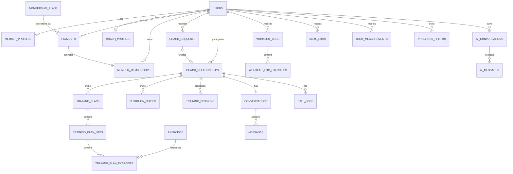

# Meta Gym — Database Final Review Context

Tệp này được ghép cơ học từ bốn tài liệu nguồn để phục vụ review chéo. Mỗi phần giữ nguyên nội dung của tệp gốc.

---

## SOURCE: docs\requirements\database-spec.md

# Meta Gym — Đặc tả database MVP

> Cập nhật: 21/10/2026  
> Trạng thái: Bản đặc tả chờ duyệt, chưa khởi tạo PostgreSQL.  
> Phạm vi: Một phòng gym, một Admin, Member và Coach dùng chung hệ thống.

## 1. Mục tiêu

Tài liệu này xác định đầy đủ các đối tượng dữ liệu cần cho MVP Meta Gym, gồm:

- Tên bảng và trách nhiệm của bảng.
- Trường dữ liệu, kiểu PostgreSQL và tính bắt buộc.
- Khóa chính, khóa ngoại, giá trị trạng thái.
- Unique constraint, check constraint và index quan trọng.
- Quy tắc lưu lịch sử và quyền riêng tư.

Tài liệu này là nguồn chuẩn cho bước tạo migration sau khi được duyệt.

## 2. Quy ước kỹ thuật

- PostgreSQL là hệ quản trị cơ sở dữ liệu.
- Khóa chính của bảng nghiệp vụ dùng `uuid`, sinh ở backend.
- Thời điểm dùng `timestamptz`, lưu theo UTC. Múi giờ nghiệp vụ duy nhất là `Asia/Ho_Chi_Minh`; backend chuyển thời điểm sang múi giờ này trước khi xác định ngày nghiệp vụ, không tin ngày giờ từ thiết bị.
- Ngày không kèm giờ dùng `date`. Ngày hiệu lực membership tính theo lịch Việt Nam và bao gồm cả ngày bắt đầu lẫn ngày kết thúc.
- Tiền chỉ dùng VND và lưu bằng `bigint` theo số đồng, không dùng `float` và không lưu phần thập phân. Vì hệ thống chỉ có một tiền tệ nên không thêm cột `currency` vào từng bảng.
- Email dùng extension `citext` hoặc unique index trên `lower(email)`.
- Trạng thái dùng `varchar` kèm `CHECK`; không dùng PostgreSQL enum để dễ thay đổi migration.
- Mọi bảng thay đổi được đều có `created_at` và `updated_at`, trừ bảng chỉ ghi lịch sử. PostgreSQL tự đặt hai cột khi `INSERT` và cập nhật `updated_at` bằng một trigger dùng chung khi dữ liệu thực sự thay đổi; Flutter và Admin web không được gửi các giá trị hệ thống này.
- Không xóa vật lý tài khoản, thanh toán, gói đã mua, quan hệ, giáo trình đã công bố, nhật ký, tin nhắn, cuộc gọi và dữ liệu AI.
- Trường nhạy cảm chỉ được bảo vệ bằng phân quyền backend; URL ảnh riêng tư phải là URL ký có thời hạn, không phải URL công khai vĩnh viễn.

Quy ước cột:

- `PK`: khóa chính.
- `FK`: khóa ngoại.
- `NN`: bắt buộc, không được `NULL`.
- Các cột không ghi `NN` được phép `NULL`.

## 3. Tổng quan các nhóm bảng

| Nhóm | Bảng |
| --- | --- |
| Tài khoản | `users`, `member_profiles`, `coach_profiles`, `password_reset_codes` |
| Gói tập và thanh toán | `membership_plans`, `payments`, `member_memberships` |
| Quan hệ Coach–Member | `coach_requests`, `coach_relationships`, `coach_termination_requests`, `coach_transfer_history` |
| Nội dung phòng gym | `gym_profile`, `equipment`, `exercises` |
| Giáo trình và lịch tập | `training_plans`, `training_plan_days`, `training_plan_exercises`, `nutrition_guides`, `training_sessions` |
| Tệp và hình ảnh | `media_assets` |
| Theo dõi tiến độ | `workout_logs`, `workout_log_exercises`, `meal_logs`, `body_measurements`, `progress_photos`, `progress_comments` |
| Nhắn tin | `conversations`, `conversation_participants`, `messages` |
| Cuộc gọi | `call_logs` |
| AI | `ai_conversations`, `ai_messages` |
| Kiểm toán | `admin_audit_logs` |

Tổng cộng: **33 bảng nghiệp vụ**. Dashboard không có bảng riêng vì được tổng hợp từ các bảng hiện có.

## 4. Identity & Access

### 4.1. `users`

Lưu tài khoản đăng nhập và thông tin chung của cả Member, Coach và Admin.

| Cột | Kiểu | Ràng buộc | Ý nghĩa |
| --- | --- | --- | --- |
| `id` | `uuid` | PK | Mã người dùng |
| `email` | `citext` | NN, UNIQUE | Email đăng nhập |
| `password_hash` | `varchar(255)` | NN | Mật khẩu đã băm; không bao giờ lưu mật khẩu gốc |
| `role` | `varchar(20)` | NN, CHECK | `MEMBER`, `COACH`, `ADMIN` |
| `full_name` | `varchar(120)` | NN | Họ tên hiển thị |
| `phone` | `varchar(20)` | | Số điện thoại |
| `avatar_media_id` | `uuid` | FK → `media_assets.id` | Ảnh đại diện |
| `status` | `varchar(20)` | NN, CHECK | `ACTIVE`, `DISABLED` |
| `session_version` | `integer` | NN, mặc định `0`, CHECK `>= 0` | Phiên bản xác thực để vô hiệu JWT cũ |
| `disabled_at` | `timestamptz` | | Thời điểm Admin khóa tài khoản |
| `disabled_reason` | `text` | | Lý do khóa tài khoản |
| `last_login_at` | `timestamptz` | | Lần đăng nhập thành công gần nhất |
| `created_at` | `timestamptz` | NN | Thời điểm tạo |
| `updated_at` | `timestamptz` | NN | Thời điểm cập nhật |

Ràng buộc và index:

- Unique email không phân biệt chữ hoa/thường.
- Chỉ có một dòng `role = 'ADMIN'` bằng partial unique index.
- Index `(role, status)` và index tìm kiếm `full_name`.
- Không cho đổi vai trò sau khi tài khoản đã phát sinh dữ liệu.
- JWT chứa `session_version`. Mọi API xác thực phải kiểm tra `status = 'ACTIVE'` và phiên bản trong JWT bằng giá trị hiện tại trong database.
- Khi khóa tài khoản hoặc đặt lại mật khẩu thành công, backend khóa dòng `users`, tăng `session_version` và làm cho toàn bộ JWT cũ mất hiệu lực. Mở khóa không khôi phục JWT cũ; người dùng phải đăng nhập lại.
- Tài khoản Member bị khóa không tự động kết thúc quan hệ Coach và vẫn chiếm suất khi quan hệ là `ACTIVE` hoặc `PAUSED`.

### 4.2. `member_profiles`

Thông tin bổ sung do Member tự khai báo. Thông tin này không phải chẩn đoán y tế.

| Cột | Kiểu | Ràng buộc | Ý nghĩa |
| --- | --- | --- | --- |
| `user_id` | `uuid` | PK, FK → `users.id` | Đồng thời là mã Member |
| `date_of_birth` | `date` | | Ngày sinh |
| `gender` | `varchar(30)` | CHECK | `MALE`, `FEMALE`, `OTHER`, `PREFER_NOT_TO_SAY` |
| `height_cm` | `numeric(5,2)` | CHECK | Chiều cao, lớn hơn 0 và không quá 300 cm |
| `fitness_goal` | `text` | | Mục tiêu tập luyện |
| `experience_level` | `varchar(20)` | CHECK | `BEGINNER`, `INTERMEDIATE`, `ADVANCED` |
| `activity_level` | `varchar(20)` | CHECK | `LOW`, `MODERATE`, `HIGH` |
| `health_notes` | `text` | | Thông tin sức khỏe Member tự khai báo |
| `injury_notes` | `text` | | Chấn thương hoặc hạn chế vận động tự khai báo |
| `dietary_preferences` | `text` | | Sở thích, dị ứng hoặc hạn chế ăn uống tự khai báo |
| `created_at` | `timestamptz` | NN | Thời điểm tạo |
| `updated_at` | `timestamptz` | NN | Thời điểm cập nhật |

Quyền riêng tư: Member, chính Member đó và Coach đang phụ trách mới được đọc; Admin chỉ xem thông tin tài khoản cơ bản, không xem ghi chú sức khỏe chi tiết.

### 4.3. `coach_profiles`

| Cột | Kiểu | Ràng buộc | Ý nghĩa |
| --- | --- | --- | --- |
| `user_id` | `uuid` | PK, FK → `users.id` | Đồng thời là mã Coach |
| `biography` | `text` | | Giới thiệu Coach |
| `specialties` | `text[]` | NN, mặc định `{}` | Chuyên môn |
| `qualifications` | `text` | | Bằng cấp/chứng chỉ dạng mô tả |
| `experience_years` | `smallint` | NN, CHECK `>= 0` | Số năm kinh nghiệm |
| `availability_note` | `text` | | Ghi chú thời gian có thể hướng dẫn |
| `member_limit` | `smallint` | NN, CHECK `> 0` | Số Member tối đa |
| `created_at` | `timestamptz` | NN | Thời điểm tạo |
| `updated_at` | `timestamptz` | NN | Thời điểm cập nhật |

Số suất đang dùng được đếm từ quan hệ `ACTIVE` và `PAUSED`, không lưu thành cột để tránh sai lệch.

### 4.4. `password_reset_codes`

| Cột | Kiểu | Ràng buộc | Ý nghĩa |
| --- | --- | --- | --- |
| `id` | `uuid` | PK | Mã yêu cầu |
| `user_id` | `uuid` | NN, FK → `users.id` | Người yêu cầu |
| `code_hash` | `varchar(255)` | NN | Mã xác nhận đã băm |
| `attempt_count` | `smallint` | NN, mặc định `0` | Số lần nhập sai |
| `expires_at` | `timestamptz` | NN | Hạn sử dụng |
| `used_at` | `timestamptz` | | Thời điểm đã dùng |
| `invalidated_at` | `timestamptz` | | Thời điểm bị thay thế hoặc vô hiệu hóa |
| `created_at` | `timestamptz` | NN | Thời điểm tạo |

Index: `(user_id, created_at DESC)`. Mỗi lần tạo mã mới phải làm mất hiệu lực các mã cũ chưa dùng. Mã chỉ hợp lệ khi `used_at IS NULL`, `invalidated_at IS NULL`, chưa hết hạn và `attempt_count < 5`.

Quy tắc đặt lại mật khẩu:

- Dùng mã một lần gửi qua email, thời hạn 15 phút; không đổi sang security question hoặc cho Admin đọc mật khẩu cũ.
- API yêu cầu mã luôn trả thông báo trung tính dù email có tồn tại hay không.
- Giới hạn tối đa 3 lần yêu cầu trong 15 phút theo tài khoản và IP; giới hạn này do service/rate limiter thực thi.
- API kiểm tra mã không đánh dấu `used_at`. API đặt mật khẩu phải gửi lại `request_id` và mã, khóa dòng mã cùng dòng `users`, kiểm tra lại toàn bộ điều kiện rồi cập nhật mật khẩu, đặt `used_at` và tăng `session_version` trong cùng transaction.

## 5. Membership & Payment

### 5.1. `membership_plans`

| Cột | Kiểu | Ràng buộc | Ý nghĩa |
| --- | --- | --- | --- |
| `id` | `uuid` | PK | Mã gói |
| `name` | `varchar(100)` | NN | Tên gói |
| `description` | `text` | | Nội dung giới thiệu |
| `price` | `bigint` | NN, CHECK `>= 0` | Giá bán tính theo số đồng VND |
| `duration_days` | `integer` | NN, CHECK `> 0` | Số ngày sử dụng |
| `status` | `varchar(20)` | NN, CHECK | `ACTIVE`, `INACTIVE` |
| `created_by` | `uuid` | NN, FK → `users.id` | Admin tạo |
| `created_at` | `timestamptz` | NN | Thời điểm tạo |
| `updated_at` | `timestamptz` | NN | Thời điểm cập nhật |

Không sửa giá hoặc thời hạn của các gói Member đã mua; giao dịch và membership lưu snapshot cần thiết.

### 5.2. `payments`

| Cột | Kiểu | Ràng buộc | Ý nghĩa |
| --- | --- | --- | --- |
| `id` | `uuid` | PK | Mã giao dịch |
| `member_id` | `uuid` | NN, FK → `users.id` | Member mua gói |
| `plan_id` | `uuid` | NN, FK → `membership_plans.id` | Gói được mua |
| `plan_name_snapshot` | `varchar(100)` | NN | Tên gói tại lúc mua |
| `duration_days_snapshot` | `integer` | NN, CHECK `> 0` | Thời hạn tại lúc mua |
| `amount` | `bigint` | NN, CHECK `>= 0` | Số tiền tại lúc mua, tính theo số đồng VND |
| `method` | `varchar(20)` | NN, CHECK | `MOCK_QR`, `FRONT_DESK` |
| `status` | `varchar(20)` | NN, CHECK | `PENDING`, `SUCCESS`, `FAILED`, `CANCELLED` |
| `transaction_code` | `varchar(50)` | NN, UNIQUE | Mã giao dịch hiển thị |
| `idempotency_key` | `varchar(100)` | NN | Khóa chống tạo giao dịch trùng |
| `request_hash` | `varchar(64)` | NN | SHA-256 của nội dung tạo giao dịch để phát hiện dùng lại key với nội dung khác |
| `created_by` | `uuid` | NN, FK → `users.id` | Member hoặc Admin tạo giao dịch |
| `decided_by` | `uuid` | FK → `users.id` | Admin xác nhận, từ chối hoặc hủy giao dịch |
| `confirmed_at` | `timestamptz` | | Thời điểm thành công |
| `decided_at` | `timestamptz` | | Thời điểm chuyển khỏi `PENDING` |
| `failure_reason` | `text` | | Lý do thất bại/hủy |
| `created_at` | `timestamptz` | NN | Thời điểm tạo |
| `updated_at` | `timestamptz` | NN | Thời điểm cập nhật |

Ràng buộc và index:

- UNIQUE `(created_by, idempotency_key)`.
- Cùng idempotency key nhưng `request_hash` khác phải trả lỗi, không dùng lại kết quả cũ.
- Index `(member_id, created_at DESC)` và `(status, created_at DESC)`.
- Sau khi `SUCCESS`, số tiền, gói, người mua và phương thức không được sửa.
- Chỉ Admin được chuyển `PENDING` sang `SUCCESS`, `FAILED` hoặc `CANCELLED`. Các trạng thái kết thúc không chuyển lại `PENDING`; trường hợp sự cố phải được xử lý bằng thao tác quản trị có audit, không sửa mất lịch sử.
- `SUCCESS` bắt buộc có `confirmed_at`, `decided_at`, `decided_by` và không có `failure_reason`. `FAILED`/`CANCELLED` bắt buộc có `decided_at`, `decided_by` và `failure_reason`.

### 5.3. `member_memberships`

| Cột | Kiểu | Ràng buộc | Ý nghĩa |
| --- | --- | --- | --- |
| `id` | `uuid` | PK | Mã lần đăng ký gói |
| `member_id` | `uuid` | NN, FK → `users.id` | Member sở hữu |
| `plan_id` | `uuid` | NN, FK → `membership_plans.id` | Gói tham chiếu |
| `source_payment_id` | `uuid` | NN, UNIQUE, FK → `payments.id` | Giao dịch tạo ra gói này |
| `start_date` | `date` | NN | Ngày bắt đầu, tính cả ngày này |
| `end_date` | `date` | NN | Ngày kết thúc, tính cả ngày này |
| `status` | `varchar(20)` | NN, CHECK | `SCHEDULED`, `ACTIVE`, `EXPIRED`, `CANCELLED` |
| `activated_at` | `timestamptz` | | Thời điểm kích hoạt |
| `expired_at` | `timestamptz` | | Thời điểm chuyển hết hạn |
| `created_at` | `timestamptz` | NN | Thời điểm tạo |
| `updated_at` | `timestamptz` | NN | Thời điểm cập nhật |

Ràng buộc:

- `end_date >= start_date`.
- Một Member chỉ có tối đa một gói `ACTIVE` bằng partial unique index.
- Gói mua tiếp được xếp `SCHEDULED` với ngày bắt đầu sau ngày kết thúc gói trước.
- Dùng `btree_gist` và exclusion constraint trên `member_id` cùng `daterange(start_date, end_date, '[]')` để mọi membership không phải `CANCELLED` của cùng Member không chồng ngày hiệu lực.
- Index `(member_id, status, start_date)` để tìm gói hiện tại và hàng đợi.
- Membership còn hiệu lực khi ngày hiện tại tại `Asia/Ho_Chi_Minh` nằm trong đoạn `[start_date, end_date]`. Gói nối tiếp bắt đầu vào ngày sau `end_date` của gói trước.

## 6. Coaching Relationship

### 6.1. `coach_requests`

| Cột | Kiểu | Ràng buộc | Ý nghĩa |
| --- | --- | --- | --- |
| `id` | `uuid` | PK | Mã yêu cầu |
| `member_id` | `uuid` | NN, FK → `users.id` | Member gửi yêu cầu |
| `coach_id` | `uuid` | NN, FK → `users.id` | Coach được chọn |
| `message` | `text` | | Lời nhắn của Member |
| `status` | `varchar(20)` | NN, CHECK | `PENDING`, `ACCEPTED`, `REJECTED`, `CANCELLED` |
| `rejection_reason` | `text` | | Lý do từ chối |
| `requested_at` | `timestamptz` | NN | Thời điểm gửi |
| `decided_at` | `timestamptz` | | Thời điểm xử lý |
| `created_at` | `timestamptz` | NN | Thời điểm tạo |
| `updated_at` | `timestamptz` | NN | Thời điểm cập nhật |

Partial unique index bảo đảm một Member chỉ có một yêu cầu `PENDING`.

Yêu cầu đã `ACCEPTED`, `REJECTED` hoặc `CANCELLED` là lịch sử và không được dùng lại. Nếu Member chọn hoặc chuyển Coach lần nữa thì phải tạo yêu cầu/quan hệ mới.

### 6.2. `coach_relationships`

| Cột | Kiểu | Ràng buộc | Ý nghĩa |
| --- | --- | --- | --- |
| `id` | `uuid` | PK | Mã quan hệ |
| `member_id` | `uuid` | NN, FK → `users.id` | Member |
| `coach_id` | `uuid` | NN, FK → `users.id` | Coach phụ trách |
| `source_request_id` | `uuid` | FK → `coach_requests.id` | Yêu cầu tạo quan hệ; có thể trống nếu Admin chuyển Coach |
| `status` | `varchar(20)` | NN, CHECK | `ACTIVE`, `PAUSED`, `ENDED` |
| `started_at` | `timestamptz` | NN | Thời điểm bắt đầu |
| `paused_at` | `timestamptz` | | Thời điểm tạm ngưng |
| `pause_reason` | `varchar(30)` | CHECK | Hiện tại chỉ dùng `MEMBERSHIP_EXPIRED` |
| `ended_at` | `timestamptz` | | Thời điểm kết thúc |
| `ended_by` | `uuid` | FK → `users.id` | Người thực hiện kết thúc |
| `end_reason` | `text` | | Lý do kết thúc |
| `created_at` | `timestamptz` | NN | Thời điểm tạo |
| `updated_at` | `timestamptz` | NN | Thời điểm cập nhật |

Ràng buộc và index:

- Partial unique index trên `member_id` khi trạng thái là `ACTIVE` hoặc `PAUSED`.
- UNIQUE `(id, member_id, coach_id)` để các bảng nghiệp vụ có thể dùng composite FK xác nhận đúng ba thành phần của quan hệ.
- UNIQUE `source_request_id` khi cột này có giá trị để một yêu cầu không tạo được hai quan hệ.
- Index `(coach_id, status)` để đếm suất; cả `ACTIVE` và `PAUSED` đều chiếm suất.
- Chỉ quan hệ `ACTIVE` được tạo tin nhắn và cuộc gọi mới.
- `ENDED` bắt buộc có `ended_at`; quan hệ đã `ENDED` không được kích hoạt lại. Gia hạn gói chỉ tự kích hoạt quan hệ đang `PAUSED` vì `MEMBERSHIP_EXPIRED`.
- Khi nhận hoặc chuyển Coach, transaction phải khóa dòng Member và Coach trước khi đếm lại các quan hệ `ACTIVE`/`PAUSED`, không chỉ dựa vào số suất đã hiển thị cho client.
- Coach có quan hệ `ACTIVE` được đọc/ghi dữ liệu chuyên môn. Quan hệ `PAUSED` chỉ được đọc lịch sử. Sau `ENDED`, Coach cũ chỉ được đọc chat cũ và giáo trình/hướng dẫn/buổi tập do chính quan hệ đó tạo; không được đọc hồ sơ sức khỏe, nhật ký, số đo hoặc ảnh tiến trình của Member.

### 6.3. `coach_termination_requests`

| Cột | Kiểu | Ràng buộc | Ý nghĩa |
| --- | --- | --- | --- |
| `id` | `uuid` | PK | Mã yêu cầu |
| `relationship_id` | `uuid` | NN, FK → `coach_relationships.id` | Quan hệ cần kết thúc |
| `coach_id` | `uuid` | NN, FK → `users.id` | Coach gửi yêu cầu |
| `reason` | `text` | NN | Lý do xin ngừng phụ trách |
| `status` | `varchar(20)` | NN, CHECK | `PENDING`, `APPROVED`, `REJECTED`, `CANCELLED` |
| `admin_note` | `text` | | Ghi chú của Admin |
| `decided_by` | `uuid` | FK → `users.id` | Admin xử lý |
| `decided_at` | `timestamptz` | | Thời điểm xử lý |
| `created_at` | `timestamptz` | NN | Thời điểm tạo |
| `updated_at` | `timestamptz` | NN | Thời điểm cập nhật |

Partial unique index bảo đảm mỗi quan hệ chỉ có một yêu cầu `PENDING`.

### 6.4. `coach_transfer_history`

| Cột | Kiểu | Ràng buộc | Ý nghĩa |
| --- | --- | --- | --- |
| `id` | `uuid` | PK | Mã lịch sử chuyển |
| `member_id` | `uuid` | NN, FK → `users.id` | Member được chuyển |
| `old_relationship_id` | `uuid` | NN, FK → `coach_relationships.id` | Quan hệ cũ |
| `new_relationship_id` | `uuid` | NN, FK → `coach_relationships.id` | Quan hệ mới |
| `old_coach_id` | `uuid` | NN, FK → `users.id` | Coach cũ |
| `new_coach_id` | `uuid` | NN, FK → `users.id` | Coach mới |
| `reason` | `text` | NN | Sự cố và lý do chuyển |
| `admin_id` | `uuid` | NN, FK → `users.id` | Admin thực hiện |
| `created_at` | `timestamptz` | NN | Thời điểm chuyển |

Chuyển Coach phải kết thúc quan hệ cũ, tạo quan hệ mới và ghi lịch sử trong cùng một transaction.

## 7. Gym Content

### 7.1. `gym_profile`

Hệ thống chỉ có đúng một dòng với `id = 1`.

| Cột | Kiểu | Ràng buộc | Ý nghĩa |
| --- | --- | --- | --- |
| `id` | `smallint` | PK, CHECK `id = 1` | Khóa cố định |
| `name` | `varchar(150)` | NN | Tên phòng gym |
| `address` | `text` | NN | Địa chỉ |
| `phone` | `varchar(20)` | | Số liên hệ |
| `email` | `citext` | | Email liên hệ |
| `description` | `text` | | Giới thiệu |
| `opening_hours` | `jsonb` | NN | Giờ mở cửa theo từng ngày |
| `rules` | `text` | | Nội quy |
| `cover_media_id` | `uuid` | FK → `media_assets.id` | Ảnh đại diện phòng gym |
| `updated_by` | `uuid` | FK → `users.id` | Admin cập nhật gần nhất |
| `created_at` | `timestamptz` | NN | Thời điểm tạo |
| `updated_at` | `timestamptz` | NN | Thời điểm cập nhật |

### 7.2. `equipment`

| Cột | Kiểu | Ràng buộc | Ý nghĩa |
| --- | --- | --- | --- |
| `id` | `uuid` | PK | Mã thiết bị |
| `name` | `varchar(120)` | NN | Tên thiết bị |
| `category` | `varchar(80)` | NN | Nhóm thiết bị |
| `target_muscles` | `text[]` | NN, mặc định `{}` | Nhóm cơ tác động |
| `image_media_id` | `uuid` | FK → `media_assets.id` | Hình ảnh |
| `description` | `text` | | Mô tả |
| `usage_steps` | `jsonb` | NN | Mảng các bước có số thứ tự và nội dung |
| `safety_notes` | `text` | | Cảnh báo an toàn |
| `video_url` | `text` | | Video hướng dẫn bên ngoài |
| `status` | `varchar(20)` | NN, CHECK | `ACTIVE`, `HIDDEN` |
| `created_by` | `uuid` | NN, FK → `users.id` | Admin tạo |
| `created_at` | `timestamptz` | NN | Thời điểm tạo |
| `updated_at` | `timestamptz` | NN | Thời điểm cập nhật |

Index: `(status, category)` và chỉ mục tìm kiếm tên.

### 7.3. `exercises`

| Cột | Kiểu | Ràng buộc | Ý nghĩa |
| --- | --- | --- | --- |
| `id` | `uuid` | PK | Mã bài tập |
| `equipment_id` | `uuid` | FK → `equipment.id` | Thiết bị liên quan, có thể trống |
| `name` | `varchar(120)` | NN | Tên bài tập |
| `description` | `text` | | Mô tả |
| `target_muscles` | `text[]` | NN, mặc định `{}` | Nhóm cơ |
| `instructions` | `text` | NN | Hướng dẫn thực hiện |
| `safety_notes` | `text` | | Cảnh báo |
| `difficulty` | `varchar(20)` | CHECK | `BEGINNER`, `INTERMEDIATE`, `ADVANCED` |
| `video_url` | `text` | | Video hướng dẫn |
| `status` | `varchar(20)` | NN, CHECK | `ACTIVE`, `HIDDEN` |
| `created_by` | `uuid` | NN, FK → `users.id` | Admin tạo |
| `created_at` | `timestamptz` | NN | Thời điểm tạo |
| `updated_at` | `timestamptz` | NN | Thời điểm cập nhật |

## 8. Training & Nutrition

### 8.1. `training_plans`

| Cột | Kiểu | Ràng buộc | Ý nghĩa |
| --- | --- | --- | --- |
| `id` | `uuid` | PK | Mã giáo trình |
| `relationship_id` | `uuid` | NN, FK → `coach_relationships.id` | Quan hệ tạo giáo trình |
| `member_id` | `uuid` | NN, FK → `users.id` | Member nhận giáo trình |
| `coach_id` | `uuid` | NN, FK → `users.id` | Coach tạo |
| `title` | `varchar(150)` | NN | Tên giáo trình |
| `goal` | `text` | | Mục tiêu |
| `start_date` | `date` | | Ngày bắt đầu dự kiến |
| `end_date` | `date` | | Ngày kết thúc dự kiến |
| `version` | `integer` | NN, CHECK `> 0` | Phiên bản theo Member |
| `status` | `varchar(20)` | NN, CHECK | `DRAFT`, `ACTIVE`, `ARCHIVED` |
| `published_at` | `timestamptz` | | Thời điểm công bố |
| `archived_at` | `timestamptz` | | Thời điểm lưu trữ |
| `created_at` | `timestamptz` | NN | Thời điểm tạo |
| `updated_at` | `timestamptz` | NN | Thời điểm cập nhật |

Ràng buộc:

- `end_date` phải lớn hơn hoặc bằng `start_date` khi có cả hai.
- UNIQUE `(member_id, version)`.
- Một Member chỉ có tối đa một giáo trình `ACTIVE`.
- Member chỉ đọc được `ACTIVE` và `ARCHIVED`, không đọc bản `DRAFT`.
- `(relationship_id, member_id, coach_id)` phải tham chiếu composite key tương ứng của `coach_relationships`.
- Chỉ bản `DRAFT` được sửa nội dung. Khi công bố, bản `ACTIVE` cũ chuyển `ARCHIVED`, bản mới chuyển `ACTIVE`; `ACTIVE` và `ARCHIVED` là bất biến, mọi thay đổi tiếp theo phải tạo phiên bản mới.

### 8.2. `training_plan_days`

| Cột | Kiểu | Ràng buộc | Ý nghĩa |
| --- | --- | --- | --- |
| `id` | `uuid` | PK | Mã ngày tập |
| `plan_id` | `uuid` | NN, FK → `training_plans.id` | Giáo trình cha |
| `day_number` | `smallint` | NN, CHECK `> 0` | Thứ tự ngày/buổi |
| `title` | `varchar(120)` | NN | Tên ngày tập |
| `notes` | `text` | | Ghi chú |
| `created_at` | `timestamptz` | NN | Thời điểm tạo |
| `updated_at` | `timestamptz` | NN | Thời điểm cập nhật |

UNIQUE `(plan_id, day_number)`.

### 8.3. `training_plan_exercises`

| Cột | Kiểu | Ràng buộc | Ý nghĩa |
| --- | --- | --- | --- |
| `id` | `uuid` | PK | Mã cấu hình bài tập |
| `plan_day_id` | `uuid` | NN, FK → `training_plan_days.id` | Ngày tập |
| `exercise_id` | `uuid` | NN, FK → `exercises.id` | Bài tập |
| `exercise_name_snapshot` | `varchar(120)` | | Tên bài tập được chụp khi công bố giáo trình |
| `instructions_snapshot` | `text` | | Hướng dẫn được chụp khi công bố |
| `safety_notes_snapshot` | `text` | | Cảnh báo an toàn được chụp khi công bố |
| `display_order` | `smallint` | NN, CHECK `> 0` | Thứ tự hiển thị |
| `sets` | `smallint` | CHECK `> 0` | Số hiệp |
| `reps` | `varchar(50)` | | Số lần, cho phép dạng `8-12` |
| `duration_seconds` | `integer` | CHECK `> 0` | Thời lượng nếu là bài theo thời gian |
| `rest_seconds` | `integer` | CHECK `>= 0` | Thời gian nghỉ |
| `weight_guidance` | `varchar(100)` | | Gợi ý mức tạ; không ép thành số cố định |
| `notes` | `text` | | Lưu ý kỹ thuật |
| `created_at` | `timestamptz` | NN | Thời điểm tạo |
| `updated_at` | `timestamptz` | NN | Thời điểm cập nhật |

UNIQUE `(plan_day_id, display_order)`. Phải có ít nhất một trong `reps` hoặc `duration_seconds`. Khi giáo trình được công bố, ba cột snapshot là bắt buộc; thay đổi danh mục `exercises` về sau không làm thay đổi nội dung phiên bản đã công bố.

### 8.4. `nutrition_guides`

| Cột | Kiểu | Ràng buộc | Ý nghĩa |
| --- | --- | --- | --- |
| `id` | `uuid` | PK | Mã hướng dẫn |
| `relationship_id` | `uuid` | NN, FK → `coach_relationships.id` | Quan hệ tạo hướng dẫn |
| `member_id` | `uuid` | NN, FK → `users.id` | Member nhận |
| `coach_id` | `uuid` | NN, FK → `users.id` | Coach tạo |
| `title` | `varchar(150)` | NN | Tiêu đề |
| `content` | `text` | NN | Nội dung hướng dẫn dạng văn bản |
| `version` | `integer` | NN, CHECK `> 0` | Phiên bản theo Member |
| `status` | `varchar(20)` | NN, CHECK | `DRAFT`, `ACTIVE`, `ARCHIVED` |
| `published_at` | `timestamptz` | | Thời điểm công bố |
| `archived_at` | `timestamptz` | | Thời điểm lưu trữ |
| `created_at` | `timestamptz` | NN | Thời điểm tạo |
| `updated_at` | `timestamptz` | NN | Thời điểm cập nhật |

UNIQUE `(member_id, version)` và chỉ một dòng `ACTIVE` cho mỗi Member. `(relationship_id, member_id, coach_id)` phải tham chiếu composite key của `coach_relationships`. Chỉ `DRAFT` được sửa nội dung; `ACTIVE` và `ARCHIVED` là bất biến, sửa đổi phải tạo phiên bản mới.

### 8.5. `training_sessions`

| Cột | Kiểu | Ràng buộc | Ý nghĩa |
| --- | --- | --- | --- |
| `id` | `uuid` | PK | Mã buổi tập |
| `relationship_id` | `uuid` | NN, FK → `coach_relationships.id` | Quan hệ liên quan |
| `title` | `varchar(150)` | NN | Tên buổi tập |
| `scheduled_start_at` | `timestamptz` | NN | Giờ bắt đầu dự kiến |
| `scheduled_end_at` | `timestamptz` | | Giờ kết thúc dự kiến |
| `status` | `varchar(20)` | NN, CHECK | `SCHEDULED`, `COMPLETED`, `MEMBER_ABSENT`, `CANCELLED` |
| `notes` | `text` | | Ghi chú của Coach |
| `cancellation_reason` | `text` | | Lý do hủy |
| `cancelled_at` | `timestamptz` | | Thời điểm hủy |
| `completed_at` | `timestamptz` | | Thời điểm hoàn thành |
| `created_at` | `timestamptz` | NN | Thời điểm tạo |
| `updated_at` | `timestamptz` | NN | Thời điểm cập nhật |

`scheduled_end_at` phải sau `scheduled_start_at`. Index `(relationship_id, scheduled_start_at)`.

Chuyển trạng thái hợp lệ: `SCHEDULED → COMPLETED`, `SCHEDULED → MEMBER_ABSENT` hoặc `SCHEDULED → CANCELLED`. Trạng thái kết thúc không được khôi phục về `SCHEDULED`; quan hệ chuyển `PAUSED` hoặc `ENDED` phải hủy các buổi tương lai còn `SCHEDULED`. `COMPLETED` bắt buộc có `completed_at`; `CANCELLED` bắt buộc có `cancelled_at` và `cancellation_reason`.

## 9. Tệp và hình ảnh

### 9.1. `media_assets`

Lưu metadata của tệp; nội dung tệp nằm ở dịch vụ lưu trữ, không lưu binary trong PostgreSQL.

| Cột | Kiểu | Ràng buộc | Ý nghĩa |
| --- | --- | --- | --- |
| `id` | `uuid` | PK | Mã tệp |
| `owner_id` | `uuid` | NN, FK → `users.id` | Người tải lên |
| `purpose` | `varchar(30)` | NN, CHECK | `AVATAR`, `MESSAGE`, `PROGRESS_PHOTO`, `MEAL_PHOTO`, `EQUIPMENT`, `GYM` |
| `access_scope` | `varchar(20)` | NN, CHECK | `PUBLIC`, `PRIVATE` |
| `storage_key` | `text` | NN, UNIQUE | Khóa trong dịch vụ lưu trữ |
| `original_name` | `varchar(255)` | NN | Tên tệp ban đầu |
| `mime_type` | `varchar(100)` | | Loại ảnh đã được backend xác minh |
| `size_bytes` | `bigint` | CHECK `> 0` | Kích thước tệp đã được backend xác minh |
| `width` | `integer` | CHECK `> 0` | Chiều rộng ảnh |
| `height` | `integer` | CHECK `> 0` | Chiều cao ảnh |
| `status` | `varchar(20)` | NN, CHECK | `UPLOADING`, `READY`, `FAILED`, `DELETED` |
| `expires_at` | `timestamptz` | NN | Hạn hoàn tất upload; mặc định 30 phút sau khi tạo |
| `ready_at` | `timestamptz` | | Thời điểm backend xác minh file thành công |
| `failed_at` | `timestamptz` | | Thời điểm upload/xác minh thất bại |
| `failure_reason` | `text` | | Lý do thất bại đã lọc, không chứa dữ liệu bí mật |
| `created_at` | `timestamptz` | NN | Thời điểm tải lên |
| `deleted_at` | `timestamptz` | | Thời điểm xóa mềm |

Ảnh tin nhắn và tiến trình bắt buộc `PRIVATE`; ảnh phòng gym, thiết bị và avatar có thể `PUBLIC`.

Ràng buộc và vòng đời:

- Chuyển trạng thái hợp lệ: `UPLOADING → READY`, `UPLOADING → FAILED`, `UPLOADING/FAILED/READY → DELETED`. Không khôi phục bản ghi `DELETED`.
- `READY` bắt buộc có `mime_type`, `size_bytes`, `ready_at`, kích thước ảnh hợp lệ và file thực sự tồn tại trong storage. Chỉ media `READY` đúng owner, purpose và access scope mới được gắn vào đối tượng nghiệp vụ.
- `FAILED` bắt buộc có `failed_at` và `failure_reason`; `DELETED` bắt buộc có `deleted_at`.
- Job cleanup idempotent chạy hằng ngày: xử lý `UPLOADING` quá `expires_at`, `FAILED`, file vật lý của bản ghi `DELETED`, và file storage mồ côi quá 24 giờ. Nếu xóa vật lý thất bại thì giữ `storage_key` để lần chạy sau thử lại.

## 10. Progress Tracking

### 10.1. `workout_logs`

| Cột | Kiểu | Ràng buộc | Ý nghĩa |
| --- | --- | --- | --- |
| `id` | `uuid` | PK | Mã nhật ký tập |
| `member_id` | `uuid` | NN, FK → `users.id` | Chủ nhật ký |
| `training_session_id` | `uuid` | FK → `training_sessions.id` | Buổi tập liên quan |
| `training_plan_id` | `uuid` | FK → `training_plans.id` | Giáo trình tham chiếu |
| `performed_at` | `timestamptz` | NN | Thời điểm tập |
| `duration_minutes` | `smallint` | CHECK `> 0` | Tổng thời lượng |
| `completion_level` | `smallint` | CHECK `0..100` | Phần trăm hoàn thành |
| `notes` | `text` | | Cảm nhận và ghi chú |
| `created_at` | `timestamptz` | NN | Thời điểm tạo |
| `updated_at` | `timestamptz` | NN | Thời điểm cập nhật |

Index `(member_id, performed_at DESC)`.

### 10.2. `workout_log_exercises`

| Cột | Kiểu | Ràng buộc | Ý nghĩa |
| --- | --- | --- | --- |
| `id` | `uuid` | PK | Mã chi tiết |
| `workout_log_id` | `uuid` | NN, FK → `workout_logs.id` | Nhật ký cha |
| `exercise_id` | `uuid` | FK → `exercises.id` | Bài tập tham chiếu |
| `exercise_name_snapshot` | `varchar(120)` | NN | Tên bài tập tại thời điểm ghi |
| `display_order` | `smallint` | NN, CHECK `> 0` | Thứ tự |
| `sets_completed` | `smallint` | CHECK `>= 0` | Số hiệp hoàn thành |
| `reps_summary` | `varchar(100)` | | Ví dụ `12, 10, 8` |
| `weight_kg` | `numeric(6,2)` | CHECK `>= 0` | Mức tạ |
| `duration_seconds` | `integer` | CHECK `> 0` | Thời lượng bài |
| `notes` | `text` | | Ghi chú |
| `created_at` | `timestamptz` | NN | Thời điểm tạo |

UNIQUE `(workout_log_id, display_order)`.

### 10.3. `meal_logs`

| Cột | Kiểu | Ràng buộc | Ý nghĩa |
| --- | --- | --- | --- |
| `id` | `uuid` | PK | Mã bữa ăn |
| `member_id` | `uuid` | NN, FK → `users.id` | Chủ nhật ký |
| `eaten_at` | `timestamptz` | NN | Thời điểm ăn |
| `meal_type` | `varchar(20)` | CHECK | `BREAKFAST`, `LUNCH`, `DINNER`, `SNACK`, `OTHER` |
| `meal_name` | `varchar(150)` | NN | Tên/mô tả ngắn |
| `description` | `text` | | Chi tiết món ăn |
| `estimated_calories` | `integer` | CHECK `>= 0` | Member tự ước lượng, không bắt buộc |
| `image_media_id` | `uuid` | FK → `media_assets.id` | Ảnh bữa ăn |
| `notes` | `text` | | Ghi chú |
| `created_at` | `timestamptz` | NN | Thời điểm tạo |
| `updated_at` | `timestamptz` | NN | Thời điểm cập nhật |

Index `(member_id, eaten_at DESC)`.

### 10.4. `body_measurements`

| Cột | Kiểu | Ràng buộc | Ý nghĩa |
| --- | --- | --- | --- |
| `id` | `uuid` | PK | Mã lần đo |
| `member_id` | `uuid` | NN, FK → `users.id` | Chủ dữ liệu |
| `measured_at` | `timestamptz` | NN | Thời điểm đo |
| `weight_kg` | `numeric(5,2)` | NN, CHECK `> 0` | Cân nặng |
| `body_fat_percent` | `numeric(5,2)` | CHECK `0..100` | Tỷ lệ mỡ nếu có |
| `chest_cm` | `numeric(5,2)` | CHECK `> 0` | Vòng ngực |
| `waist_cm` | `numeric(5,2)` | CHECK `> 0` | Vòng eo |
| `hips_cm` | `numeric(5,2)` | CHECK `> 0` | Vòng hông |
| `arm_cm` | `numeric(5,2)` | CHECK `> 0` | Vòng tay |
| `thigh_cm` | `numeric(5,2)` | CHECK `> 0` | Vòng đùi |
| `notes` | `text` | | Ghi chú |
| `created_at` | `timestamptz` | NN | Thời điểm tạo |
| `updated_at` | `timestamptz` | NN | Thời điểm cập nhật |

Index `(member_id, measured_at DESC)`. Ngoài cân nặng, các số đo khác đều không bắt buộc.

### 10.5. `progress_photos`

| Cột | Kiểu | Ràng buộc | Ý nghĩa |
| --- | --- | --- | --- |
| `id` | `uuid` | PK | Mã ảnh tiến trình |
| `member_id` | `uuid` | NN, FK → `users.id` | Chủ ảnh |
| `media_id` | `uuid` | NN, UNIQUE, FK → `media_assets.id` | Tệp ảnh riêng tư |
| `taken_at` | `timestamptz` | NN | Thời điểm chụp |
| `pose` | `varchar(20)` | CHECK | `FRONT`, `SIDE`, `BACK`, `OTHER` |
| `notes` | `text` | | Ghi chú |
| `created_at` | `timestamptz` | NN | Thời điểm tạo |
| `updated_at` | `timestamptz` | NN | Thời điểm cập nhật |

Index `(member_id, taken_at DESC)`.

### 10.6. `progress_comments`

| Cột | Kiểu | Ràng buộc | Ý nghĩa |
| --- | --- | --- | --- |
| `id` | `uuid` | PK | Mã nhận xét |
| `member_id` | `uuid` | NN, FK → `users.id` | Member nhận nhận xét |
| `coach_id` | `uuid` | NN, FK → `users.id` | Coach viết |
| `relationship_id` | `uuid` | NN, FK → `coach_relationships.id` | Quan hệ tại lúc nhận xét |
| `workout_log_id` | `uuid` | FK → `workout_logs.id` | Nhật ký tập được nhận xét |
| `meal_log_id` | `uuid` | FK → `meal_logs.id` | Nhật ký ăn được nhận xét |
| `measurement_id` | `uuid` | FK → `body_measurements.id` | Lần đo được nhận xét |
| `progress_photo_id` | `uuid` | FK → `progress_photos.id` | Ảnh được nhận xét |
| `content` | `text` | NN | Nội dung nhận xét |
| `created_at` | `timestamptz` | NN | Thời điểm gửi |

Tối đa một trong bốn cột đối tượng đích được có giá trị; nếu tất cả trống thì đây là nhận xét tiến độ chung.

`(relationship_id, member_id, coach_id)` phải tham chiếu composite key của `coach_relationships`. Coach chỉ được tạo nhận xét khi quan hệ đó đang `ACTIVE`. Member được sửa hoặc xóa bản ghi tiến độ của mình cho đến khi có nhận xét Coach đầu tiên trỏ tới bản ghi; sau đó bản ghi trở thành bất biến. Thao tác sửa bản ghi và tạo nhận xét phải khóa cùng dòng tiến độ để tránh race condition. Nhận xét không bị xóa vật lý và việc ẩn/xóa nhận xét về sau không làm bản ghi tiến độ mở khóa trở lại.

## 11. Messaging

### 11.1. `conversations`

| Cột | Kiểu | Ràng buộc | Ý nghĩa |
| --- | --- | --- | --- |
| `id` | `uuid` | PK | Mã cuộc trò chuyện |
| `relationship_id` | `uuid` | NN, UNIQUE, FK → `coach_relationships.id` | Mỗi quan hệ có một cuộc trò chuyện |
| `last_message_at` | `timestamptz` | | Dùng sắp xếp danh sách |
| `created_at` | `timestamptz` | NN | Thời điểm tạo |
| `updated_at` | `timestamptz` | NN | Thời điểm cập nhật |

### 11.2. `conversation_participants`

| Cột | Kiểu | Ràng buộc | Ý nghĩa |
| --- | --- | --- | --- |
| `conversation_id` | `uuid` | PK phần 1, FK → `conversations.id` | Cuộc trò chuyện |
| `user_id` | `uuid` | PK phần 2, FK → `users.id` | Member hoặc Coach |
| `last_read_message_id` | `uuid` | FK → `messages.id` | Tin cuối cùng đã đọc |
| `last_read_at` | `timestamptz` | | Thời điểm đọc |
| `joined_at` | `timestamptz` | NN | Thời điểm tham gia |

Mỗi conversation có đúng hai người, khớp với Member và Coach của quan hệ. Quy tắc này được kiểm tra bằng transaction/service.

### 11.3. `messages`

| Cột | Kiểu | Ràng buộc | Ý nghĩa |
| --- | --- | --- | --- |
| `id` | `uuid` | PK | Mã tin nhắn |
| `conversation_id` | `uuid` | NN, FK → `conversations.id` | Cuộc trò chuyện |
| `sender_id` | `uuid` | NN, FK → `users.id` | Người gửi |
| `client_message_id` | `uuid` | NN | ID sinh ở ứng dụng để chống gửi trùng |
| `message_type` | `varchar(20)` | NN, CHECK | `TEXT`, `IMAGE` |
| `content` | `text` | | Nội dung văn bản hoặc chú thích ảnh |
| `media_id` | `uuid` | FK → `media_assets.id` | Ảnh đính kèm |
| `sent_at` | `timestamptz` | NN | Thời điểm gửi theo server |

Ràng buộc:

- UNIQUE `(sender_id, client_message_id)`.
- `TEXT` bắt buộc có `content`; `IMAGE` bắt buộc có `media_id`.
- Index `(conversation_id, sent_at DESC, id)` để phân trang ổn định.
- Không hỗ trợ sửa, thu hồi hoặc xóa tin nhắn trong MVP.

## 12. Voice & Video Call

### 12.1. `call_logs`

| Cột | Kiểu | Ràng buộc | Ý nghĩa |
| --- | --- | --- | --- |
| `id` | `uuid` | PK | Mã cuộc gọi nội bộ |
| `relationship_id` | `uuid` | NN, FK → `coach_relationships.id` | Quan hệ liên quan |
| `provider_call_id` | `varchar(150)` | UNIQUE | Mã phiên từ SDK bên thứ ba |
| `caller_id` | `uuid` | NN, FK → `users.id` | Người gọi |
| `receiver_id` | `uuid` | NN, FK → `users.id` | Người nhận |
| `call_type` | `varchar(20)` | NN, CHECK | `VOICE`, `VIDEO` |
| `status` | `varchar(20)` | NN, CHECK | `CREATED`, `RINGING`, `ANSWERED`, `REJECTED`, `MISSED`, `ENDED`, `FAILED` |
| `initiated_at` | `timestamptz` | NN | Thời điểm bắt đầu gọi |
| `answered_at` | `timestamptz` | | Thời điểm bắt máy |
| `ended_at` | `timestamptz` | | Thời điểm kết thúc |
| `duration_seconds` | `integer` | NN, mặc định `0`, CHECK `>= 0` | Thời lượng |
| `failure_reason` | `text` | | Nguyên nhân lỗi |
| `created_at` | `timestamptz` | NN | Thời điểm tạo bản ghi |
| `updated_at` | `timestamptz` | NN | Thời điểm cập nhật |

Index `(caller_id, initiated_at DESC)`, `(receiver_id, initiated_at DESC)`. Không có cột ghi âm hoặc ghi hình.

Chuyển trạng thái hợp lệ: `CREATED → RINGING`, `CREATED/RINGING → FAILED`, `RINGING → ANSWERED/REJECTED/MISSED/ENDED`, `ANSWERED → ENDED`. Cập nhật trạng thái dùng conditional update trên trạng thái hiện tại để xử lý race giữa bắt máy, từ chối và hủy. Chỉ quan hệ `ACTIVE` với hai tài khoản `ACTIVE` được bắt đầu/tiếp tục cuộc gọi; khi quan hệ chuyển `PAUSED`/`ENDED` hoặc một tài khoản bị khóa, cuộc gọi chưa kết thúc phải chuyển trạng thái kết thúc phù hợp.

## 13. AI Advisor

### 13.1. `ai_conversations`

| Cột | Kiểu | Ràng buộc | Ý nghĩa |
| --- | --- | --- | --- |
| `id` | `uuid` | PK | Mã cuộc trò chuyện AI |
| `user_id` | `uuid` | NN, FK → `users.id` | Chủ sở hữu Member/Coach |
| `title` | `varchar(150)` | NN | Tiêu đề |
| `created_at` | `timestamptz` | NN | Thời điểm tạo |
| `updated_at` | `timestamptz` | NN | Thời điểm cập nhật gần nhất |
| `deleted_at` | `timestamptz` | | Xóa mềm |

Index `(user_id, updated_at DESC)` với điều kiện `deleted_at IS NULL`.

### 13.2. `ai_messages`

| Cột | Kiểu | Ràng buộc | Ý nghĩa |
| --- | --- | --- | --- |
| `id` | `uuid` | PK | Mã tin AI |
| `conversation_id` | `uuid` | NN, FK → `ai_conversations.id` | Cuộc trò chuyện |
| `role` | `varchar(20)` | NN, CHECK | `USER`, `ASSISTANT` |
| `content` | `text` | NN | Câu hỏi hoặc câu trả lời |
| `client_request_id` | `uuid` | | Khóa idempotency do Flutter tạo cho tin `USER` |
| `request_hash` | `varchar(64)` | | SHA-256 nội dung câu hỏi đã chuẩn hóa |
| `reply_to_message_id` | `uuid` | UNIQUE, FK → `ai_messages.id` | Tin `USER` mà câu trả lời `ASSISTANT` phản hồi |
| `status` | `varchar(20)` | NN, CHECK | `PROCESSING`, `COMPLETED`, `FAILED` |
| `provider` | `varchar(50)` | | Nhà cung cấp AI |
| `model_name` | `varchar(100)` | | Model đã sử dụng |
| `provider_request_id` | `varchar(150)` | | Mã truy vết từ nhà cung cấp |
| `input_tokens` | `integer` | CHECK `>= 0` | Token đầu vào nếu nhà cung cấp trả về |
| `output_tokens` | `integer` | CHECK `>= 0` | Token đầu ra nếu nhà cung cấp trả về |
| `safety_category` | `varchar(50)` | | Phân loại an toàn nếu có |
| `completed_at` | `timestamptz` | | Thời điểm xử lý thành công |
| `failed_at` | `timestamptz` | | Thời điểm xử lý thất bại |
| `created_at` | `timestamptz` | NN | Thời điểm tạo |

Ràng buộc và xử lý:

- Index `(conversation_id, created_at, id)` và partial UNIQUE `(conversation_id, client_request_id)` cho các dòng `role = 'USER'`.
- Tin `USER` bắt buộc có `client_request_id`, `request_hash`; tin `ASSISTANT` bắt buộc có `reply_to_message_id`, không có hai câu trả lời cho cùng một câu hỏi.
- Tin `USER` được tạo ở `PROCESSING`. Khi thành công, transaction cập nhật nó thành `COMPLETED`, đặt `completed_at` và tạo tin `ASSISTANT COMPLETED`. Khi lỗi, cập nhật tin `USER` thành `FAILED`, đặt `failed_at` và không lưu câu trả lời dang dở.
- Retry cùng ID và cùng hash: trả kết quả đã lưu, trạng thái đang xử lý hoặc lỗi đã lưu; không gọi provider lần nữa. Cùng ID nhưng khác hash trả lỗi xung đột. Retry một yêu cầu `FAILED` phải dùng ID mới.
- Chỉ request tạo được dòng `USER PROCESSING` mới gọi provider; không giữ transaction database mở trong thời gian chờ AI. `PROCESSING` quá 2 phút được chuyển `FAILED` bởi tác vụ kiểm tra timeout, không tự gọi lại provider.
- Idempotency ngăn backend chủ động gọi lặp nhưng không cam kết exactly-once tại nhà cung cấp khi backend mất kết nối sau khi provider đã xử lý.

## 14. Admin Audit

### 14.1. `admin_audit_logs`

Ghi lại thao tác quản trị quan trọng, không lưu nội dung riêng tư.

| Cột | Kiểu | Ràng buộc | Ý nghĩa |
| --- | --- | --- | --- |
| `id` | `uuid` | PK | Mã log |
| `admin_id` | `uuid` | NN, FK → `users.id` | Admin thực hiện |
| `action` | `varchar(80)` | NN | Ví dụ `USER_DISABLED`, `COACH_TRANSFERRED` |
| `entity_type` | `varchar(50)` | NN | Loại đối tượng |
| `entity_id` | `text` | | Khóa đối tượng dạng chuỗi, hỗ trợ cả UUID và `gym_profile.id = 1` |
| `summary` | `text` | NN | Mô tả ngắn, không chứa mật khẩu/nội dung riêng tư |
| `metadata` | `jsonb` | NN, mặc định `{}` | Dữ liệu bổ sung đã lọc |
| `created_at` | `timestamptz` | NN | Thời điểm thao tác |

Index `(admin_id, created_at DESC)` và `(entity_type, entity_id, created_at DESC)`. Bảng này chỉ thêm mới, không sửa hoặc xóa qua API.

Các thao tác bắt buộc audit gồm xác nhận/từ chối/điều chỉnh payment do sự cố, khóa/mở tài khoản, thay đổi thông tin quan trọng của tài khoản khác, thay đổi gói/giá và cấu hình gym. Không audit thao tác đọc thông thường và tuyệt đối không lưu mật khẩu, JWT, mã reset, nội dung chat/AI hoặc URL media riêng tư. `metadata` lưu dữ liệu nghiệp vụ đã lọc theo cấu trúc `{ "before": ..., "after": ... }`. Thao tác nghiệp vụ quan trọng và audit phải nằm trong cùng transaction; ghi audit thất bại thì rollback thao tác.

## 15. Quan hệ chính giữa các đối tượng



## 16. Transaction bắt buộc

Các thao tác sau phải chạy trong một database transaction:

1. Xác nhận thanh toán → chuyển payment thành `SUCCESS` → tạo membership → tính chuỗi ngày nối tiếp.
2. Coach chấp nhận yêu cầu → khóa dòng Coach/quan hệ → kiểm tra giới hạn → tạo quan hệ → tạo conversation → cập nhật request.
3. Gói hết hạn → chuyển membership → tạm ngưng quan hệ đang hoạt động.
4. Gia hạn thành công → kích hoạt gói phù hợp → khôi phục quan hệ đang `PAUSED`.
5. Admin duyệt yêu cầu kết thúc → kết thúc quan hệ → cập nhật termination request.
6. Admin chuyển Coach → kiểm tra suất Coach mới → kết thúc quan hệ cũ → tạo quan hệ và conversation mới → ghi transfer history.
7. Công bố giáo trình/hướng dẫn mới → lưu trữ bản `ACTIVE` cũ → kích hoạt phiên bản mới.

### 16.1. Thứ tự tạo migration và xử lý FK vòng

Migration nền tảng phải tạo schema theo thứ tự:

1. Extension cần thiết: `citext`, `btree_gist`.
2. Hàm trigger dùng chung cho `updated_at` và các type/thành phần nền tảng khác.
3. Bảng độc lập, sau đó các bảng phụ thuộc theo nhóm nghiệp vụ.
4. FK thông thường có thể khai báo ngay khi cả hai bảng đã tồn tại.
5. FK gây vòng được thêm sau bằng `ALTER TABLE`.
6. UNIQUE, CHECK, exclusion constraint, partial index và index truy vấn.
7. Chạy kiểm tra toàn vẹn rồi mới chạy baseline seed.

Vòng FK hiện có giữa `users.avatar_media_id` và `media_assets.owner_id` được xử lý cụ thể như sau: tạo `users` với cột `avatar_media_id` nhưng chưa gắn FK; tạo `media_assets` cùng FK `owner_id → users.id`; sau đó thêm FK `users.avatar_media_id → media_assets.id`. Các composite FK chỉ được thêm sau khi composite UNIQUE được tham chiếu đã tồn tại. Không bỏ FK, không đổi cột bắt buộc thành nullable và không dùng `ON DELETE CASCADE` cho dữ liệu phải giữ lịch sử chỉ để làm migration dễ hơn.

### 16.2. Index truy vấn và timestamp

- Không tạo index trùng với PK, UNIQUE, exclusion constraint hoặc partial unique index đã có.
- Index phải dùng mốc nghiệp vụ thật của từng bảng: `performed_at`, `eaten_at`, `measured_at`, `taken_at`, `scheduled_start_at`, `initiated_at`; không thay bằng `created_at` một cách máy móc.
- Các truy vấn chính phải được kiểm tra bằng `EXPLAIN` sau khi có dữ liệu demo: duyệt payment chờ, tìm membership hiện tại/hàng đợi, đếm suất Coach, phân trang chat, lịch tập, tiến độ, lịch sử cuộc gọi, AI và cleanup media.
- `created_at`/`updated_at` chỉ là metadata kỹ thuật. Các mốc nghiệp vụ như `confirmed_at`, `decided_at`, `completed_at`, `cancelled_at`, `ended_at`, `ready_at` phải dùng cột riêng.

## 17. Quy tắc xóa và lưu lịch sử

| Dữ liệu | Cách xử lý |
| --- | --- |
| User | Đổi `status`, không xóa |
| Gói tập | Đổi `status = INACTIVE`, không xóa |
| Payment/membership | Không xóa |
| Yêu cầu và quan hệ Coach | Không xóa; chuyển trạng thái |
| Giáo trình đã công bố | Chuyển `ARCHIVED` |
| Giáo trình nháp chưa công bố | Có thể xóa trước khi triển khai API xóa; MVP hiện chưa cần API xóa |
| Nhật ký và số đo | Không xóa vật lý nếu đã có nhận xét |
| Tin nhắn/cuộc gọi | Không xóa |
| Hội thoại AI | Xóa mềm bằng `deleted_at` |
| Media | Đánh dấu `DELETED`; tác vụ nền xóa tệp khi không còn tham chiếu |
| Audit log | Chỉ thêm mới |

## 18. Dữ liệu khởi tạo sau khi duyệt

Baseline seed bắt buộc, chạy lặp an toàn và luôn được áp dụng khi dựng database:

- Một tài khoản Admin chính; mật khẩu lấy từ biến môi trường khi chạy seed.
- Một dòng `gym_profile` rỗng cơ bản với `id = 1`.

Demo seed là lệnh riêng, chỉ chạy khi được chỉ định trong môi trường development/test. Demo có thể tạo gói tập, Coach, Member, thiết bị, bài tập, relationship, giáo trình, lịch, tiến độ, chat và AI mẫu nhưng phải tuân thủ toàn bộ constraint; không gọi payment/AI thật và không tự chạy trong production. Cả hai loại seed dùng khóa nhận diện ổn định để chạy lại không tạo dữ liệu trùng và không xóa dữ liệu người dùng đã có.

## 19. Tiêu chí duyệt đặc tả

- Tất cả màn hình và API đã chốt đều có nơi lưu dữ liệu phù hợp.
- Một Member không thể có hai gói `ACTIVE`, hai yêu cầu Coach `PENDING` hoặc hai quan hệ chưa kết thúc.
- Quan hệ `PAUSED` vẫn được tính vào giới hạn Coach.
- Dữ liệu thanh toán và lịch sử chuyên môn không bị thay đổi theo dữ liệu danh mục về sau.
- Member, Coach và Admin không thể đọc dữ liệu ngoài phạm vi được phép.
- Tin nhắn gửi lại không bị tạo trùng.
- Giao dịch gửi lại không bị tạo trùng.
- Mọi thao tác nhiều bước quan trọng có transaction rõ ràng.
- Không có bảng riêng cho dữ liệu chỉ có thể tính toán như số suất còn lại hoặc số liệu dashboard.

## 20. Các điểm cần duyệt

1. Thông tin tự khai báo trong `member_profiles` có giữ đủ các trường sức khỏe, chấn thương và ăn uống như trên không.
2. `nutrition_guides` dùng nội dung văn bản tự do cho MVP, chưa tách thành thực đơn từng ngày/từng món.
3. Một quan hệ mới sau khi chuyển Coach tạo một conversation mới; lịch sử Coach cũ giữ nguyên và chỉ đọc.
4. Ảnh riêng tư nằm ở dịch vụ lưu trữ tệp và được truy cập bằng URL ký có thời hạn.
5. Chưa lưu refresh token vì kiến trúc xác thực MVP hiện dùng access token JWT; nếu bổ sung refresh token sẽ cần thêm bảng phiên đăng nhập.


---

## SOURCE: docs\requirements\confirmed-workflows.md

# Meta Gym — Đặc tả và kế hoạch MVP

> Cập nhật: 20/10/2026  
> Trạng thái: Bản chốt nghiệp vụ và kỹ thuật để người dùng thực hiện lượt review cuối trước khi lập trình.

## 1. Mục tiêu và phạm vi MVP

Meta Gym là hệ thống dành cho một phòng gym, hỗ trợ quản lý hội viên và quá trình tập luyện.

- Member và Coach sử dụng ứng dụng Flutter.
- Admin sử dụng một website quản trị riêng.
- Member quản lý gói tập, lựa chọn Coach, nhận hướng dẫn, ghi nhật ký và theo dõi tiến độ.
- Coach trực tiếp hướng dẫn và theo dõi Member.
- Admin quản lý hoạt động chung của phòng gym.
- AI chỉ cung cấp thông tin tham khảo, không thay thế Coach.

Luồng nghiệp vụ trọng tâm của MVP:

`Đăng ký → mua gói mô phỏng → chọn Coach → nhận hướng dẫn → ghi nhật ký → theo dõi tiến bộ`

## 2. Phạm vi đã loại khỏi MVP

- Nhiều phòng gym hoặc nhiều chi nhánh.
- Lớp học nhóm và đăng ký lớp.
- Thanh toán thật, hoàn tiền và xuất hóa đơn.
- Điểm danh bằng QR, khuôn mặt hoặc vân tay.
- Mạng xã hội, bảng tin và kết bạn.
- Đồng bộ đồng hồ thông minh hoặc ứng dụng sức khỏe.
- Hệ thống dinh dưỡng tự động chuyên sâu.
- AI chẩn đoán bệnh, thay thế Coach hoặc tự động sửa giáo trình.
- Phân quyền tùy chỉnh phức tạp.
- Báo cáo và phân tích dữ liệu chuyên sâu.
- Quản lý kho và bán sản phẩm.
- Quản lý lương, chấm công và hoa hồng nhân viên.
- Đặt lịch sử dụng từng máy tập.

Gọi thoại và gọi video giữa Member và Coach **nằm trong MVP** và được thực hiện trực tiếp trong ứng dụng bằng dịch vụ/SDK có sẵn, không tự xây dựng WebRTC.

## 3. Vai trò và quyền hạn

### 3.1. Member

- Tự đăng ký, đăng nhập và cập nhật hồ sơ cá nhân.
- Xem gói tập, thực hiện thanh toán mô phỏng và theo dõi thời hạn gói.
- Xem thông tin phòng gym, thiết bị và hồ sơ Coach.
- Gửi hoặc hủy yêu cầu chọn Coach khi yêu cầu còn chờ.
- Chỉ có một Coach đang phụ trách tại một thời điểm.
- Xem giáo trình, hướng dẫn ăn uống và lịch tập do Coach cung cấp.
- Ghi nhật ký tập luyện, bữa ăn, cân nặng, số đo và hình ảnh tiến trình.
- Xem lịch sử và biểu đồ tiến bộ.
- Nhắn tin, gọi thoại và gọi video với Coach đang phụ trách.
- Sử dụng AI để hỏi và tham khảo.
- Không được sửa giáo trình chính thức của Coach hoặc xem dữ liệu của Member khác.

### 3.2. Coach

- Tài khoản do Admin tạo.
- Cập nhật hồ sơ chuyên môn và thông tin giới thiệu.
- Có giới hạn số Member do Admin thiết lập.
- Xem, chấp nhận hoặc từ chối yêu cầu của Member.
- Xem dữ liệu của các Member mình đang phụ trách.
- Tạo và cập nhật giáo trình tập luyện, hướng dẫn ăn uống và lịch buổi tập.
- Theo dõi nhật ký, số đo và tiến trình của Member.
- Nhận xét, điều chỉnh giáo trình và ghi nhận trạng thái buổi tập.
- Nhắn tin, gọi thoại và gọi video với Member đang phụ trách.
- Sử dụng AI để tham khảo nhưng phải tự quyết định nội dung chính thức.
- Không được xem dữ liệu của Member không thuộc quyền phụ trách.
- Không được nhận Member vượt quá giới hạn.

### 3.3. Admin

- Hệ thống chỉ có một tài khoản Admin chính được tạo sẵn.
- Admin chỉ sử dụng website quản trị.
- Tạo và quản lý tài khoản Coach.
- Xem, khóa hoặc mở lại tài khoản Member và Coach.
- Thiết lập số Member tối đa cho từng Coach.
- Quản lý gói tập và giao dịch mô phỏng.
- Ghi nhận việc mua hoặc gia hạn gói tại quầy.
- Theo dõi và xử lý quan hệ Member–Coach.
- Xử lý yêu cầu kết thúc quan hệ do Coach gửi.
- Chỉ gán hoặc chuyển Coach khi có sự cố và phải lưu lý do.
- Quản lý thông tin phòng gym, thiết bị và hướng dẫn sử dụng.
- Xem thống kê quản trị cơ bản.
- Không được đọc tin nhắn, nội dung cuộc gọi hoặc sửa dữ liệu chuyên môn của Coach và Member.

## 4. Luồng tổng thể của Member

### 4.1. Đăng ký và sử dụng chức năng miễn phí

1. Member đăng ký bằng họ tên, email và mật khẩu.
2. Member đăng nhập và cập nhật hồ sơ.
3. Khi chưa có gói tập, Member vẫn được:
   - Xem thông tin phòng gym.
   - Xem hướng dẫn thiết bị.
   - Xem danh sách và hồ sơ Coach.
   - Sử dụng AI để hỏi và tham khảo.

### 4.2. Đăng ký gói tập

1. Member chọn một gói tập.
2. Member thực hiện thanh toán mô phỏng.
3. Thanh toán thành công sẽ tự động:
   - Lưu giao dịch.
   - Kích hoạt gói tập.
   - Xác định ngày bắt đầu và ngày hết hạn.
   - Mở các chức năng tập luyện chính thức.

### 4.3. Lựa chọn Coach

1. Member có gói tập đang hoạt động xem các Coach còn khả năng nhận người.
2. Member gửi yêu cầu cho một Coach.
3. Trong khi chờ, Member có thể hủy yêu cầu nhưng không được gửi đồng thời cho Coach khác.
4. Coach từ chối: Member được chọn Coach khác.
5. Coach chấp nhận: quan hệ được kích hoạt và Member chiếm một suất của Coach.

### 4.4. Quá trình được hướng dẫn

Member được:

- Xem giáo trình tập luyện và hướng dẫn ăn uống.
- Xem lịch các buổi tập.
- Ghi nhật ký tập luyện và bữa ăn.
- Cập nhật cân nặng, số đo và hình ảnh tiến trình.
- Nhận nhận xét từ Coach.
- Nhắn tin, gọi thoại và gọi video với Coach.
- Xem lịch sử và biểu đồ tiến bộ.

Dữ liệu do Coach tạo phải được phân biệt với dữ liệu Member tự ghi.

### 4.5. Gói tập hết hạn và gia hạn

Khi gói tập hết hạn:

- Quan hệ với Coach chuyển sang `Tạm ngưng`.
- Member vẫn chiếm một suất của Coach.
- Toàn bộ dữ liệu và lịch sử được giữ lại.
- Member chỉ được xem lịch sử, không được tạo nhật ký chính thức mới.
- Nhắn tin và cuộc gọi với Coach bị tạm khóa.
- Member vẫn được dùng AI và xem thông tin chung.

Khi Member thanh toán gia hạn thành công:

- Gói tập được kích hoạt lại.
- Quan hệ với Coach tự động trở lại trạng thái hoạt động.
- Các chức năng tập luyện và liên lạc được mở lại.

### 4.6. Đổi Coach

1. Member kết thúc quan hệ hiện tại.
2. Quan hệ cũ ngừng chiếm suất nhưng lịch sử được giữ lại.
3. Member gửi yêu cầu cho Coach mới.

## 5. Luồng tổng thể của Coach

### 5.1. Khởi tạo và cập nhật hồ sơ

1. Admin tạo tài khoản Coach.
2. Coach đăng nhập ứng dụng Flutter.
3. Coach cập nhật ảnh đại diện, giới thiệu, chuyên môn, kinh nghiệm và thời gian có thể hướng dẫn.

### 5.2. Xử lý yêu cầu của Member

1. Coach xem các yêu cầu đang chờ và thông tin cơ bản của Member.
2. Coach từ chối yêu cầu và cung cấp lý do ngắn; hoặc chấp nhận nếu còn suất.
3. Khi chấp nhận, quan hệ Coach–Member được kích hoạt.

### 5.3. Hướng dẫn Member

1. Coach xem mục tiêu, kinh nghiệm vận động, số đo, thói quen và lưu ý sức khỏe do Member khai báo.
2. Coach tạo giáo trình tập luyện, hướng dẫn ăn uống, mục tiêu và lịch tập riêng.
3. Coach quản lý trạng thái buổi tập: sắp diễn ra, hoàn thành, Member vắng hoặc đã hủy.
4. Coach xem nhật ký và tiến trình của Member.
5. Coach nhận xét và điều chỉnh giáo trình khi cần.
6. Coach nhắn tin, gọi thoại và gọi video với Member đang hoạt động.

Coach không thực hiện chẩn đoán y tế.

### 5.4. Member hết hạn gói tập

- Quan hệ chuyển sang `Tạm ngưng`.
- Member vẫn chiếm một suất.
- Coach chỉ được xem lịch sử, không tạo giáo trình hoặc buổi tập mới.
- Nhắn tin và cuộc gọi bị tạm khóa.
- Quan hệ tự động hoạt động lại khi Member gia hạn thành công.

### 5.5. Coach ngừng phụ trách Member

1. Coach nhập lý do và gửi yêu cầu đến Admin.
2. Trong khi chờ, quan hệ vẫn hoạt động.
3. Admin chấp nhận: quan hệ kết thúc và suất Coach được giải phóng.
4. Admin từ chối: Coach tiếp tục phụ trách Member.

## 6. Luồng tổng thể của Admin

### 6.1. Quản lý tổng quan

1. Admin đăng nhập website quản trị.
2. Admin xem bảng điều khiển gồm:
   - Tổng số Member và Coach.
   - Trạng thái tài khoản.
   - Trạng thái gói tập.
   - Khả năng nhận Member của Coach.
   - Trạng thái quan hệ Member–Coach.
   - Giao dịch trên ứng dụng và tại quầy.

### 6.2. Quản lý Member và Coach

- Xem và thay đổi trạng thái tài khoản Member.
- Tạo, cập nhật, khóa hoặc mở lại tài khoản Coach.
- Thiết lập giới hạn Member cho Coach.
- Hệ thống cảnh báo khi Admin khóa Coach đang phụ trách Member.

### 6.3. Quản lý gói tập và giao dịch

- Tạo, sửa, bật hoặc ngừng áp dụng gói tập.
- Không xóa vĩnh viễn gói đã phát sinh giao dịch.
- Xem lịch sử thanh toán mô phỏng và thanh toán tại quầy.
- Đánh dấu giao dịch lỗi hoặc bị hủy nhưng không xóa lịch sử.

Quy trình tại quầy:

1. Admin chọn Member và gói tập.
2. Admin ghi nhận phương thức `Tại quầy`.
3. Admin xác nhận giao dịch.
4. Gói tập được kích hoạt hoặc gia hạn.
5. Quan hệ Coach đang tạm ngưng được kích hoạt lại.

### 6.4. Quản lý quan hệ Member–Coach

Admin xem yêu cầu đang chờ, quan hệ hoạt động, tạm ngưng và đã kết thúc.

Khi xử lý yêu cầu kết thúc của Coach:

1. Admin xem lý do.
2. Chấp nhận: quan hệ kết thúc và giải phóng suất Coach.
3. Từ chối: quan hệ tiếp tục hoạt động.
4. Quyết định và lý do được lưu lại.

### 6.5. Chuyển Coach khi có sự cố

Admin chỉ thực hiện khi Coach nghỉ việc, bị khóa hoặc không thể tiếp tục hướng dẫn.

1. Admin nhập lý do chuyển.
2. Hệ thống kiểm tra Coach mới còn suất.
3. Quan hệ cũ được kết thúc.
4. Quan hệ mới được tạo.
5. Lịch sử với Coach cũ được giữ nguyên.
6. Giáo trình cũ không tự động trở thành giáo trình của Coach mới.

### 6.6. Quản lý nội dung phòng gym

Admin quản lý:

- Thông tin phòng gym.
- Nội quy.
- Danh sách thiết bị.
- Hướng dẫn sử dụng thiết bị.
- Cảnh báo an toàn cơ bản.

## 7. Luồng AI và giới hạn an toàn

### 7.1. Phạm vi sử dụng

- AI chỉ dành cho Member và Coach trong ứng dụng Flutter.
- Admin không có chức năng AI trên website quản trị.
- AI chỉ dùng để hỏi đáp và tham khảo, không thay thế Coach.

Người dùng có thể:

- Hỏi kiến thức cơ bản về tập luyện.
- Hỏi về dinh dưỡng và thói quen ăn uống.
- Hỏi cách sử dụng máy tập hoặc thực hiện bài tập.
- Yêu cầu gợi ý lịch tập tham khảo.
- Yêu cầu giải thích thuật ngữ liên quan đến gym.

### 7.2. Lịch sử trò chuyện

- Người dùng có thể tạo nhiều cuộc trò chuyện AI.
- Hệ thống lưu lịch sử để người dùng xem lại.
- Người dùng được đổi tên hoặc xóa cuộc trò chuyện của mình.
- Mỗi người chỉ được xem lịch sử AI của chính mình.
- Admin, Coach khác và Member khác không được xem lịch sử này.

### 7.3. Nguyên tắc dữ liệu

- AI chỉ sử dụng nội dung người dùng trực tiếp nhập vào cuộc trò chuyện.
- AI không tự động đọc hồ sơ, số đo hoặc nhật ký tập luyện.
- AI không đọc giáo trình do Coach tạo.
- AI không đọc tin nhắn hoặc nội dung cuộc gọi giữa Member và Coach.
- AI không tự động ghi câu trả lời vào nhật ký hoặc giáo trình.
- Coach phải tự kiểm tra và quyết định trước khi sử dụng nội dung AI trong giáo trình chính thức.

### 7.4. Giới hạn an toàn

AI phải:

- Thông báo nội dung chỉ mang tính tham khảo.
- Không chẩn đoán bệnh hoặc chấn thương.
- Không kê thuốc hoặc đưa ra hướng dẫn điều trị.
- Khuyên người dùng gặp bác sĩ hoặc chuyên gia khi có dấu hiệu bất thường.
- Không đề xuất mức tập luyện nguy hiểm.
- Không khẳng định một chế độ tập hoặc ăn uống phù hợp với tất cả mọi người.
- Nêu rõ khi không có đủ thông tin để trả lời chính xác.
- Khuyến nghị Member trao đổi với Coach trước khi áp dụng kế hoạch quan trọng.

### 7.5. Xử lý ngoại lệ

- API AI không phản hồi: thông báo người dùng thử lại sau.
- Câu hỏi không rõ: yêu cầu người dùng bổ sung thông tin.
- Nội dung ngoài phạm vi: từ chối lịch sự.
- Câu hỏi liên quan đến tình trạng nguy hiểm: khuyên người dùng ngừng tập và tìm hỗ trợ chuyên môn.
- Yêu cầu thất bại: không lưu câu trả lời đang dang dở.

## 8. Các module nghiệp vụ đã chốt

| STT | Module | Phạm vi chính |
| ---: | --- | --- |
| 1 | `Identity & Access` | Đăng ký, đăng nhập, hồ sơ, vai trò và trạng thái tài khoản |
| 2 | `Membership & Payment` | Gói tập, thanh toán mô phỏng, giao dịch tại quầy, kích hoạt và gia hạn |
| 3 | `Coaching Relationship` | Hồ sơ Coach, giới hạn Member, yêu cầu chọn Coach và vòng đời quan hệ |
| 4 | `Training & Nutrition` | Giáo trình, bài tập, hướng dẫn ăn uống, mục tiêu và lịch buổi tập |
| 5 | `Progress Tracking` | Nhật ký, cân nặng, số đo, hình ảnh và biểu đồ tiến bộ |
| 6 | `Messaging` | Nhắn tin riêng giữa Member và Coach |
| 7 | `Voice & Video Call` | Gọi thoại và gọi video trực tiếp trong ứng dụng |
| 8 | `AI Advisor` | Hỏi đáp tham khảo và lịch sử trò chuyện AI |
| 9 | `Gym Content` | Thông tin phòng gym, nội quy, thiết bị và hướng dẫn sử dụng |
| 10 | `Admin Dashboard` | Tổng hợp số liệu quản trị cơ bản |

### 8.1. Nguyên tắc tổ chức

- Giáo trình tập luyện và hướng dẫn dinh dưỡng được gộp trong `Training & Nutrition`.
- `Progress Tracking` được tách riêng vì dữ liệu chủ yếu do Member ghi nhận và Coach theo dõi.
- `Messaging` và `Voice & Video Call` là hai module độc lập.
- Thông tin phòng gym và thiết bị được gộp trong `Gym Content`.
- Admin web sử dụng các module nghiệp vụ chung; chức năng quản trị nằm trong module liên quan.
- `Admin Dashboard` chỉ tổng hợp dữ liệu thống kê, không chứa lại toàn bộ nghiệp vụ quản trị.
- Không xây dựng module thông báo riêng; trạng thái và huy hiệu chưa đọc nằm trong module phát sinh sự kiện.
- Push notification không thuộc phạm vi MVP.

## 9. Danh sách màn hình đã chốt

### 9.1. Identity & Access

**Flutter — Member và Coach**

- Khởi động và khôi phục phiên đăng nhập.
- Đăng nhập chung, tự điều hướng theo vai trò.
- Đăng ký Member.
- Quên mật khẩu, xác nhận mã email và tạo mật khẩu mới.
- Xem và chỉnh sửa hồ sơ cá nhân.
- Đổi mật khẩu.

**Admin web**

- Đăng nhập, hồ sơ và đổi mật khẩu Admin.
- Danh sách và chi tiết tài khoản Member.
- Danh sách, tạo và chỉnh sửa tài khoản Coach.
- Khóa hoặc mở lại tài khoản với hộp thoại xác nhận.
- Đặt lại mật khẩu Coach khi cần.

### 9.2. Membership & Payment

**Flutter — Member**

- Gói tập hiện tại.
- Danh sách và chi tiết gói tập.
- Thanh toán bằng QR mô phỏng.
- Kết quả thanh toán.
- Lịch sử và chi tiết giao dịch.

**Admin web**

- Danh sách, tạo và chỉnh sửa gói tập.
- Danh sách và chi tiết gói của Member.
- Tạo giao dịch tại quầy.
- Danh sách và chi tiết giao dịch.

Member chỉ có một gói đang hoạt động. Gói mua thêm bắt đầu sau ngày hết hạn của gói hiện tại.

### 9.3. Coaching Relationship

**Flutter — Member**

- Danh sách và chi tiết Coach.
- Gửi yêu cầu chọn Coach.
- Theo dõi hoặc hủy yêu cầu đang chờ.
- Xem Coach hiện tại.
- Kết thúc quan hệ.
- Xem lịch sử Coach.

**Flutter — Coach**

- Danh sách và chi tiết yêu cầu đang chờ.
- Chấp nhận hoặc từ chối kèm lý do.
- Danh sách và chi tiết Member đang phụ trách.
- Gửi và theo dõi yêu cầu ngừng phụ trách.
- Xem lịch sử Member.

**Admin web**

- Danh sách và chi tiết Coach cùng giới hạn Member.
- Danh sách và chi tiết quan hệ Member–Coach.
- Danh sách và xử lý yêu cầu kết thúc.
- Chuyển Coach khi có sự cố.
- Lịch sử chuyển Coach.

### 9.4. Training & Nutrition

**Flutter — Member**

- Kế hoạch hiện tại.
- Chi tiết giáo trình, ngày tập và bài tập.
- Hướng dẫn dinh dưỡng.
- Lịch và chi tiết buổi tập.
- Lịch sử kế hoạch.

**Flutter — Coach**

- Kế hoạch hiện tại và lịch sử của Member.
- Tạo, chỉnh sửa, xem trước và công bố giáo trình.
- Chọn và cấu hình bài tập.
- Tạo hoặc cập nhật hướng dẫn dinh dưỡng.
- Quản lý lịch buổi tập.
- Cập nhật trạng thái buổi tập.

Mỗi Member có tối đa một giáo trình tập và một hướng dẫn dinh dưỡng đang áp dụng. Bản cũ được lưu trữ; Member không thấy bản nháp.

### 9.5. Progress Tracking

**Flutter — Member**

- Tổng quan tiến độ.
- Xem và ghi nhật ký tập luyện.
- Xem và ghi nhật ký ăn uống.
- Xem và cập nhật số đo cơ thể.
- Xem và thêm ảnh tiến trình.
- Biểu đồ tiến bộ.
- Nhận xét của Coach.

**Flutter — Coach**

- Tổng quan tiến độ của từng Member.
- Nhật ký tập luyện và ăn uống.
- Lịch sử số đo và biểu đồ.
- Ảnh tiến trình.
- Gửi nhận xét.
- Danh sách Member lâu chưa cập nhật.

Admin không được xem nhật ký, số đo chi tiết hoặc ảnh tiến trình. Coach cũ mất quyền xem sau khi quan hệ kết thúc.

### 9.6. Messaging

**Flutter — Member và Coach**

- Danh sách cuộc trò chuyện.
- Màn hình trò chuyện.
- Xem hình ảnh trong tin nhắn.
- Trạng thái gửi thất bại và gửi lại.

Phạm vi MVP chỉ hỗ trợ văn bản và hình ảnh; không có tin nhắn thoại, tệp tùy ý, thu hồi hoặc chỉnh sửa tin nhắn. Lịch sử chuyển sang chỉ đọc khi quan hệ tạm ngưng hoặc kết thúc. Tin nhắn được tải theo trang và cập nhật bằng polling; chưa dùng push notification.

### 9.7. Voice & Video Call

**Flutter — Member và Coach**

- Cuộc gọi đến.
- Đang gọi đi.
- Cuộc gọi thoại.
- Cuộc gọi video.
- Kết quả cuộc gọi.
- Lịch sử cuộc gọi.

Chỉ hỗ trợ cuộc gọi một-một giữa Member và Coach có quan hệ hoạt động. Dùng SDK bên thứ ba, không tự xây dựng WebRTC; không ghi âm, ghi hình, gọi nhóm hoặc chia sẻ màn hình. Hệ thống chỉ lưu thông tin cuộc gọi như người gọi, người nhận, loại, thời điểm, thời lượng và trạng thái.

### 9.8. AI Advisor

**Flutter — Member và Coach**

- Danh sách cuộc trò chuyện AI.
- Tạo cuộc trò chuyện mới.
- Hỏi đáp dạng văn bản.
- Đổi tên hoặc xóa cuộc trò chuyện.
- Màn hình thông tin giới hạn an toàn.

MVP chỉ hỗ trợ văn bản, không gửi ảnh, tệp hoặc giọng nói cho AI. Mỗi câu trả lời hiển thị cảnh báo tham khảo. Khi API lỗi, người dùng được thử gửi lại và câu trả lời dang dở không được lưu.

### 9.9. Gym Content

**Flutter — Member và Coach**

- Thông tin phòng gym.
- Nội quy.
- Danh sách, tìm kiếm và lọc thiết bị.
- Chi tiết thiết bị và hướng dẫn sử dụng.

**Admin web**

- Chỉnh sửa thông tin phòng gym và nội quy.
- Danh sách, tạo và chỉnh sửa thiết bị.
- Bật hoặc ẩn thiết bị.

Nội dung thiết bị gồm tên, nhóm cơ, hình ảnh, mô tả, các bước sử dụng, cảnh báo và đường dẫn video tùy chọn.

### 9.10. Admin Dashboard

- Một màn hình tổng quan gồm các thẻ số liệu.
- Biểu đồ Member mới và giao dịch theo thời gian.
- Bảng Coach đã đủ hoặc sắp đủ suất.
- Danh sách gói sắp hết hạn và các yêu cầu cần xử lý.
- Bộ lọc thời gian cơ bản.

Dashboard chỉ tổng hợp và liên kết tới màn hình nghiệp vụ; không sao chép chức năng chỉnh sửa của các module khác.

## 10. Mô hình dữ liệu MVP

> Đặc tả database chuẩn hóa chính thức nằm tại [`database-spec.md`](./database-spec.md). Nếu phần tóm tắt bên dưới khác tài liệu đó thì ưu tiên `database-spec.md`.

### 10.1. Tài khoản và hồ sơ

| Bảng | Dữ liệu chính |
| --- | --- |
| `users` | email, password_hash, role, full_name, phone, avatar_url, status, timestamps |
| `password_reset_codes` | user_id, code_hash, expires_at, used_at |
| `coach_profiles` | user_id, biography, specialties, experience_years, availability_note, member_limit |

Email phải duy nhất không phân biệt chữ hoa/thường. Vai trò gồm `member`, `coach`, `admin`; trạng thái gồm `active`, `disabled`.

### 10.2. Gói tập và thanh toán

| Bảng | Dữ liệu chính |
| --- | --- |
| `membership_plans` | name, description, price, duration_days, status |
| `member_memberships` | member_id, plan_id, start_date, end_date, status, source_payment_id |
| `payments` | member_id, plan_id, amount, method, status, transaction_code, created_by |

Phương thức gồm `mock_qr` và `front_desk`; trạng thái gồm `pending`, `success`, `failed`, `cancelled`.

### 10.3. Quan hệ Coach–Member

| Bảng | Dữ liệu chính |
| --- | --- |
| `coach_requests` | member_id, coach_id, status, rejection_reason, timestamps |
| `coach_relationships` | member_id, coach_id, status, started_at, paused_at, ended_at, end_reason |
| `coach_termination_requests` | relationship_id, coach_id, reason, status, admin_note, decided_at |
| `coach_transfer_history` | member_id, old_coach_id, new_coach_id, reason, admin_id, created_at |

Mỗi Member chỉ có một yêu cầu đang chờ và một quan hệ `active` hoặc `paused`. Quan hệ tạm ngưng vẫn được tính vào giới hạn của Coach.

### 10.4. Giáo trình và lịch tập

| Bảng | Dữ liệu chính |
| --- | --- |
| `exercises` | name, description, target_muscles, equipment_id, instruction_video_url, status |
| `training_plans` | member_id, coach_id, title, goal, start_date, end_date, status, published_at |
| `training_plan_days` | plan_id, day_number, title, notes |
| `training_plan_exercises` | plan_day_id, exercise_id, sets, reps, rest_seconds, notes, display_order |
| `nutrition_guides` | member_id, coach_id, title, content, status, published_at |
| `training_sessions` | relationship_id, scheduled_at, title, notes, status |

Trạng thái kế hoạch gồm `draft`, `active`, `archived`; trạng thái buổi tập gồm `scheduled`, `completed`, `member_absent`, `cancelled`.

### 10.5. Theo dõi tiến độ

| Bảng | Dữ liệu chính |
| --- | --- |
| `workout_logs` | member_id, training_session_id nullable, performed_at, details_json, completion_level, notes |
| `meal_logs` | member_id, eaten_at, meal_name, image_url, notes |
| `body_measurements` | member_id, measured_at, weight, chest, waist, hips, arm, thigh |
| `progress_photos` | member_id, taken_at, image_url, notes |
| `progress_comments` | coach_id, member_id, target_type, target_id, content, created_at |

Các trường số đo ngoài cân nặng được phép để trống. Dữ liệu được phân trang và không xóa vật lý sau khi đã phát sinh nhận xét.

### 10.6. Giao tiếp và AI

| Bảng | Dữ liệu chính |
| --- | --- |
| `messages` | relationship_id, sender_id, message_type, content, image_url, sent_at, read_at |
| `call_logs` | relationship_id, caller_id, receiver_id, call_type, status, started_at, ended_at, duration_seconds |
| `ai_conversations` | user_id, title, created_at, updated_at, deleted_at |
| `ai_messages` | conversation_id, role, content, status, created_at |

Nội dung tin nhắn và AI chỉ truy cập được bởi chủ thể được phép; Admin không có API đọc nội dung.

### 10.7. Nội dung phòng gym

| Bảng | Dữ liệu chính |
| --- | --- |
| `gym_profile` | name, address, phone, description, opening_hours, rules |
| `equipment` | name, category, target_muscles, image_url, description, usage_steps, safety_notes, video_url, status |

Tất cả bảng nghiệp vụ có `created_at`, `updated_at` khi phù hợp. Những dữ liệu cần giữ lịch sử dùng trạng thái hoặc `deleted_at`, không xóa vật lý.

## 11. API REST MVP

Tất cả API dùng tiền tố `/api`; API bảo vệ phải kiểm tra JWT, vai trò, quyền sở hữu dữ liệu và trạng thái quan hệ.

> Danh sách endpoint chuẩn hóa chính thức nằm tại [`api-contract.md`](./api-contract.md). Nếu tên endpoint trong phần tóm tắt bên dưới khác tài liệu đó thì ưu tiên `api-contract.md`.

### 11.1. Identity & Access

- `POST /auth/register` — đăng ký Member.
- `POST /auth/login` — đăng nhập chung.
- `POST /auth/forgot-password` — gửi mã xác nhận.
- `POST /auth/verify-reset-code` — kiểm tra mã.
- `POST /auth/reset-password` — đặt mật khẩu mới.
- `GET /auth/me` — khôi phục phiên.
- `PATCH /users/me` — sửa hồ sơ cá nhân.
- `PATCH /users/me/password` — đổi mật khẩu.
- `GET /admin/users` và `GET /admin/users/:id` — quản lý tài khoản.
- `POST /admin/coaches` — tạo Coach.
- `PATCH /admin/users/:id/status` — khóa hoặc mở tài khoản.

### 11.2. Membership & Payment

- `GET /membership-plans` và `GET /membership-plans/:id`.
- `POST /admin/membership-plans`, `PATCH /admin/membership-plans/:id`.
- `GET /memberships/me` — gói hiện tại và gói nối tiếp.
- `POST /payments/mock-qr` — tạo giao dịch QR mô phỏng.
- `POST /payments/:id/confirm` — xác nhận mô phỏng thành công.
- `GET /payments/me` và `GET /payments/:id`.
- `POST /admin/payments/front-desk` — giao dịch tại quầy.
- `GET /admin/payments` và `GET /admin/memberships`.

### 11.3. Coaching Relationship

- `GET /coaches` và `GET /coaches/:id`.
- `POST /coach-requests`, `GET /coach-requests/me`, `DELETE /coach-requests/:id`.
- `GET /coach/requests`, `PATCH /coach/requests/:id/accept`, `PATCH /coach/requests/:id/reject`.
- `GET /relationships/me` và `GET /relationships/history`.
- `POST /relationships/:id/end-by-member`.
- `GET /coach/members` và `GET /coach/members/:memberId`.
- `POST /coach/relationships/:id/termination-requests`.
- `GET /admin/relationships`.
- `PATCH /admin/termination-requests/:id/approve` hoặc `/reject`.
- `POST /admin/relationships/:id/transfer`.

### 11.4. Training & Nutrition

- `GET /members/me/training-plans/active` và `GET /members/me/training-plans/history`.
- `GET /coach/members/:memberId/training-plans`.
- `POST /coach/members/:memberId/training-plans`.
- `PATCH /coach/training-plans/:id`, `POST /coach/training-plans/:id/publish`.
- `GET /members/me/nutrition-guide`.
- `POST /coach/members/:memberId/nutrition-guides`, `PATCH /coach/nutrition-guides/:id`.
- `GET /training-sessions/me`.
- `POST /coach/training-sessions`, `PATCH /coach/training-sessions/:id`.
- `PATCH /coach/training-sessions/:id/status`.
- `GET /exercises` và các API Admin quản lý danh mục bài tập khi cần.

### 11.5. Progress Tracking

- `GET /progress/me/summary`.
- `GET|POST|PATCH /workout-logs`.
- `GET|POST|PATCH /meal-logs`.
- `GET|POST|PATCH /body-measurements`.
- `GET|POST|PATCH /progress-photos`.
- `GET /progress/me/charts`.
- `GET /coach/members/:memberId/progress`.
- `POST /coach/progress-comments`.

### 11.6. Messaging

- `GET /conversations` — quan hệ có thể trò chuyện.
- `GET /relationships/:id/messages` — tải tin nhắn theo trang.
- `POST /relationships/:id/messages` — gửi văn bản hoặc hình ảnh.
- `PATCH /relationships/:id/messages/read` — đánh dấu đã đọc.

### 11.7. Voice & Video Call

- `POST /calls/token` — cấp thông tin tham gia cuộc gọi từ SDK bên thứ ba.
- `POST /calls` — tạo bản ghi cuộc gọi.
- `PATCH /calls/:id/status` — cập nhật trạng thái hoặc kết thúc.
- `GET /calls/history` — lịch sử của người dùng hiện tại.

### 11.8. AI Advisor

- `GET|POST /ai/conversations`.
- `PATCH|DELETE /ai/conversations/:id`.
- `GET /ai/conversations/:id/messages`.
- `POST /ai/conversations/:id/messages` — gửi câu hỏi qua backend đến dịch vụ AI.

### 11.9. Gym Content và Dashboard

- `GET /gym-profile`, `GET /equipment`, `GET /equipment/:id`.
- `PATCH /admin/gym-profile`.
- `POST /admin/equipment`, `PATCH /admin/equipment/:id`.
- `GET /admin/dashboard?from=&to=`.

## 12. Tiêu chí hoàn thành MVP

- Member hoàn thành được luồng đăng ký → mua gói → chọn Coach → nhận kế hoạch → ghi tiến độ.
- Coach hoàn thành được luồng nhận Member → công bố kế hoạch → theo dõi → phản hồi.
- Admin quản lý được tài khoản, gói, giao dịch, quan hệ và nội dung phòng gym.
- Nhắn tin và cuộc gọi chỉ hoạt động với quan hệ đang hoạt động.
- AI trả lời qua API, lưu lịch sử và không tự đọc dữ liệu nghiệp vụ.
- Quyền truy cập được kiểm tra ở backend, không chỉ ẩn nút trên giao diện.
- Dữ liệu lịch sử không bị mất khi gói hết hạn, đổi Coach hoặc khóa tài khoản.
- Flutter chạy qua `flutter analyze` và `flutter test` không lỗi.
- Backend vượt qua kiểm tra cú pháp, test API trọng yếu và kiểm tra phân quyền.
- Admin web build thành công và các màn hình chính hoạt động trên desktop.
- Không lưu mật khẩu, khóa API hoặc thông tin bí mật trong Git.


---

## SOURCE: docs\requirements\api-contract.md

# Meta Gym — Danh sách API REST cho MVP

> Cập nhật: 20/10/2026  
> Trạng thái: Bản thiết kế để duyệt trước khi lập trình.  
> Phạm vi: Một phòng gym, Flutter cho Member/Coach, web cho Admin.

## 1. Quy ước chung

- Base URL: `/api/v1`.
- API cần đăng nhập dùng `Authorization: Bearer <accessToken>`.
- Vai trò: `MEMBER`, `COACH`, `ADMIN`.
- Tất cả danh sách dùng phân trang: `page`, `pageSize`, `sortBy`, `sortOrder`.
- Bộ lọc dùng query string dạng camelCase, ví dụ `?status=ACTIVE&search=an`.
- Dữ liệu trả về dùng camelCase; giá trị enum dùng `UPPER_SNAKE_CASE`.
- `PATCH` chỉ cập nhật những trường được gửi lên.
- Các API tạo thanh toán phải nhận header `Idempotency-Key` để gửi lại không tạo giao dịch trùng.
- Backend luôn kiểm tra quyền sở hữu và quan hệ Coach–Member; không chỉ dựa vào việc ẩn nút ở giao diện.

Phản hồi thành công cho một đối tượng:

```json
{ "data": {} }
```

Phản hồi thành công cho danh sách:

```json
{
  "data": [],
  "pagination": {
    "page": 1,
    "pageSize": 20,
    "totalItems": 0,
    "totalPages": 0
  }
}
```

Phản hồi lỗi thống nhất:

```json
{
  "error": {
    "code": "VALIDATION_ERROR",
    "message": "Dữ liệu không hợp lệ",
    "details": {}
  }
}
```

## 2. System

| Method | Endpoint | Quyền | Mục đích |
| --- | --- | --- | --- |
| `GET` | `/health` | Public | Kiểm tra backend và database có hoạt động |

## 3. Identity & Access

| Method | Endpoint | Quyền | Mục đích |
| --- | --- | --- | --- |
| `POST` | `/auth/registrations` | Public | Đăng ký tài khoản Member |
| `POST` | `/auth/sessions` | Public | Đăng nhập chung cho ba vai trò |
| `GET` | `/users/me` | Đã đăng nhập | Khôi phục phiên và lấy hồ sơ hiện tại |
| `PATCH` | `/users/me` | Đã đăng nhập | Cập nhật hồ sơ cá nhân |
| `PATCH` | `/users/me/password` | Đã đăng nhập | Đổi mật khẩu |
| `POST` | `/password-reset-requests` | Public | Gửi mã đặt lại mật khẩu qua email |
| `POST` | `/password-reset-verifications` | Public | Kiểm tra mã đặt lại mật khẩu |
| `POST` | `/password-resets` | Public | Đặt mật khẩu mới sau khi xác minh |
| `GET` | `/admin/users` | Admin | Danh sách Member/Coach; lọc theo vai trò, trạng thái, từ khóa |
| `GET` | `/admin/users/:userId` | Admin | Chi tiết một tài khoản |
| `POST` | `/admin/coaches` | Admin | Tạo tài khoản Coach |
| `PATCH` | `/admin/users/:userId` | Admin | Sửa thông tin tài khoản hoặc giới hạn Member của Coach |
| `PATCH` | `/admin/users/:userId/status` | Admin | Khóa hoặc mở lại tài khoản |
| `POST` | `/admin/coaches/:coachId/password-resets` | Admin | Đặt mật khẩu tạm thời cho Coach |

Ghi chú: đăng xuất trong MVP chỉ xóa access token ở ứng dụng. Không cần API đăng xuất khi chưa xây refresh token hoặc danh sách thu hồi token.

## 4. Membership & Payment

### 4.1. Gói tập

| Method | Endpoint | Quyền | Mục đích |
| --- | --- | --- | --- |
| `GET` | `/membership-plans` | Public | Danh sách gói đang mở bán |
| `GET` | `/membership-plans/:planId` | Public | Chi tiết gói tập |
| `GET` | `/memberships/me` | Member | Gói hiện tại và gói đang chờ kích hoạt |
| `GET` | `/memberships/me/history` | Member | Lịch sử gói tập |
| `GET` | `/admin/memberships` | Admin | Danh sách gói của tất cả Member |
| `GET` | `/admin/members/:memberId/memberships` | Admin | Lịch sử gói của một Member |
| `POST` | `/admin/membership-plans` | Admin | Tạo gói tập |
| `PATCH` | `/admin/membership-plans/:planId` | Admin | Sửa hoặc ngừng bán gói tập |

### 4.2. Thanh toán mô phỏng

| Method | Endpoint | Quyền | Mục đích |
| --- | --- | --- | --- |
| `POST` | `/payments` | Member | Tạo giao dịch QR mô phỏng; bắt buộc `Idempotency-Key` |
| `POST` | `/payments/:paymentId/mock-confirmations` | Member | Mô phỏng thanh toán thành công và kích hoạt/xếp nối gói |
| `GET` | `/payments/me` | Member | Lịch sử giao dịch của chính mình |
| `GET` | `/payments/:paymentId` | Chủ giao dịch/Admin | Chi tiết giao dịch |
| `GET` | `/admin/payments` | Admin | Danh sách và lọc tất cả giao dịch |
| `POST` | `/admin/front-desk-payments` | Admin | Ghi nhận mua/gia hạn tại quầy; bắt buộc `Idempotency-Key` |
| `PATCH` | `/admin/payments/:paymentId` | Admin | Đánh dấu giao dịch chờ là thất bại hoặc hủy |

## 5. Coaching Relationship

### 5.1. Tìm và yêu cầu Coach

| Method | Endpoint | Quyền | Mục đích |
| --- | --- | --- | --- |
| `GET` | `/coaches` | Đã đăng nhập | Danh sách Coach và số suất còn lại |
| `GET` | `/coaches/:coachId` | Đã đăng nhập | Hồ sơ chi tiết Coach |
| `POST` | `/coach-requests` | Member | Gửi yêu cầu chọn một Coach |
| `GET` | `/coach-requests/me` | Member | Xem yêu cầu hiện tại và lịch sử yêu cầu |
| `DELETE` | `/coach-requests/:requestId` | Member | Hủy yêu cầu khi còn `PENDING` |
| `GET` | `/coach/requests` | Coach | Danh sách yêu cầu gửi đến mình |
| `GET` | `/coach/requests/:requestId` | Coach | Chi tiết yêu cầu |
| `PATCH` | `/coach/requests/:requestId` | Coach | Chấp nhận hoặc từ chối; kiểm tra gói tập và giới hạn suất |

### 5.2. Quan hệ đang phụ trách

| Method | Endpoint | Quyền | Mục đích |
| --- | --- | --- | --- |
| `GET` | `/relationships/me` | Member | Coach hiện tại và trạng thái quan hệ |
| `GET` | `/relationships/me/history` | Member | Lịch sử Coach đã từng phụ trách |
| `POST` | `/relationships/:relationshipId/terminations` | Member | Member kết thúc quan hệ trực tiếp |
| `GET` | `/coach/members` | Coach | Danh sách Member đang được phụ trách |
| `GET` | `/coach/members/:memberId` | Coach | Hồ sơ Member thuộc quyền phụ trách |
| `POST` | `/coach/termination-requests` | Coach | Xin Admin cho ngừng phụ trách Member |
| `GET` | `/coach/termination-requests` | Coach | Theo dõi yêu cầu của mình |
| `GET` | `/admin/relationships` | Admin | Danh sách quan hệ và lịch sử |
| `GET` | `/admin/relationships/:relationshipId` | Admin | Chi tiết quan hệ |
| `GET` | `/admin/termination-requests` | Admin | Danh sách yêu cầu ngừng phụ trách |
| `PATCH` | `/admin/termination-requests/:requestId` | Admin | Duyệt hoặc từ chối yêu cầu |
| `POST` | `/admin/coach-transfers` | Admin | Chuyển Coach khi có sự cố và lưu lý do |

## 6. Training & Nutrition

### 6.1. Giáo trình tập luyện

| Method | Endpoint | Quyền | Mục đích |
| --- | --- | --- | --- |
| `GET` | `/training-plans/me/active` | Member | Giáo trình đang áp dụng |
| `GET` | `/training-plans/me/history` | Member | Lịch sử giáo trình đã công bố |
| `GET` | `/training-plans/:planId` | Member liên quan/Coach liên quan | Chi tiết ngày tập và bài tập |
| `GET` | `/coach/members/:memberId/training-plans` | Coach | Danh sách giáo trình của Member |
| `POST` | `/coach/members/:memberId/training-plans` | Coach | Tạo giáo trình nháp |
| `PATCH` | `/coach/training-plans/:planId` | Coach | Sửa nội dung hoặc trạng thái giáo trình |
| `POST` | `/coach/training-plans/:planId/publications` | Coach | Công bố giáo trình và lưu bản cũ |

### 6.2. Hướng dẫn dinh dưỡng

| Method | Endpoint | Quyền | Mục đích |
| --- | --- | --- | --- |
| `GET` | `/nutrition-guides/me/active` | Member | Hướng dẫn dinh dưỡng hiện tại |
| `GET` | `/nutrition-guides/me/history` | Member | Lịch sử hướng dẫn dinh dưỡng |
| `GET` | `/coach/members/:memberId/nutrition-guides` | Coach | Danh sách hướng dẫn của Member |
| `POST` | `/coach/members/:memberId/nutrition-guides` | Coach | Tạo hướng dẫn dinh dưỡng |
| `PATCH` | `/coach/nutrition-guides/:guideId` | Coach | Sửa hoặc công bố hướng dẫn |

### 6.3. Lịch buổi tập và danh mục bài tập

| Method | Endpoint | Quyền | Mục đích |
| --- | --- | --- | --- |
| `GET` | `/training-sessions/me` | Member | Lịch các buổi tập của Member |
| `GET` | `/training-sessions/:sessionId` | Người liên quan | Chi tiết buổi tập |
| `GET` | `/coach/training-sessions` | Coach | Lịch các buổi tập do Coach quản lý |
| `POST` | `/coach/training-sessions` | Coach | Tạo buổi tập |
| `PATCH` | `/coach/training-sessions/:sessionId` | Coach | Sửa lịch, ghi chú hoặc trạng thái buổi tập |
| `GET` | `/exercises` | Đã đăng nhập | Tìm và lọc danh mục bài tập |
| `GET` | `/exercises/:exerciseId` | Đã đăng nhập | Chi tiết bài tập |
| `POST` | `/admin/exercises` | Admin | Tạo bài tập dùng chung |
| `PATCH` | `/admin/exercises/:exerciseId` | Admin | Sửa hoặc ẩn bài tập |

## 7. Progress Tracking

| Method | Endpoint | Quyền | Mục đích |
| --- | --- | --- | --- |
| `GET` | `/progress/me/summary` | Member | Số liệu tiến độ gần nhất |
| `GET` | `/progress/me/charts` | Member | Dữ liệu biểu đồ theo khoảng thời gian |
| `GET` | `/workout-logs` | Member | Nhật ký tập luyện của chính mình |
| `POST` | `/workout-logs` | Member | Ghi nhật ký tập luyện |
| `PATCH` | `/workout-logs/:logId` | Member | Sửa nhật ký của mình |
| `GET` | `/meal-logs` | Member | Nhật ký ăn uống của chính mình |
| `POST` | `/meal-logs` | Member | Ghi bữa ăn |
| `PATCH` | `/meal-logs/:logId` | Member | Sửa bữa ăn |
| `GET` | `/body-measurements` | Member | Lịch sử cân nặng và số đo |
| `POST` | `/body-measurements` | Member | Thêm lần đo |
| `PATCH` | `/body-measurements/:measurementId` | Member | Sửa lần đo |
| `GET` | `/progress-photos` | Member | Danh sách ảnh tiến trình |
| `POST` | `/progress-photos` | Member | Thêm ảnh tiến trình |
| `PATCH` | `/progress-photos/:photoId` | Member | Sửa ngày hoặc ghi chú ảnh |
| `GET` | `/coach/members/:memberId/progress/summary` | Coach | Tổng quan tiến độ Member đang phụ trách |
| `GET` | `/coach/members/:memberId/workout-logs` | Coach | Xem nhật ký tập của Member |
| `GET` | `/coach/members/:memberId/meal-logs` | Coach | Xem nhật ký ăn của Member |
| `GET` | `/coach/members/:memberId/body-measurements` | Coach | Xem lịch sử số đo |
| `GET` | `/coach/members/:memberId/progress-photos` | Coach | Xem ảnh tiến trình |
| `GET` | `/progress-comments` | Member/Coach liên quan | Xem nhận xét theo đối tượng |
| `POST` | `/coach/progress-comments` | Coach | Gửi nhận xét cho Member |

Admin không có API đọc nhật ký, số đo hoặc ảnh tiến trình chi tiết.

## 8. Messaging

| Method | Endpoint | Quyền | Mục đích |
| --- | --- | --- | --- |
| `GET` | `/conversations` | Member/Coach | Danh sách cuộc trò chuyện và số tin chưa đọc |
| `GET` | `/conversations/:relationshipId/messages` | Hai bên của quan hệ | Tải tin nhắn theo trang |
| `POST` | `/conversations/:relationshipId/messages` | Hai bên, quan hệ `ACTIVE` | Gửi văn bản hoặc hình ảnh |
| `PATCH` | `/conversations/:relationshipId/read-state` | Hai bên của quan hệ | Đánh dấu đã đọc đến một tin nhắn |
| `POST` | `/media/images` | Member/Coach | Tải ảnh lên cho tin nhắn hoặc tiến trình |

Quan hệ `PAUSED` hoặc `ENDED` chỉ được đọc lịch sử. Admin không có API đọc nội dung tin nhắn.

## 9. Voice & Video Call

| Method | Endpoint | Quyền | Mục đích |
| --- | --- | --- | --- |
| `POST` | `/calls` | Member/Coach, quan hệ `ACTIVE` | Tạo bản ghi cuộc gọi thoại hoặc video |
| `POST` | `/calls/:callId/access-tokens` | Hai người tham gia | Nhận token ngắn hạn từ dịch vụ gọi bên thứ ba |
| `PATCH` | `/calls/:callId` | Hai người tham gia | Cập nhật trạng thái bắt máy, từ chối, nhỡ hoặc kết thúc |
| `GET` | `/calls` | Member/Coach | Lịch sử cuộc gọi của chính mình |

SDK bên thứ ba xử lý truyền âm thanh/hình ảnh. Backend chỉ cấp quyền và lưu metadata, không lưu nội dung cuộc gọi. Admin không có API nghe/xem cuộc gọi.

## 10. AI Advisor

| Method | Endpoint | Quyền | Mục đích |
| --- | --- | --- | --- |
| `GET` | `/ai-conversations` | Member/Coach | Danh sách cuộc trò chuyện AI của chính mình |
| `POST` | `/ai-conversations` | Member/Coach | Tạo cuộc trò chuyện mới |
| `GET` | `/ai-conversations/:conversationId` | Chủ sở hữu | Chi tiết cuộc trò chuyện |
| `PATCH` | `/ai-conversations/:conversationId` | Chủ sở hữu | Đổi tên cuộc trò chuyện |
| `DELETE` | `/ai-conversations/:conversationId` | Chủ sở hữu | Xóa mềm cuộc trò chuyện |
| `GET` | `/ai-conversations/:conversationId/messages` | Chủ sở hữu | Tải lịch sử hỏi đáp theo trang |
| `POST` | `/ai-conversations/:conversationId/messages` | Chủ sở hữu | Gửi câu hỏi văn bản tới dịch vụ AI |

Backend phải kiểm tra và chuẩn hóa phản hồi từ dịch vụ AI trước khi lưu. AI không tự đọc hồ sơ, nhật ký, giáo trình hay tin nhắn. Admin không có API đọc lịch sử AI.

## 11. Gym Content

| Method | Endpoint | Quyền | Mục đích |
| --- | --- | --- | --- |
| `GET` | `/gym-profile` | Public | Thông tin phòng gym, giờ mở cửa và nội quy |
| `PATCH` | `/admin/gym-profile` | Admin | Cập nhật thông tin phòng gym |
| `GET` | `/equipment` | Public | Danh sách, tìm kiếm và lọc thiết bị |
| `GET` | `/equipment/:equipmentId` | Public | Hướng dẫn và cảnh báo của thiết bị |
| `POST` | `/admin/equipment` | Admin | Thêm thiết bị |
| `PATCH` | `/admin/equipment/:equipmentId` | Admin | Sửa hoặc ẩn thiết bị |

## 12. Admin Dashboard

| Method | Endpoint | Quyền | Mục đích |
| --- | --- | --- | --- |
| `GET` | `/admin/dashboard` | Admin | Thẻ số liệu, biểu đồ và danh sách cần xử lý theo `from`, `to` |

## 13. Kiểm tra nghiệp vụ bắt buộc ở backend

- Member phải có gói `ACTIVE` mới được gửi yêu cầu Coach và sử dụng chức năng theo dõi chính thức.
- Một Member chỉ có một yêu cầu Coach `PENDING` và một quan hệ `ACTIVE` hoặc `PAUSED`.
- Khi Coach chấp nhận yêu cầu, backend phải kiểm tra lại số suất trong cùng transaction để tránh nhận vượt giới hạn.
- Quan hệ `PAUSED` vẫn chiếm suất; gia hạn gói thành công tự chuyển lại `ACTIVE`.
- Tin nhắn và cuộc gọi mới chỉ được tạo khi quan hệ `ACTIVE`.
- Coach chỉ xem dữ liệu Member đang thuộc quyền phụ trách; khi kết thúc quan hệ thì mất quyền xem chi tiết.
- Admin không được đọc tin nhắn, nội dung cuộc gọi, lịch sử AI, nhật ký, số đo hoặc ảnh tiến trình.
- Cùng một `Idempotency-Key` và cùng nội dung thanh toán phải trả lại kết quả cũ; cùng key nhưng khác nội dung phải trả lỗi `422`.
- Không tin trực tiếp phản hồi từ API AI, dịch vụ email, lưu ảnh hoặc SDK cuộc gọi; luôn kiểm tra cấu trúc trước khi sử dụng.

## 14. Thứ tự triển khai API

1. System + Identity & Access.
2. Membership & Payment.
3. Coaching Relationship.
4. Training & Nutrition.
5. Progress Tracking.
6. Messaging.
7. Voice & Video Call.
8. AI Advisor.
9. Gym Content.
10. Admin Dashboard.

Chỉ bắt đầu nhóm API tiếp theo sau khi nhóm trước có kiểm tra phân quyền và các luồng lỗi trọng yếu.


---

## SOURCE: tasks\todo.md

# Meta Gym MVP — Task List

> Chưa bắt đầu triển khai. Chỉ đánh dấu hoàn thành khi có code, kiểm thử và bằng chứng chạy thực tế.

## Giai đoạn 1 — Nền tảng

### Task 1: Chuẩn hóa cấu trúc và quy ước dự án

**Chủ trì:** Thành viên 1  
**Phụ thuộc:** Không

**Tiêu chí hoàn thành:**

- [ ] Backend, Flutter và Admin web có cấu trúc theo module/feature thống nhất.
- [ ] Có quy ước response lỗi, phân trang, tên endpoint và biến môi trường.
- [ ] `.env.example` không chứa bí mật thật.

**Kiểm tra:** Backend check, Flutter analyze/test và Admin build đều chạy được.

### Task 2: Tạo schema, migration và seed nền tảng

**Chủ trì:** Thành viên 1  
**Phụ thuộc:** Task 1

**Tiêu chí hoàn thành:**

- [ ] Migration tạo được các bảng nền tảng và ràng buộc quan trọng.
- [ ] Seed tạo một Admin, gói tập, Coach, thiết bị và bài tập mẫu.
- [ ] Có thể dựng lại database từ đầu bằng một quy trình được ghi lại.

**Kiểm tra:** Chạy migration/seed trên database trống và kiểm tra dữ liệu.

### Task 3: Spike email, AI và voice/video

**Chủ trì:** Thành viên 3  
**Phụ thuộc:** Task 1

**Tiêu chí hoàn thành:**

- [ ] Gửi được một email thử nghiệm.
- [ ] Backend nhận được một câu trả lời AI thử nghiệm.
- [ ] Hai thiết bị tham gia được một cuộc gọi thử nghiệm.
- [ ] Lựa chọn provider và phương án dự phòng được ghi vào tài liệu.

**Kiểm tra:** Demo trực tiếp ba thử nghiệm; không commit khóa bí mật.

### Checkpoint 1

- [ ] Ba ứng dụng build/chạy được.
- [ ] Database dựng lại được.
- [ ] Các tích hợp rủi ro đã được thử sớm.

## Giai đoạn 2 — Identity và Gym Content

### Task 4: Đăng ký và đăng nhập theo vai trò

**Chủ trì:** Thành viên 1  
**Phụ thuộc:** Tasks 1–2

**Tiêu chí hoàn thành:**

- [ ] Member đăng ký và đăng nhập được.
- [ ] Coach/Admin không thể tự đăng ký công khai.
- [ ] JWT và trạng thái tài khoản được kiểm tra ở backend.

**Kiểm tra:** Test thành công, sai mật khẩu, sai vai trò và tài khoản bị khóa.

### Task 5: Khôi phục phiên, hồ sơ và đổi mật khẩu

**Chủ trì:** Thành viên 1  
**Phụ thuộc:** Task 4

**Tiêu chí hoàn thành:**

- [ ] Flutter lưu token an toàn và tự điều hướng đúng vai trò.
- [ ] Member/Coach sửa được trường hồ sơ cho phép.
- [ ] Người dùng đổi mật khẩu và phiên cũ được xử lý đúng.

**Kiểm tra:** Khởi động lại ứng dụng, đăng xuất và đăng nhập lại.

### Task 6: Quên mật khẩu qua email

**Chủ trì:** Thành viên 1  
**Phụ thuộc:** Tasks 3–4

**Tiêu chí hoàn thành:**

- [ ] Mã được băm, có hạn và chỉ dùng một lần.
- [ ] Email không tồn tại không làm lộ thông tin tài khoản.
- [ ] Mật khẩu mới đăng nhập được; mã cũ bị từ chối.

**Kiểm tra:** Test mã đúng, sai, hết hạn và dùng lại.

### Task 7: Quản lý tài khoản trên Admin web

**Chủ trì:** Thành viên 3  
**Phụ thuộc:** Tasks 4–5

**Tiêu chí hoàn thành:**

- [ ] Admin xem Member và tạo Coach được.
- [ ] Admin khóa/mở tài khoản với xác nhận.
- [ ] Người không phải Admin bị API từ chối.

**Kiểm tra:** Build Admin web và test ma trận vai trò.

### Task 8: Gym Content end-to-end

**Chủ trì:** Thành viên 3  
**Phụ thuộc:** Tasks 2, 4

**Tiêu chí hoàn thành:**

- [ ] Admin quản lý thông tin gym và thiết bị.
- [ ] Member/Coach tìm kiếm và xem hướng dẫn thiết bị.
- [ ] Nội dung bị ẩn không xuất hiện trên Flutter.

**Kiểm tra:** Tạo/sửa/ẩn thiết bị và kiểm tra trên ứng dụng.

### Checkpoint 2

- [ ] Identity hoạt động end-to-end.
- [ ] Phân quyền backend được test.
- [ ] Gym Content chạy trên Admin web và Flutter.

## Giai đoạn 3 — Membership và Coaching

### Task 9: Quản lý gói tập

**Chủ trì:** Thành viên 1  
**Phụ thuộc:** Tasks 2, 7

**Tiêu chí hoàn thành:**

- [ ] Admin tạo/sửa/ngừng áp dụng gói.
- [ ] Member chỉ thấy gói đang áp dụng.
- [ ] Gói đã có giao dịch không bị xóa vật lý.

**Kiểm tra:** CRUD có kiểm tra validation và quyền Admin.

### Task 10: QR thanh toán mô phỏng và nối tiếp gói

**Chủ trì:** Thành viên 1  
**Phụ thuộc:** Task 9

**Tiêu chí hoàn thành:**

- [ ] Member tạo và xác nhận giao dịch QR mô phỏng.
- [ ] Gói đầu tiên kích hoạt ngay; gói mua thêm nối tiếp đúng ngày.
- [ ] Xác nhận lặp không tạo hai membership.

**Kiểm tra:** Test transaction cho gói mới, gia hạn và yêu cầu trùng.

### Task 11: Thanh toán tại quầy

**Chủ trì:** Thành viên 3  
**Phụ thuộc:** Tasks 9–10

**Tiêu chí hoàn thành:**

- [ ] Admin tạo giao dịch cho đúng Member và gói.
- [ ] Giao dịch lưu người tạo và phương thức `front_desk`.
- [ ] Quy tắc nối tiếp giống thanh toán trên ứng dụng.

**Kiểm tra:** Test từ Admin web đến membership của Member.

### Task 12: Danh sách Coach và yêu cầu chọn Coach

**Chủ trì:** Thành viên 2  
**Phụ thuộc:** Tasks 5, 10

**Tiêu chí hoàn thành:**

- [ ] Member xem được Coach, chuyên môn và số suất còn lại.
- [ ] Chỉ Member có gói hoạt động gửi yêu cầu được.
- [ ] Mỗi Member chỉ có một yêu cầu đang chờ.

**Kiểm tra:** Test Member chưa có gói, Coach đủ suất và yêu cầu trùng.

### Task 13: Coach xử lý yêu cầu và tạo quan hệ

**Chủ trì:** Thành viên 2  
**Phụ thuộc:** Task 12

**Tiêu chí hoàn thành:**

- [ ] Coach chấp nhận/từ chối kèm lý do.
- [ ] Chấp nhận tạo đúng một quan hệ và giữ giới hạn Coach.
- [ ] Member xem được trạng thái và lý do từ chối.

**Kiểm tra:** Test đồng thời hai yêu cầu tranh suất cuối cùng.

### Task 14: Tạm ngưng, kết thúc và chuyển Coach

**Chủ trì:** Thành viên 2  
**Phụ thuộc:** Tasks 11, 13

**Tiêu chí hoàn thành:**

- [ ] Hết hạn/tái kích hoạt cập nhật quan hệ đúng và giữ suất.
- [ ] Coach gửi yêu cầu kết thúc; Admin duyệt/từ chối được.
- [ ] Admin chuyển Coach có lý do, kiểm tra suất và giữ lịch sử.

**Kiểm tra:** Test đầy đủ chuyển trạng thái và quyền truy cập sau mỗi trạng thái.

### Checkpoint 3

- [ ] Luồng Member mua gói và chọn Coach chạy end-to-end.
- [ ] Không thể vượt giới hạn Coach hoặc tạo quan hệ trùng.
- [ ] Lịch sử được giữ khi kết thúc/chuyển Coach.

## Giai đoạn 4 — Hướng dẫn và tiến độ

### Task 15: Giáo trình tập luyện

**Chủ trì:** Thành viên 2  
**Phụ thuộc:** Task 14

**Tiêu chí hoàn thành:**

- [ ] Coach tạo bản nháp gồm ngày tập và bài tập.
- [ ] Công bố kế hoạch lưu trữ bản cũ và chỉ để một bản hoạt động.
- [ ] Member chỉ xem bản đã công bố.

**Kiểm tra:** Test quyền Coach khác, quan hệ tạm ngưng và lịch sử kế hoạch.

### Task 16: Dinh dưỡng và lịch buổi tập

**Chủ trì:** Thành viên 2  
**Phụ thuộc:** Task 15

**Tiêu chí hoàn thành:**

- [ ] Coach công bố một hướng dẫn dinh dưỡng hoạt động.
- [ ] Coach tạo/sửa buổi tập và cập nhật trạng thái.
- [ ] Member xem được lịch và nội dung tương ứng.

**Kiểm tra:** Test trạng thái buổi tập và quyền khi quan hệ tạm ngưng.

### Task 17: Nhật ký tập và ăn uống

**Chủ trì:** Thành viên 2  
**Phụ thuộc:** Task 16

**Tiêu chí hoàn thành:**

- [ ] Member tạo/sửa nhật ký của mình.
- [ ] Coach hiện tại xem được; Admin và Coach khác không xem được.
- [ ] Danh sách được phân trang.

**Kiểm tra:** Test quyền sở hữu, tải ảnh và giới hạn kích thước.

### Task 18: Số đo, ảnh và biểu đồ tiến bộ

**Chủ trì:** Thành viên 2  
**Phụ thuộc:** Task 17

**Tiêu chí hoàn thành:**

- [ ] Member ghi số đo và ảnh theo ngày.
- [ ] Flutter hiển thị biểu đồ cân nặng/số đo.
- [ ] Coach nhận xét được; Coach cũ mất quyền sau khi quan hệ kết thúc.

**Kiểm tra:** Test chuỗi thời gian, giá trị rỗng và ma trận quyền.

### Checkpoint 4

- [ ] Coach giao kế hoạch và Member ghi tiến độ end-to-end.
- [ ] Dữ liệu riêng tư không lộ cho Admin hoặc Coach khác.
- [ ] Biểu đồ hiển thị đúng dữ liệu theo ngày.

## Giai đoạn 5 — Giao tiếp và AI

### Task 19: Nhắn tin văn bản và hình ảnh

**Chủ trì:** Thành viên 3  
**Phụ thuộc:** Task 14

**Tiêu chí hoàn thành:**

- [ ] Member/Coach trong quan hệ hoạt động gửi và nhận được tin nhắn.
- [ ] Có phân trang, polling, đã đọc, chưa đọc và gửi lại khi lỗi.
- [ ] Quan hệ tạm ngưng/kết thúc chỉ được đọc lịch sử.

**Kiểm tra:** Test hai tài khoản, quyền truy cập và mất mạng tạm thời.

### Task 20: Cuộc gọi thoại và video

**Chủ trì:** Thành viên 3  
**Phụ thuộc:** Tasks 3, 14

**Tiêu chí hoàn thành:**

- [ ] Hai người trong quan hệ hoạt động gọi thoại/video được.
- [ ] Quan hệ không hợp lệ không lấy được token cuộc gọi.
- [ ] Lịch sử lưu loại, trạng thái và thời lượng; không ghi nội dung.

**Kiểm tra:** Demo trên hai thiết bị, từ chối, nhỡ và kết thúc cuộc gọi.

### Task 21: AI Advisor

**Chủ trì:** Thành viên 3  
**Phụ thuộc:** Tasks 3–4

**Tiêu chí hoàn thành:**

- [ ] Member/Coach tạo cuộc trò chuyện và hỏi đáp văn bản được.
- [ ] Lịch sử chỉ thuộc người dùng hiện tại; có đổi tên/xóa.
- [ ] Có timeout, thử lại và thông báo giới hạn an toàn.

**Kiểm tra:** Test quyền sở hữu, API lỗi, nội dung nguy hiểm và không lưu phản hồi dang dở.

### Checkpoint 5

- [ ] Messaging, call và AI hoạt động độc lập.
- [ ] Dịch vụ ngoài lỗi không làm ứng dụng sập.
- [ ] Không có khóa bí mật trong Flutter hoặc Git.

## Giai đoạn 6 — Dashboard và hoàn thiện

### Task 22: Admin Dashboard

**Chủ trì:** Thành viên 3  
**Phụ thuộc:** Tasks 7, 11, 14, 18

**Tiêu chí hoàn thành:**

- [ ] Hiển thị đúng các thẻ số liệu và biểu đồ theo thời gian.
- [ ] Có danh sách Coach gần đủ suất, gói sắp hết hạn và yêu cầu chờ.
- [ ] Các liên kết mở đúng màn hình nghiệp vụ.

**Kiểm tra:** Đối chiếu số liệu với truy vấn database và dữ liệu seed.

### Task 23: Kiểm thử end-to-end và bảo mật quyền

**Chủ trì:** Cả nhóm  
**Phụ thuộc:** Tasks 4–22

**Tiêu chí hoàn thành:**

- [ ] Ba luồng Member, Coach, Admin chạy hoàn chỉnh.
- [ ] Ma trận quyền theo vai trò và trạng thái quan hệ vượt qua kiểm thử.
- [ ] Dữ liệu lịch sử còn nguyên sau hết hạn, đổi Coach và khóa tài khoản.

**Kiểm tra:** Backend tests, Flutter tests, Admin build và checklist thủ công.

### Task 24: Hoàn thiện demo và tài liệu

**Chủ trì:** Cả nhóm  
**Phụ thuộc:** Task 23

**Tiêu chí hoàn thành:**

- [ ] Có hướng dẫn cài đặt, biến môi trường và seed demo.
- [ ] Có ba tài khoản demo và kịch bản trình bày dự phòng.
- [ ] Báo cáo, sơ đồ và slide khớp với hệ thống thực tế.

**Kiểm tra:** Một thành viên không phụ trách phần đó cài lại và chạy demo từ tài liệu.

### Checkpoint cuối

- [ ] `flutter analyze` và `flutter test` thành công.
- [ ] Backend check/test thành công.
- [ ] Admin web build thành công.
- [ ] Không còn lỗi nghiêm trọng hoặc cao.
- [ ] Người dùng review và duyệt kế hoạch trước khi bắt đầu code.


